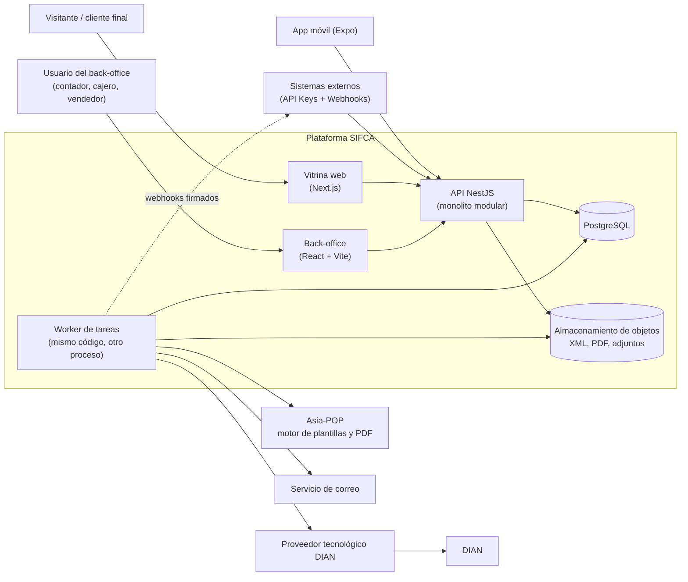
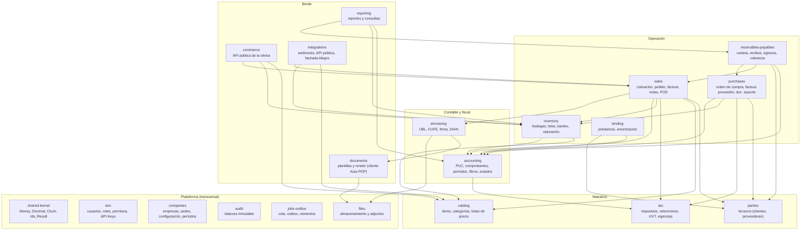
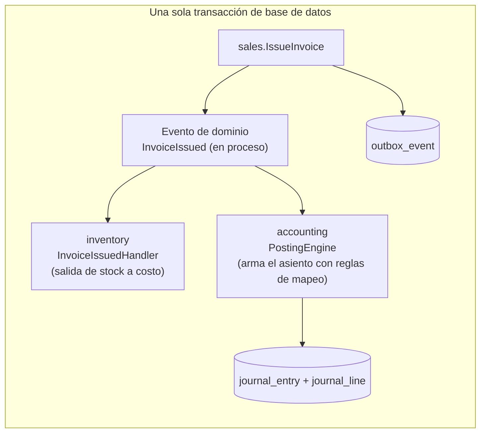

# Visión general y módulos del backend

Estado: **borrador de Fase 1** · Relacionado: [`02-modelo-de-datos-preliminar.md`](02-modelo-de-datos-preliminar.md),
[`06-decisiones-adr.md`](06-decisiones-adr.md)

## 1. Principios de diseño

1. **Monolito modular, no microservicios.** Un solo despliegue NestJS con módulos de límites estrictos. Una
   transacción contable (número de factura + inventario + asiento + estado del documento) debe ser atómica;
   repartirla entre servicios obliga a sagas y consistencia eventual en el lugar donde menos se tolera.
   Los módulos se diseñan para poder extraerse después (p. ej. `einvoicing`), no para extraerse hoy.
2. **El dominio no conoce el framework.** Arquitectura hexagonal (puertos y adaptadores) por módulo:
   reglas contables e impuestos en TypeScript puro, probables sin base de datos ni NestJS.
3. **La base de datos es la última línea de defensa.** Las invariantes críticas (asiento cuadrado,
   comprobante inmutable, consecutivos sin saltos) se imponen **también** con restricciones y *triggers* en
   PostgreSQL, no solo en código.
4. **Dinero = decimal.** Nunca `number`/`float` para valores monetarios, cantidades o costos (ver R-CON-009).
5. **Reglas fiscales = datos con vigencia.** Tarifas, bases y UVT viven en tablas con fecha de inicio y fin
   (ADR-0005).
6. **API first.** Todo lo que hace el back-office lo hace por la misma API pública (con permisos distintos).
7. **Idempotencia y auditoría por defecto** en toda operación que cambie dinero, inventario o estado fiscal.

## 2. Contexto del sistema



Notas:

- `api` y `worker` son el **mismo código** desplegado en dos modos (servir HTTP / procesar cola). Así los
  trabajos largos (transmisión DIAN, PDF, webhooks) no bloquean peticiones.
- Asia-POP se llama **solo desde el worker** y por red interna (ver `05-integracion-asia-pop.md`).

## 3. Mapa de módulos del backend



> Las flechas indican **dependencia en tiempo de compilación** (quién importa a quién). `accounting` **no**
> importa `sales` ni `purchases`: recibe solicitudes de contabilización mediante un puerto
> (`PostingPort`) y reglas de mapeo configurables (§6). Todos los módulos pueden usar `shared-kernel`,
> `iam`, `tenancy`, `audit` y `jobs-outbox`; esas flechas se omiten por claridad.

> **Cómo se evita el ciclo `sales` ↔ `einvoicing`.** `sales` depende de `einvoicing` solo para emitir el
> evento con el **documento canónico (una instantánea)**; `einvoicing` **no** lee tablas ni importa clases de
> `sales`. El resultado de la DIAN vuelve como eventos (`EInvoiceAccepted`, `EInvoiceRejected`) que `sales`
> escucha para cambiar el estado del documento. Lo mismo aplica a `documents` (recibe datos, no los consulta).
> Así el grafo sigue siendo un DAG (regla D-5).

### 3.1 Responsabilidades de cada módulo

| Módulo | Es dueño de | No debe |
|---|---|---|
| `shared-kernel` | Tipos `Money`/`Decimal`, `Clock`, generación de IDs, errores base | Contener lógica de negocio |
| `iam` | Usuarios, roles, permisos, sesiones, **API Keys** y sus alcances (*scopes*) | Conocer entidades de negocio |
| `companies` | Empresa, sedes, parámetros fiscales (responsabilidades RUT, régimen), períodos contables, rangos de numeración | — |
| `parties` | Terceros: NIT/DV, tipo de documento, responsabilidades fiscales, direcciones, contactos | Guardar saldos (los calcula `receivables-payables`) |
| `catalog` | Ítems (simple, kit, variante), categorías, unidades, listas de precio, imágenes, publicación en vitrina | Guardar existencias |
| `tax` | Impuestos, tablas de tarifas con vigencia, UVT, reglas de retención, motor de cálculo de impuestos y retenciones | Postear asientos |
| `inventory` | Bodegas, lotes, movimientos (kardex), saldos, reservas, valoración por promedio ponderado | Decidir precios de venta |
| `sales` | Cotización, pedido, remisión opcional, factura, nota crédito/débito, sesiones de POS | Calcular impuestos por su cuenta (usa `tax`) |
| `purchases` | Orden de compra, factura de proveedor, documento soporte, devoluciones | — |
| `receivables-payables` | Cuentas por cobrar/pagar, recibos de caja, comprobantes de egreso, cruces, edades, gestión de cobranza | — |
| `lending` | Préstamos, cronogramas, abonos, mora | — |
| `accounting` | Plan de cuentas, comprobantes, motor de contabilización, períodos, libros, balance de prueba, estados financieros | Conocer reglas de ventas/compras |
| `einvoicing` | Construcción del UBL, CUFE/CUDE, firma, transmisión, estados DIAN, eventos | Calcular impuestos |
| `documents` | Registro de plantillas, solicitud de render a Asia-POP, almacenamiento del PDF resultante | Tomar decisiones de negocio |
| `commerce` | Endpoints públicos de la vitrina: catálogo, carrito, pedido web | Exponer datos internos (costos, saldos) |
| `integrations` | Endpoints de integración, suscripciones y entrega de webhooks, fachada compatible con Alegra | — |
| `reporting` | Consultas y reportes de solo lectura (modelos de lectura) | Escribir en tablas de otros módulos |

## 4. Estructura interna de un módulo (hexagonal)

```text
apps/api/src/modules/<modulo>/
├── domain/                 # TypeScript puro: entidades, objetos de valor, servicios de dominio, eventos
│   ├── entities/
│   ├── value-objects/
│   ├── services/           # p. ej. WeightedAverageCostService, WithholdingCalculator
│   ├── events/
│   └── ports/              # interfaces que el dominio necesita (repositorios, relojes, otros módulos)
├── application/            # casos de uso (comandos y consultas), orquestan dominio + puertos
│   ├── commands/
│   ├── queries/
│   └── dto/                # objetos internos (no los de HTTP)
├── infrastructure/         # adaptadores: persistencia, clientes externos, mappers
│   ├── persistence/        # entidades de ORM + repositorios que implementan ports/
│   └── clients/
├── interfaces/             # entrada al módulo
│   ├── http/               # controladores + DTO de HTTP (class-validator, decoradores Swagger)
│   └── jobs/               # consumidores de cola / manejadores de eventos
├── <modulo>.module.ts
└── index.ts                # **única** API pública del módulo (fachada y tipos exportados)
```

### Reglas de dependencia (se verifican en CI)

| # | Regla |
|---|---|
| D-1 | `domain/` no importa NestJS, el ORM, `class-validator` ni nada de `infrastructure/` o `interfaces/` |
| D-2 | `application/` depende de `domain/` y de **puertos**, nunca de clases concretas del ORM |
| D-3 | Un módulo solo importa de otro a través de su `index.ts`. Prohibido importar rutas internas de otro módulo |
| D-4 | Ningún módulo lee o escribe **tablas** de otro módulo; usa su fachada o sus eventos (las únicas lecturas cruzadas permitidas son vistas de solo lectura de `reporting`) |
| D-5 | Los grafos de dependencia entre módulos no tienen ciclos (la figura de §3 es un DAG) |

Se hace cumplir con una herramienta de reglas de arquitectura en CI (p. ej. `dependency-cruiser` o
`eslint-plugin-boundaries`; elegir en F2) más una prueba que falla si aparece un ciclo.

## 5. Estructura del repositorio (monorepo)

```text
sifca/
├── apps/
│   ├── api/            # NestJS (HTTP + worker, mismos módulos)
│   ├── admin/          # React + Vite (back-office, SPA tras login)
│   ├── storefront/     # Next.js (vitrinas públicas, SEO y SSR)
│   └── mobile/         # Expo / React Native
├── packages/
│   ├── api-client/     # cliente tipado generado desde OpenAPI (admin, storefront, mobile)
│   ├── ui/             # componentes compartidos del back-office (tabla densa, paleta de comandos)
│   ├── domain-shared/  # tipos y utilidades puras compartibles (Money, formatos, validadores NIT/DV)
│   └── config/         # configuraciones de ESLint, TS, prettier
├── docs/               # esta documentación
└── infra/              # Docker, compose, IaC (cuando aplique)
```

Gestor de paquetes y *task runner*: ver `03-evaluacion-de-librerias.md` §5. **Por qué el back-office es una
SPA con Vite y la vitrina es Next.js:** el back-office vive detrás de login (sin SEO) y se beneficia de un
cliente puro; la vitrina necesita HTML renderizado en servidor para SEO y compartir enlaces.

## 6. Contabilización: cómo se conectan operación y contabilidad

El módulo `accounting` no conoce facturas. El flujo es:



1. `sales` publica un **evento de dominio en proceso** (síncrono, dentro de la misma transacción).
2. `inventory` y `accounting` tienen manejadores que reaccionan y escriben en sus propias tablas.
3. `accounting` convierte el evento en asiento usando **reglas de mapeo** configurables
   (`posting_rule`: tipo de documento + concepto → cuenta, naturaleza, tercero). El asiento pasa por las
   validaciones R-CON-001…008.
4. Los efectos externos (DIAN, PDF, correo, webhooks) **no** ocurren en la transacción: se registran en
   `outbox_event` y los procesa el worker (patrón *transactional outbox*, ADR-0006).

Si cualquier manejador falla, **toda la transacción se revierte**: no puede existir una factura emitida sin
su asiento ni su movimiento de inventario.

## 7. Aspectos transversales

### 7.1 Multiempresa y seguridad de datos

- Todas las tablas de negocio llevan `company_id`.
- Aislamiento en dos capas: filtro en la capa de aplicación **y** *Row-Level Security* en PostgreSQL con
  `SET LOCAL app.company_id = …` al inicio de cada transacción (ADR-0002).
- Las claves únicas incluyen `company_id` (p. ej. `UNIQUE (company_id, code)`).

### 7.2 Autenticación y autorización

| Cliente | Mecanismo |
|---|---|
| Back-office, móvil | Access token JWT de vida corta + refresh token rotatorio; MFA recomendado para roles contables |
| Integraciones | **API Key** por empresa (`X-API-Key`), con *scopes* (`catalog:read`, `orders:write`, `invoices:read` …), límite de tasa y rotación |
| Vitrina pública | Endpoints `/public/*` sin autenticación, con límite de tasa y sin datos internos |
| Servicios internos (Asia-POP) | Credencial de servicio con firma HMAC o mTLS (ver `05-…`) |

Autorización: RBAC (rol → permisos del tipo `sales.invoice.issue`) más reglas por empresa/sede. Los permisos
son los mismos que alimentan la paleta de comandos: **no se muestra una acción que el usuario no puede
ejecutar**.

### 7.3 Auditoría

`audit_log` de solo inserción: quién, cuándo, qué entidad, valor anterior y posterior (JSON), IP y origen
(UI, API Key, worker). Los comprobantes contables no se editan, por lo que su auditoría es la propia cadena
de reversiones.

### 7.4 Idempotencia

Todo `POST` que crea dinero, stock o documentos fiscales acepta el encabezado `Idempotency-Key`. El servidor
guarda `(company_id, key, hash del cuerpo, respuesta)` por 24 h. Misma clave y mismo cuerpo → misma respuesta;
misma clave y otro cuerpo → `422`.

### 7.5 Tareas asíncronas

Cola respaldada por PostgreSQL (menos piezas de infraestructura al inicio; ver ADR-0006) con reintentos
exponenciales, *dead-letter* y panel de estado. Tipos: transmisión DIAN, render de PDF, correo, entrega de
webhooks, recálculo de valoración retroactiva, generación de reportes pesados.

### 7.6 Observabilidad

Logs estructurados con `request_id`, `company_id` y `user_id`; **nunca** se registran tokens, claves de API ni
datos personales completos. Métricas de colas, latencia por endpoint y estado de las transmisiones DIAN.

### 7.7 Fechas y zona horaria

- Fecha contable: tipo `date` (sin hora).
- Instantes: `timestamptz` en UTC; presentación en `America/Bogota`.
- La fecha y hora de expedición de una factura se toman del reloj del servidor (inyectable para pruebas).

### 7.8 Privacidad

Datos personales regidos por la Ley 1581 de 2012 (Habeas Data) 🔶: política de tratamiento, autorización del
titular en la vitrina, retención y supresión compatibles con la obligación de conservar documentos contables.

## 8. Paleta de comandos / búsqueda global (Cmd/Ctrl+K)

### 8.1 Requisitos

| ID | Requisito |
|---|---|
| CP-01 | `Ctrl/Cmd+K` abre la paleta en cualquier pantalla del back-office (incluso con foco en un campo, salvo que el campo capture el atajo) |
| CP-02 | Busca por **ventanas** (navegación), **acciones** («Nueva factura», «Registrar recibo de caja») y **registros** (terceros, ítems, facturas por número, comprobantes) |
| CP-03 | Búsqueda difusa y tolerante a tildes; respeta permisos del usuario |
| CP-04 | Soporta prefijos: `>` acciones, `@` terceros, `#` documentos, `/` ayuda |
| CP-05 | Muestra atajos de teclado de cada acción y los más recientes del usuario |
| CP-06 | Acciones con contexto (p. ej. estando en una factura: «Crear nota crédito de esta factura») |
| CP-07 | Accesible: rol `dialog`/`combobox`, navegación solo con teclado, lector de pantalla |

### 8.2 Diseño

- **Registro de comandos distribuido:** cada módulo de la SPA registra sus comandos (`id`, título, palabras
  clave, permiso requerido, atajo, función). La paleta solo ordena y muestra; no conoce los módulos.
- **Búsqueda de registros:** endpoint `GET /search?q=&types=` que consulta con índices `pg_trgm`/`unaccent`
  por tipo y devuelve resultados mínimos (id, tipo, título, subtítulo, ruta). Límite y *debounce* en el cliente.
- Componente base: ver `03-evaluacion-de-librerias.md` §3.3.

## 9. Requisitos no funcionales (objetivos iniciales)

| Ámbito | Objetivo inicial |
|---|---|
| Latencia de API (p95) | Lecturas < 300 ms; emisión de factura (sin contar DIAN) < 800 ms |
| Concurrencia | Sin consecutivos duplicados ni stock negativo no autorizado bajo carga concurrente (prueba obligatoria) |
| Disponibilidad | Objetivo 99,5 % en MVP (a definir con Q-08) |
| Copias de seguridad | Copia diaria + recuperación a un punto en el tiempo (PITR); RPO ≤ 15 min, RTO ≤ 4 h (a validar) |
| Seguridad | OWASP ASVS nivel 2 como guía; cifrado en tránsito y en reposo; secretos fuera del repositorio |
| Conservación | Documentos contables y fiscales con política ≥ 10 años 🔶 (confirmar plazo con contador) |
| Pruebas | Pruebas de propiedades para invariantes contables; pruebas de contrato OpenAPI; vectores de prueba del Anexo Técnico para CUFE/UBL |
