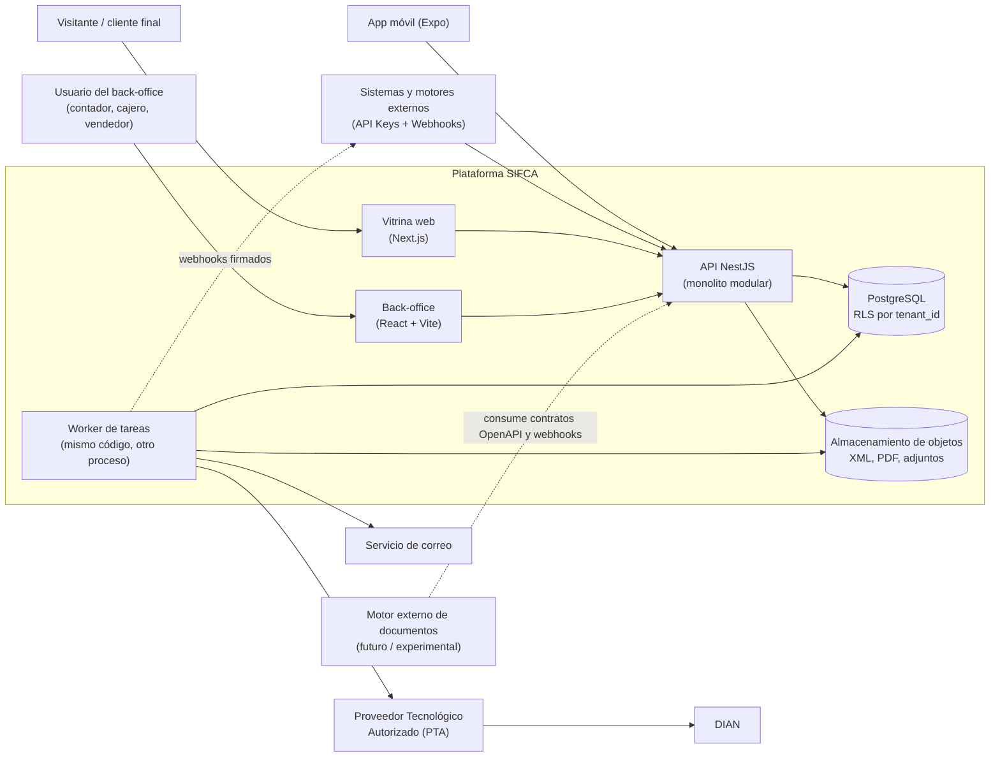
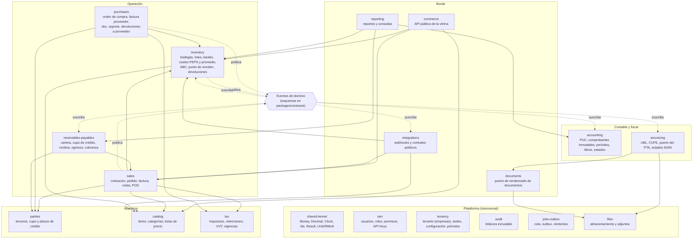
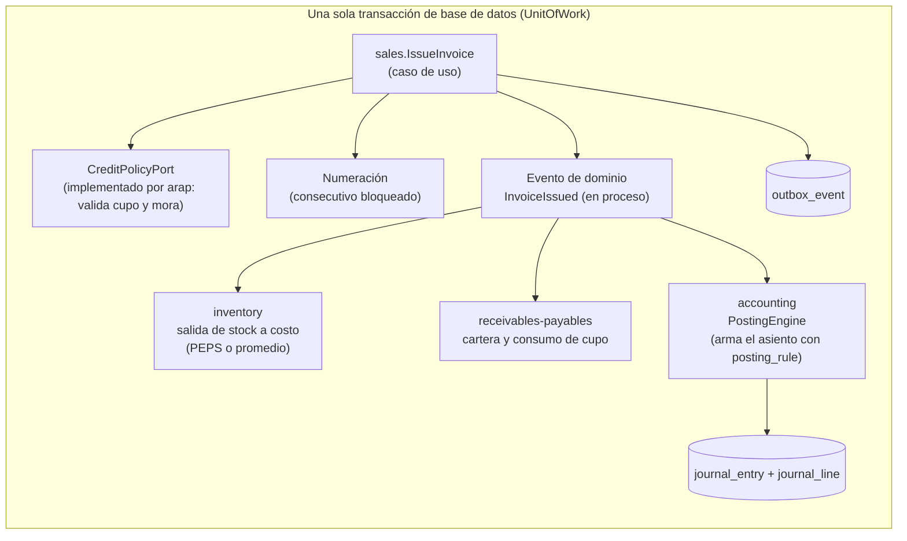

# Visión general y módulos del backend

Estado: **Fase 1 (actualizada)** · Gobernanza: [`../constitution.md`](../constitution.md) ·
Relacionado: [`02-modelo-de-datos-preliminar.md`](02-modelo-de-datos-preliminar.md),
[`06-decisiones-adr.md`](06-decisiones-adr.md)

## 1. Principios de diseño

1. **Monolito modular, no microservicios.** Un solo despliegue NestJS con módulos de límites estrictos. Una
   transacción comercial (consecutivo + inventario + cartera + asiento + estado del documento) debe ser atómica
   (constitución, principio III); repartirla entre servicios obliga a sagas y consistencia eventual en el lugar
   donde menos se tolera. Los módulos se diseñan para poder extraerse después, no para extraerse hoy.
2. **Clean Architecture estricta.** Cuatro capas concéntricas por módulo (`Domain ← Application ←
   Infrastructure / Presentation`); las dependencias de código apuntan solo hacia adentro y el dominio no
   conoce base de datos, NestJS, Prisma ni Zod (principio II).
3. **La base de datos es la última línea de defensa.** Las invariantes críticas (asiento cuadrado,
   inmutabilidad, consecutivos sin saltos, aislamiento por tenant) se imponen **también** con restricciones,
   privilegios y *triggers* en PostgreSQL, no solo en código (principios I y IV).
4. **Dinero = decimal.** Nunca `number`/`float` para valores monetarios, cantidades o costos (principio VI).
5. **Reglas fiscales y de costeo parametrizables = datos con vigencia** (ADR-0005).
6. **API first.** Todo lo que hace el back-office lo hace por la misma API pública (con permisos distintos); los
   contratos se derivan de esquemas Zod (principio V) y los sistemas externos solo consumen contratos y webhooks
   (principio IX).
7. **Idempotencia y auditoría por defecto** en toda operación que cambie dinero, inventario o estado fiscal.

## 2. Contexto del sistema



Notas:

- `api` y `worker` son el **mismo código** desplegado en dos modos (servir HTTP / procesar cola). Los trabajos
  largos (transmisión al PTA, PDF, correo, webhooks, recálculo ABC/ROP) no bloquean peticiones.
- El **motor externo de documentos** (p. ej. Asia-POP) es **fase futura / experimental** y no forma parte del
  núcleo: se conecta como cualquier otro cliente, por la API y los webhooks (`05-integracion-asia-pop.md`).

## 3. Mapa de módulos del backend



> **Cómo leer el mapa.** Las flechas **sólidas** son dependencias de compilación (quién importa a quién,
> siempre a través de la fachada pública `index.ts` del módulo destino). Las flechas **punteadas** son
> eventos: el esquema de cada evento vive en `packages/contracts`, de modo que **un módulo que reacciona a un
> evento no importa al módulo que lo publica**. Todos los módulos pueden usar `shared-kernel`, `iam`,
> `tenancy`, `audit` y `jobs-outbox`; esas flechas se omiten por claridad.

> **Cómo se evitan los ciclos (inversión de dependencias entre módulos).** Cuando un módulo necesita un dato o
> una decisión de otro, el **consumidor define el puerto** en su capa Application y el **proveedor lo
> implementa** en su capa Infrastructure; la flecha de compilación va del proveedor al consumidor.
>
> | Necesidad | Consumidor (define el puerto) | Proveedor (lo implementa) | Flecha |
> |---|---|---|---|
> | ¿El cliente puede comprar a crédito? (`CreditPolicyPort`) | `sales` | `arap` | `arap → sales` |
> | Órdenes de compra abiertas y *lead time* para el reorden (`OpenPurchaseOrdersPort`) | `inventory` | `purchases` | `purchases → inventory` |
> | Contabilizar un evento comercial | — (por eventos) | `accounting` suscrito al bus | ninguna |
> | Estado fiscal de un documento | — (por eventos `EInvoiceAccepted/Rejected`) | `sales` suscrito al bus | ninguna |
>
> El grafo resultante es un DAG (regla D-5). `accounting` no importa ningún módulo operativo.

### 3.1 Responsabilidades de cada módulo

| Módulo | Es dueño de | No debe |
|---|---|---|
| `shared-kernel` | Tipos `Money`/`Decimal`, `Clock`, generación de IDs, errores base, `Result` | Contener lógica de negocio |
| `iam` | Usuarios, roles, permisos, sesiones, **API Keys** y sus alcances | Conocer entidades de negocio |
| `tenancy` | Tenant (empresa), sedes, parámetros fiscales (responsabilidades RUT, régimen), períodos contables, rangos de numeración, contexto de tenant para RLS | — |
| `parties` | Terceros: NIT/DV, tipo de documento, responsabilidades fiscales, direcciones, contactos, **`credit_limit` y `payment_term_days`** | Guardar saldos ni exposición (los calcula `arap`) |
| `catalog` | Ítems (simple, kit, variante), categorías, unidades, listas de precio, imágenes, publicación en vitrina, método de costeo y política de despacho del ítem | Guardar existencias |
| `tax` | Impuestos, tablas de tarifas con vigencia, UVT, reglas de retención, motor de cálculo | Postear asientos |
| `inventory` | Bodegas (con tipo), lotes, movimientos (kardex), saldos, reservas, **costeo PEPS/promedio**, política de despacho, **clasificación ABC**, conteos cíclicos, **punto de reorden**, **devoluciones (reingreso)** | Decidir precios de venta |
| `sales` | Cotización, pedido, remisión opcional, factura, nota crédito/débito, sesiones de POS, **control de crédito previo a facturar/despachar** | Calcular impuestos por su cuenta (usa `tax`) |
| `purchases` | Orden de compra, factura de proveedor, documento soporte, **devoluciones a proveedor** | — |
| `receivables-payables` | CxC/CxP, **cupo de crédito y exposición**, **edades de cartera**, **estado de crédito**, retenciones/bloqueos de despacho, recibos de caja, comprobantes de egreso, cruces, cobranza | Emitir facturas |
| `accounting` | Plan de cuentas, comprobantes **inmutables**, motor de contabilización, períodos, libros, balance de prueba, estados financieros | Conocer reglas de ventas/compras |
| `einvoicing` | Construcción del UBL, CUFE/CUDE, **puerto `EInvoiceProvider` y adaptador del PTA**, estados DIAN, eventos | Calcular impuestos |
| `documents` | Puerto `DocumentRenderer`, renderizador mínimo propio de la representación gráfica, almacenamiento del PDF | Tomar decisiones de negocio |
| `commerce` | Endpoints públicos de la vitrina: catálogo, carrito, pedido web | Exponer datos internos (costos, saldos) |
| `integrations` | Suscripciones y entrega de webhooks, alimentador de catálogo y contratos públicos para motores externos | — |
| `reporting` | Consultas y reportes de solo lectura (modelos de lectura) | Escribir en tablas de otros módulos |

## 4. Estructura interna de un módulo (Clean Architecture)

Capas concéntricas, de adentro hacia afuera. **Las flechas de importación solo apuntan hacia adentro.**

```text
        ┌──────────────────────────────────────────────────────────────┐
        │  Presentation   controladores NestJS · jobs · webhooks        │
        │   ┌──────────────────────────────────────────────────────┐   │
        │   │  Infrastructure  Prisma · PTA · almacenamiento · cola │   │
        │   │   ┌──────────────────────────────────────────────┐   │   │
        │   │   │  Application   casos de uso · puertos · Zod   │   │   │
        │   │   │   ┌──────────────────────────────────────┐   │   │   │
        │   │   │   │  Domain   entidades · VOs · eventos   │   │   │   │
        │   │   │   └──────────────────────────────────────┘   │   │   │
        │   │   └──────────────────────────────────────────────┘   │   │
        │   └──────────────────────────────────────────────────────┘   │
        └──────────────────────────────────────────────────────────────┘
        Infrastructure y Presentation dependen de Application; no entre sí.
```

```text
apps/api/src/modules/<modulo>/
├── domain/                   # TypeScript puro. Sin NestJS, Prisma, Zod, fs, red ni Date.now()
│   ├── entities/             # p. ej. JournalEntry, StockMovement, CostLayer
│   ├── value-objects/        # Money, Quantity, Percentage, Nit, TenantId
│   ├── services/             # WeightedAverageCosting, FifoCosting, AbcClassifier, ReorderPointCalculator
│   └── events/               # eventos del dominio; los que cruzan módulos se publican con esquemas de packages/contracts
├── application/              # casos de uso + puertos (interfaces). Depende solo de domain/
│   ├── use-cases/            # IssueInvoice, RegisterSalesReturn, ConfirmOrder ... (1 por operación)
│   ├── ports/                # UnitOfWork, StockRepository, JournalRepository, Clock, EInvoiceProvider, CreditPolicyPort
│   └── schemas/              # re-exporta/compone esquemas Zod de packages/contracts para cada caso de uso
├── infrastructure/           # implementa los puertos. Aquí viven Prisma y los clientes externos
│   ├── persistence/          # repositorios Prisma, mappers fila↔dominio, UnitOfWork con $transaction
│   └── clients/              # adaptador del PTA, almacenamiento de objetos
├── presentation/             # entrada al módulo: traduce HTTP/cola a casos de uso
│   ├── http/                 # controladores NestJS, filtros de errores (ZodError → 422 Problem)
│   └── jobs/                 # consumidores de cola, manejadores de eventos
├── <modulo>.module.ts        # *composition root* del módulo: enlaza puertos con adaptadores
└── index.ts                  # única API pública del módulo (fachada y tipos exportados)
```

### Reglas de dependencia (se verifican en CI)

| # | Regla |
|---|---|
| D-1 | `domain/` no importa NestJS, Prisma, Zod, `class-validator`, `fs`, `http` ni `Date.now()`; tampoco nada de `application/`, `infrastructure/` ni `presentation/` |
| D-2 | `application/` depende solo de `domain/` y de **puertos que ella misma define**; nunca de Prisma ni de clases concretas |
| D-3 | `infrastructure/` y `presentation/` pueden importar `application/` y `domain/`; **no se importan entre sí** |
| D-4 | Los tipos generados por Prisma **no salen** de `infrastructure/persistence`: los repositorios reciben y devuelven objetos del dominio |
| D-5 | Un módulo solo importa de otro a través de su `index.ts`; el grafo de módulos es un DAG sin ciclos. Los eventos entre módulos se declaran en `packages/contracts`, no en el módulo que los publica |
| D-6 | Ningún módulo lee o escribe **tablas** de otro módulo (esquemas PostgreSQL separados con privilegios distintos); la integración es por fachada o por eventos. Excepción: vistas de solo lectura de `reporting` |
| D-7 | Solo los archivos `*.module.ts` y `main.ts` pueden instanciar adaptadores concretos (*composition root*) |

Se hace cumplir con una herramienta de reglas de arquitectura en CI (p. ej. `dependency-cruiser`, con una
regla por cada fila de la tabla) más una prueba que falla si aparece un ciclo. **Gates G-01 a G-03 de la
constitución.**

### Qué hace cada capa con Zod

| Capa | Uso de Zod |
|---|---|
| `packages/contracts` | **Definición** de los esquemas (entradas, salidas, eventos, webhooks); de ellos se infieren los tipos |
| Domain | **Ninguno.** Los invariantes se protegen con objetos de valor y entidades que no pueden construirse inválidos |
| Application | **Validación de la entrada de cada caso de uso** (`schema.parse` al inicio de `execute`) |
| Infrastructure | Validación de respuestas de terceros (PTA, almacenamiento) y de la configuración |
| Presentation | Delegación: el controlador pasa el cuerpo al caso de uso y traduce `ZodError` a `422 Problem` |

### Diagnóstico de Clean Architecture (skill `clean-architecture`)

La skill `clean-architecture` (instalada en `.claude/skills/`) puntúa una arquitectura con **siete preguntas de
diagnóstico**; cada una satisfecha suma un punto y 6–7 corresponde a la banda 9–10. Se usa en cada `/speckit-plan`
y al revisar código. Evaluación **del diseño** (no hay código todavía; se vuelve a puntuar con el código de la
Fase 2):

| # | Pregunta del diagnóstico | Cómo la cubre el diseño | Dónde se verifica |
|---|---|---|---|
| 1 | ¿Se prueban las reglas de negocio sin base de datos, servidor web ni framework? | Dominio y servicios de dominio puros (`WeightedAverageCosting`, `FifoCosting`, `AbcClassifier`, `ReorderPointCalculator`, `TaxEngine`); el reloj entra por puerto | G-01; pruebas unitarias del dominio |
| 2 | ¿Todas las dependencias de código apuntan hacia adentro? | Reglas D-1…D-3 y D-7 | `dependency-cruiser` en CI (G-01…G-03) |
| 3 | ¿Se puede cambiar la base de datos sin tocar la lógica de negocio? | Repositorios como puertos; Prisma solo en `infrastructure/persistence` (D-4) | G-03; ADR-0004 |
| 4 | ¿Los casos de uso son independientes del mecanismo de entrega? | Casos de uso con entrada validada con Zod; HTTP, cola y webhooks solo traducen (`presentation/`) | Spec 011 (escenarios de borde), G-08 |
| 5 | ¿El framework está confinado al círculo exterior? | NestJS solo en `presentation/` y en los `*.module.ts` (*composition root*) | D-7 |
| 6 | ¿El grafo de componentes no tiene ciclos? | Mapa de módulos como DAG; puertos invertidos entre módulos; eventos en `packages/contracts` | D-5; prueba de ciclos en CI |
| 7 | ¿Una *composition root* (Main) enlaza todas las dependencias? | Cada `*.module.ts` enlaza puertos con adaptadores; ningún caso de uso instancia un adaptador | D-7 |

**Resultado de diseño: 7/7 cubiertas ⇒ banda objetivo 9–10.** Es una evaluación del diseño propuesto; la
puntuación real se mide cuando exista código y debe mantenerse en esa banda.

#### Puntuación sobre código real (spec 001 · T093, 2026-10-14)

Mismo diagnóstico aplicado al módulo `accounting` ya implementado. Cada respuesta se **demuestra con una prueba que
falla si se rompe** (se comprobó introduciendo violaciones a propósito).

| # | Pregunta | ¿Cumple? | Evidencia ejecutable |
|---|---|:-:|---|
| 1 | ¿Se prueban las reglas de negocio sin base de datos, servidor web ni framework? | ✅ | 112 pruebas unitarias de dominio y casos de uso con dobles en memoria (`test/unit/`); propiedades con `fast-check` |
| 2 | ¿Todas las dependencias apuntan hacia adentro? | ✅ | `test/architecture/layers.spec.ts` (dependency-cruiser D-1…D-7) y `no-framework-in-domain.spec.ts` (ni imports de frameworks ni `Date.now()`) |
| 3 | ¿Se puede cambiar la base de datos sin tocar la lógica? | ✅ | `no-prisma-outside-infra.spec.ts`: Prisma solo en `infrastructure/persistence` y `platform/persistence`; los casos de uso se prueban con repositorios en memoria |
| 4 | ¿Los casos de uso son independientes del mecanismo de entrega? | ✅ | Los mismos casos de uso los ejecutan HTTP (`test/contract`), Cucumber (`test/acceptance`) y la fachada `PostJournalEntryPort` |
| 5 | ¿El framework está confinado al círculo exterior? | ✅ | NestJS solo en `presentation/`, `*.module.ts` y `platform/`; el dominio y la aplicación no lo importan (D-1, D-2) |
| 6 | ¿El grafo de componentes no tiene ciclos? | ✅ | `no-cycles.spec.ts`; `module-facade-only.spec.ts` (D-5); `AccountingUseCases` y `ACCOUNTING` viven en `application/` para evitar el ciclo módulo ↔ controlador |
| 7 | ¿Una *composition root* enlaza todo? | ✅ | `composeAccounting()` en `accounting.module.ts` crea los adaptadores; ningún caso de uso los instancia |

**Resultado: 7/7 ⇒ banda 9–10 (se mantiene).** Hallazgos corregidos durante la implementación: el adaptador de auditoría
estaba en `platform/audit` y rompía la regla D-4 (Prisma fuera de persistencia) → se movió a `platform/persistence`; el
token `ACCOUNTING` creaba un ciclo con los controladores → se movió a `application/`.

## 5. Estructura del repositorio (monorepo)

```text
sifca/
├── apps/
│   ├── api/            # NestJS (HTTP + worker, mismos módulos). src/shared-kernel (puro), src/platform (adaptadores transversales del composition root: UnitOfWork de Prisma, reloj, errores HTTP, auditoría), src/modules/<módulo>
│   ├── admin/          # React + Vite (back-office, SPA tras login)
│   ├── storefront/     # Next.js (vitrinas públicas, SEO y SSR)
│   └── mobile/         # Expo / React Native
├── packages/
│   ├── contracts/      # ESQUEMAS ZOD: única fuente de verdad de los contratos (API, eventos, webhooks)
│   ├── api-client/     # cliente tipado que consume `contracts` (admin, vitrina, móvil)
│   ├── ui/             # componentes compartidos del back-office (tabla densa, paleta de comandos)
│   ├── domain-shared/  # utilidades puras sin framework (formato de moneda, dígito de verificación del NIT)
│   └── config/         # configuraciones de ESLint, TS, prettier, reglas de dependencia
├── docs/               # constitución, specs, reglas, arquitectura
├── scripts/            # herramientas de documentación (docs.mjs)
├── .specify/           # andamiaje de Spec Kit (plantillas, scripts, espejo de la constitución)
└── infra/              # Docker, compose, IaC (cuando aplique)
```

Gestor de paquetes y *task runner*: ver `03-evaluacion-de-librerias.md` §6. **Por qué el back-office es una
SPA con Vite y la vitrina es Next.js:** el back-office vive detrás de login (sin SEO) y se beneficia de un
cliente puro; la vitrina necesita HTML renderizado en servidor para SEO y compartir enlaces.

## 6. Eventos comerciales: cómo se conectan operación, cartera y contabilidad

El módulo `accounting` no conoce facturas. Un evento comercial se ejecuta como un caso de uso dentro de **una
unidad de trabajo** (constitución III):



1. El caso de uso `IssueInvoice` valida su entrada (Zod), comprueba el crédito (`CreditPolicyPort`), asigna el
   consecutivo y publica un **evento de dominio en proceso** (síncrono, dentro de la misma transacción).
2. `inventory`, `receivables-payables` y `accounting` tienen manejadores que reaccionan y escriben en sus
   propias tablas (privilegios por esquema, D-6).
3. `accounting` convierte el evento en asiento usando **reglas de mapeo** configurables (`posting_rule`:
   tipo de documento + concepto → cuenta, naturaleza, tercero). El asiento pasa por R-CON-001…008.
4. Los efectos externos (PTA, PDF, correo, webhooks) **no** ocurren en la transacción: se registran en
   `outbox_event` y los procesa el worker (patrón *transactional outbox*, ADR-0006).

Si cualquier manejador falla, **toda la transacción se revierte**: no puede existir una factura emitida sin su
asiento, su movimiento de inventario o su efecto en cartera. El mismo patrón rige para devoluciones, compras,
recibos de caja y ajustes de inventario.

La **unidad de trabajo** es un puerto de Application (`UnitOfWork.run(fn)`); la implementación de
Infrastructure usa `prisma.$transaction(async (tx) => …, { timeout, maxWait, isolationLevel })` y propaga la
transacción a los repositorios con un contexto asíncrono (p. ej. `AsyncLocalStorage`), de modo que ningún caso
de uso ni repositorio abre transacciones por su cuenta (ver ADR-0004).

## 7. Aspectos transversales

### 7.1 Multiempresa y seguridad de datos

- Todas las tablas de negocio llevan `tenant_id` (en el MVP un tenant es una empresa, S-01).
- Aislamiento en dos capas: filtro en la capa de aplicación **y** *Row-Level Security* en PostgreSQL con
  `set_config('app.tenant_id', <id>, true)` (equivale a `SET LOCAL`) ejecutado **dentro de la transacción
  interactiva de Prisma** antes de cualquier consulta (ADR-0002, ADR-0004).
- Las claves únicas incluyen `tenant_id` (p. ej. `UNIQUE (tenant_id, code)`).

### 7.2 Autenticación y autorización

| Cliente | Mecanismo |
|---|---|
| Back-office, móvil | Access token JWT de vida corta + refresh token rotatorio; MFA recomendado para roles contables |
| Integraciones | **API Key** por empresa (`X-API-Key`), con *scopes* (`catalog:read`, `orders:write`, `invoices:read` …), límite de tasa y rotación |
| Vitrina pública | Endpoints `/public/*` sin autenticación, con límite de tasa y sin datos internos |
| Motores externos | API Key con alcances mínimos y webhooks firmados (ver `05-…`) |

Autorización: RBAC (rol → permisos del tipo `sales.invoice.issue`) más reglas por empresa/sede. Los permisos
son los mismos que alimentan la paleta de comandos: **no se muestra una acción que el usuario no puede
ejecutar**.

### 7.3 Auditoría

`audit_log` de solo inserción: quién, cuándo, qué entidad, valor anterior y posterior (JSON), IP y origen
(UI, API Key, worker). Los comprobantes contables no se editan, por lo que su auditoría es la propia cadena
de reversiones.

### 7.4 Idempotencia

Todo `POST` que crea dinero, stock o documentos fiscales acepta el encabezado `Idempotency-Key`. El servidor
guarda `(tenant_id, key, hash del cuerpo, respuesta)` por 24 h. Misma clave y mismo cuerpo → misma respuesta;
misma clave y otro cuerpo → `422`.

### 7.5 Tareas asíncronas

Cola respaldada por PostgreSQL (menos piezas de infraestructura al inicio; ver ADR-0006) con reintentos
exponenciales, *dead-letter* y panel de estado. Tipos: transmisión DIAN, render de PDF, correo, entrega de
webhooks, recálculo de valoración retroactiva, generación de reportes pesados.

### 7.6 Observabilidad

Logs estructurados con `request_id`, `tenant_id` y `user_id`; **nunca** se registran tokens, claves de API ni
datos personales completos. Métricas de colas, latencia por endpoint y estado de las transmisiones DIAN.

### 7.7 Fechas y zona horaria

- Fecha contable: tipo `date` (sin hora).
- Instantes: `timestamptz` en UTC; presentación en `America/Bogota`.
- La fecha y hora de expedición de una factura se toman del reloj del servidor (inyectable para pruebas).

### 7.8 Privacidad

Datos personales regidos por la Ley 1581 de 2012 (Habeas Data) 🔶: política de tratamiento, autorización del
titular en la vitrina, retención y supresión compatibles con la obligación de conservar documentos contables.

## 8. Paleta de comandos / búsqueda global (Cmd/Ctrl+K)

### 8.1 Requisitos

| ID | Requisito |
|---|---|
| CP-01 | `Ctrl/Cmd+K` abre la paleta en cualquier pantalla del back-office (incluso con foco en un campo, salvo que el campo capture el atajo) |
| CP-02 | Busca por **ventanas** (navegación), **acciones** («Nueva factura», «Registrar recibo de caja») y **registros** (terceros, ítems, facturas por número, comprobantes) |
| CP-03 | Búsqueda difusa y tolerante a tildes; respeta permisos del usuario |
| CP-04 | Soporta prefijos: `>` acciones, `@` terceros, `#` documentos, `/` ayuda |
| CP-05 | Muestra atajos de teclado de cada acción y los más recientes del usuario |
| CP-06 | Acciones con contexto (p. ej. estando en una factura: «Crear nota crédito de esta factura») |
| CP-07 | Accesible: rol `dialog`/`combobox`, navegación solo con teclado, lector de pantalla |

### 8.2 Diseño

- **Registro de comandos distribuido:** cada módulo de la SPA registra sus comandos (`id`, título, palabras
  clave, permiso requerido, atajo, función). La paleta solo ordena y muestra; no conoce los módulos.
- **Búsqueda de registros:** endpoint `GET /search?q=&types=` que consulta con índices `pg_trgm`/`unaccent`
  por tipo y devuelve resultados mínimos (id, tipo, título, subtítulo, ruta). Límite y *debounce* en el cliente.
- Componente base: ver `03-evaluacion-de-librerias.md` §3.3.

## 9. Requisitos no funcionales (objetivos iniciales)

| Ámbito | Objetivo inicial |
|---|---|
| Latencia de API (p95) | Lecturas < 300 ms; emisión de factura (sin contar DIAN) < 800 ms |
| Concurrencia | Sin consecutivos duplicados ni stock negativo no autorizado bajo carga concurrente (prueba obligatoria) |
| Disponibilidad | Objetivo 99,5 % en MVP (a definir con Q-08) |
| Copias de seguridad | Copia diaria + recuperación a un punto en el tiempo (PITR); RPO ≤ 15 min, RTO ≤ 4 h (a validar) |
| Seguridad | OWASP ASVS nivel 2 como guía; cifrado en tránsito y en reposo; secretos fuera del repositorio |
| Conservación | Documentos contables y fiscales con política ≥ 10 años 🔶 (confirmar plazo con contador) |
| Pruebas | Pruebas de propiedades para invariantes contables; pruebas de contrato OpenAPI; vectores de prueba del Anexo Técnico para CUFE/UBL |
