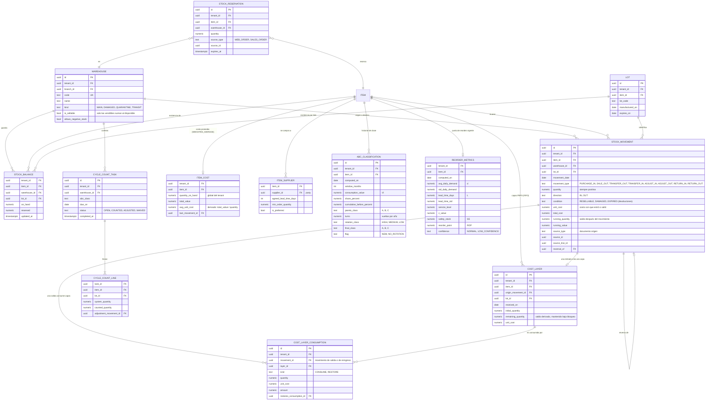
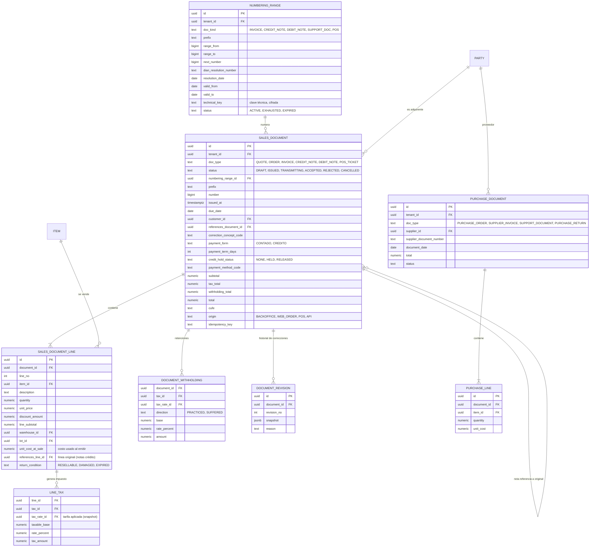
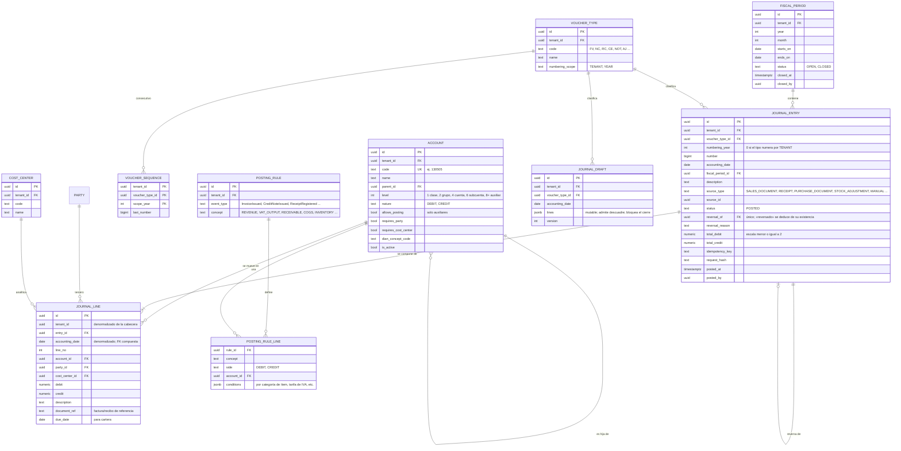
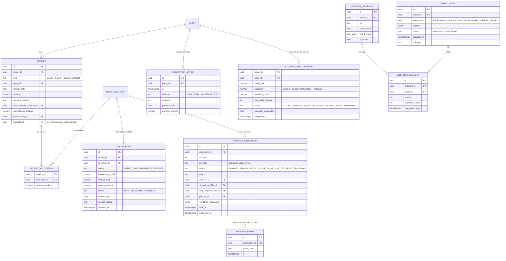

# Modelo de datos preliminar (PostgreSQL)

Estado: **borrador de Fase 1**. Es un diseño para discutir, no un DDL final. Las migraciones se escribirán en
SQL revisable (ver ADR-0004) en la Fase 2.

Relacionado: [`01-vision-general-y-modulos.md`](01-vision-general-y-modulos.md) ·
reglas: [`../02-normativa-y-reglas/`](../02-normativa-y-reglas/)

## 1. Convenciones

| Tema | Convención |
|---|---|
| Esquemas | Un **esquema PostgreSQL por módulo** (`iam`, `core`, `parties`, `catalog`, `tax`, `inventory`, `sales`, `purchases`, `acc`, `arap`, `einv`, `doc`, `integ`, `audit`, `jobs`). Refuerza la regla D-4 (ningún módulo toca tablas ajenas) con permisos de base de datos |
| Nombres | `snake_case`, tablas en singular (`journal_entry`) |
| Clave primaria | `id uuid` (UUID v7: ordenable por tiempo, buena localidad de índice) |
| Multiempresa | `tenant_id uuid NOT NULL` en toda tabla de negocio; RLS activa (ADR-0002); unicidad siempre `(tenant_id, …)` |
| Auditoría de fila | `created_at timestamptz`, `created_by uuid`, `updated_at`, `updated_by`; `version int` para bloqueo optimista en agregados editables |
| Dinero | `numeric(18,2)` (COP, 2 decimales). **Nunca** `float`/`money` |
| Costo unitario | `numeric(18,6)` |
| Cantidades | `numeric(18,4)` |
| Porcentajes | `numeric(9,6)` expresados en **porcentaje** (19% = `19.000000`) |
| Fechas | Contables: `date`. Instantes: `timestamptz` (UTC) |
| Enumeraciones | `text` + `CHECK` (o tabla de catálogo), no `ENUM` nativo: más fácil de evolucionar |
| Borrado | Datos maestros: *soft delete* (`archived_at`). Datos contables, fiscales y de stock: **nunca se borran** |
| Montos en comprobantes | Cada línea con **un solo lado** positivo: `debit` o `credit` (R-CON-002); sin importes negativos |

## 2. Diagramas entidad-relación

Los diagramas muestran las columnas más relevantes, no todas.

### 2.1 Plataforma, terceros y maestros

```mermaid
erDiagram
    TENANT ||--o{ APP_USER : "tiene miembros"
    TENANT ||--o{ API_KEY : "emite"
    TENANT ||--o{ PARTY : "registra"
    TENANT ||--o{ ITEM : "vende"
    TENANT ||--o{ BRANCH : "opera en"
    APP_USER }o--o{ ROLE : "asignado"
    ROLE ||--o{ ROLE_PERMISSION : "concede"
    PARTY ||--o{ PARTY_ADDRESS : "tiene"
    PARTY ||--o{ PARTY_CONTACT : "tiene"
    ITEM_CATEGORY ||--o{ ITEM : "agrupa"
    UNIT ||--o{ ITEM : "mide"
    ITEM ||--o{ ITEM_COMPONENT : "kit compuesto por"
    ITEM ||--o{ PRICE_LIST_ITEM : "tiene precio"
    PRICE_LIST ||--o{ PRICE_LIST_ITEM : "contiene"
    TAX ||--o{ TAX_RATE : "tarifas con vigencia"
    TAX ||--o{ ITEM : "grava"
    WITHHOLDING_CONCEPT ||--o{ TAX_RATE : "aplica a"

    TENANT {
        uuid id PK
        text legal_name
        text nit
        text nit_dv
        jsonb fiscal_responsibilities "códigos RUT, ej. O-13, O-15"
        text accounting_framework "NIIF_PYMES, MICRO"
        text timezone
        bool is_withholding_agent
        bool is_electronic_invoicer
        text retentions_recognized_at "RECEIPT o INVOICE (P-04)"
    }
    APP_USER {
        uuid id PK
        uuid tenant_id FK
        text email UK
        text password_hash
        bool mfa_enabled
    }
    API_KEY {
        uuid id PK
        uuid tenant_id FK
        text key_prefix
        text key_hash
        text_array scopes
        timestamptz expires_at
        timestamptz revoked_at
    }
    ROLE {
        uuid id PK
        uuid tenant_id FK
        text name
    }
    ROLE_PERMISSION {
        uuid role_id FK
        text permission "ej. sales.invoice.issue"
    }
    BRANCH {
        uuid id PK
        uuid tenant_id FK
        text code
        text name
    }
    PARTY {
        uuid id PK
        uuid tenant_id FK
        text kind "CUSTOMER, SUPPLIER, EMPLOYEE, OTHER"
        text id_type "NIT, CC, CE, PAS, ..."
        text id_number
        text id_dv
        text legal_name
        text trade_name
        jsonb fiscal_responsibilities
        text vat_regime
        bool is_income_declarant
        bool is_withholding_agent
        text ciiu_code
        text municipality_code
        numeric credit_limit "R-CAR-008"
        int payment_term_days
    }
    PARTY_ADDRESS {
        uuid id PK
        uuid party_id FK
        text line1
        text municipality_code
        text department_code
        text country_code
    }
    PARTY_CONTACT {
        uuid id PK
        uuid party_id FK
        text name
        text email
        text phone
    }
    ITEM_CATEGORY {
        uuid id PK
        uuid tenant_id FK
        uuid parent_id FK
        text name
    }
    UNIT {
        uuid id PK
        text code "código UN/ECE, ej. 94 unidad"
        text name
    }
    ITEM {
        uuid id PK
        uuid tenant_id FK
        text sku UK
        text name
        text item_type "SIMPLE, KIT, VARIANT_PARENT, VARIANT, SERVICE"
        bool tracks_inventory
        bool tracks_lots
        bool tracks_expiry "perecedero: obliga a FIFO"
        text costing_method "WEIGHTED_AVERAGE, FIFO (nunca LIFO)"
        text picking_policy "FEFO, FIFO, LIFO, MANUAL"
        text abc_class "A, B, C (denormalizado de la última clasificación)"
        numeric manual_daily_demand
        uuid tax_id FK
        uuid category_id FK
        uuid unit_id FK
        bool published_in_storefront
        text status
    }
    ITEM_COMPONENT {
        uuid kit_item_id FK
        uuid component_item_id FK
        numeric quantity
    }
    PRICE_LIST {
        uuid id PK
        uuid tenant_id FK
        text name
        bool includes_tax
    }
    PRICE_LIST_ITEM {
        uuid price_list_id FK
        uuid item_id FK
        numeric price
    }
    TAX {
        uuid id PK
        text code "IVA, INC, RETEFUENTE, RETEIVA, RETEICA"
        text kind "SALES_TAX, WITHHOLDING"
        text dian_tax_code "01, 04, 03, ..."
    }
    TAX_RATE {
        uuid id PK
        uuid tax_id FK
        uuid withholding_concept_id FK
        numeric rate_percent
        numeric min_base_uvt "base mínima en UVT"
        numeric min_base_amount "o base mínima en pesos"
        date valid_from
        date valid_to
        jsonb conditions "tipo de tercero, concepto, CIIU, municipio"
        text source_reference "norma que la sustenta"
        text verification_status "VERIFIED, SECONDARY, UNVERIFIED"
    }
    WITHHOLDING_CONCEPT {
        uuid id PK
        text code "COMPRAS, SERVICIOS, HONORARIOS, ARRIENDO_INMUEBLE ..."
        text name
        text applies_to "PURCHASE, SERVICE, FEES, RENT"
    }
    UVT_VALUE {
        int year PK
        numeric value
        text source_reference "resolución DIAN"
        text verification_status
    }
```



### 2.2 Inventario



> `item_cost` aplica a ítems `WEIGHTED_AVERAGE`; `cost_layer` y `cost_layer_consumption` a ítems `FIFO`.
> `stock_movement` y `cost_layer_consumption` son **de solo inserción** (constitución I); `remaining_quantity`
> y `item_cost` son **saldos derivados** que se mantienen bajo bloqueo en la misma transacción que escribe el
> movimiento y se concilian periódicamente (INV-13).

### 2.3 Ventas y compras



> Los impuestos y retenciones se **congelan** en cada documento (`tax_rate_id`, `rate_percent`, `base`).
> Si una tarifa cambia después, los documentos ya emitidos no cambian.

### 2.4 Contabilidad



### 2.5 Cartera y crédito, factura electrónica e integración



> `customer_credit_snapshot` es un **saldo derivado** (no editable): se recalcula en la misma transacción de
> cada evento que cambie exposición o mora (factura, recibo, nota crédito, pedido) y se concilia contra el libro
> mayor (INV-14, R-CAR-001/008). `credit_limit` y `payment_term_days` viven en `parties.party`.

Tablas transversales sin diagrama: `audit.audit_log`, `jobs.idempotency_key` (clave, hash del cuerpo,
respuesta, expiración), `doc.document_template` (plantilla fija del renderizador mínimo y su versión, por tipo de documento y por
empresa), `files.stored_file` (objeto en almacenamiento, hash SHA-256, tipo, tamaño).

## 3. Invariantes y cómo se imponen

| ID | Invariante | Regla | Se impone en |
|---|---|---|---|
| INV-01 | Todo comprobante cuadra: Σ `debit` = Σ `credit` | R-CON-001 | Dominio **y** *constraint trigger* diferido en `acc.journal_line` |
| INV-02 | Una línea tiene débito **o** crédito, positivo | R-CON-002 | `CHECK ((debit > 0) <> (credit > 0))` y `CHECK (debit >= 0 AND credit >= 0)` |
| INV-03 | Solo se contabiliza en cuentas auxiliares activas | R-CON-003 | FK + *trigger* que verifica `allows_posting` |
| INV-04 | No se contabiliza en períodos cerrados | R-CON-004 | *Trigger* en `journal_entry` contra `fiscal_period.status` |
| INV-05 | Los comprobantes son inmutables | R-CON-005, constitución I | (1) el rol de la aplicación NO tiene `UPDATE`/`DELETE` sobre `journal_entry`/`journal_line`; (2) *trigger* `BEFORE UPDATE OR DELETE` y `BEFORE TRUNCATE` que rechaza **toda** mutación, incluso del propietario. Sin excepciones: «reversado» no se guarda en el original, se deduce de la existencia de otro comprobante con `reversal_of` apuntando a él (índice único parcial) |
| INV-06 | Consecutivos sin saltos ni duplicados | R-CON-006, R-FE-004 | `UNIQUE (tenant_id, voucher_type_id, numbering_year, number)` + asignación con `UPDATE acc.voucher_sequence SET last_number = last_number + 1 … RETURNING` en la misma transacción (el bloqueo de fila dura hasta el *commit*; `numbering_year` = 0 si el tipo numera por empresa o el año contable si numera por año) |
| INV-07 | El movimiento de stock y el consumo de capas son inmutables; la corrección es un movimiento inverso | R-INV-004, constitución I | Privilegios y *trigger* análogos a INV-05 en `stock_movement` y `cost_layer_consumption` |
| INV-08 | No hay stock negativo salvo bodega que lo permita | R-INV-007 | `CHECK (on_hand >= 0)` condicional vía *trigger* sobre `stock_balance` |
| INV-09 | Un documento aceptado por la DIAN no se modifica; se corrige con nota crédito/débito | R-FE-009 | Máquina de estados en dominio + *trigger* sobre `sales_document` |
| INV-10 | `Σ journal_line` por documento fuente coincide con los totales del documento | R-CON-007 | Prueba de integridad periódica (job de conciliación interna) |
| INV-11 | Aislamiento por tenant | Constitución IV | RLS habilitada **y forzada** en todas las tablas de negocio; rol sin `BYPASSRLS` |
| INV-12 | Una devolución no excede lo vendido (por línea, acumulado) | R-INV-040 | Caso de uso con bloqueo de la línea original + *trigger* de verificación sobre `references_line_id` |
| INV-13 | Σ(`remaining_quantity` × `unit_cost`) de las capas = valor del inventario contable; `item_cost.total_value` = Σ de movimientos | R-INV-015 | Trabajo de conciliación diaria; bloquea el cierre mensual |
| INV-14 | La exposición de crédito del snapshot = recálculo desde cartera y pedidos | R-CAR-001, R-CAR-008 | Trabajo de conciliación diaria |
| INV-15 | Ningún comprobante contabiliza fuera de la transacción del evento comercial | Constitución III | Pruebas de atomicidad (falla inyectada en cada paso) |

### 3.1 Intención de los *triggers* críticos (ilustrativa, no es el DDL final)

```sql
-- INV-01: el cuadre se valida al confirmar la transacción, no fila por fila
CREATE CONSTRAINT TRIGGER trg_entry_balanced
AFTER INSERT OR UPDATE ON acc.journal_line
DEFERRABLE INITIALLY DEFERRED
FOR EACH ROW EXECUTE FUNCTION acc.assert_entry_balanced();
-- la función suma debit y credit del entry_id afectado y levanta excepción si difieren

-- INV-05: inmutabilidad
CREATE TRIGGER trg_entry_immutable
BEFORE UPDATE OR DELETE ON acc.journal_entry
FOR EACH ROW EXECUTE FUNCTION acc.reject_mutation();
```

## 4. Concurrencia

| Situación | Estrategia |
|---|---|
| Asignar consecutivo (comprobante, factura) | Fila de contador bloqueada con `SELECT … FOR UPDATE` dentro de la transacción de emisión; si la transacción falla, el número **no** se consume |
| Descontar stock | Bloqueo de la fila de `stock_balance` (y de `item_cost` para el promedio) en orden determinista `(item_id, warehouse_id, lot_id)` para evitar *deadlocks* |
| Doble envío del mismo `POST` | `Idempotency-Key` (§7.4 de `01-…`) |
| Edición simultánea de maestros | Bloqueo optimista con `version` |
| Nivel de aislamiento | `READ COMMITTED` por defecto + bloqueos explícitos. El cierre de período **no** usa `SERIALIZABLE`: contabilizar toma `SELECT … FOR SHARE` sobre el período y cerrar toma `FOR UPDATE`, lo que serializa ambas operaciones (spec 001, research §6); los reportes usan `REPEATABLE READ` de solo lectura |

## 5. Índices y rendimiento (puntos de partida)

- `journal_line (tenant_id, account_id, entry_id)` y `(tenant_id, party_id, account_id)` para libro mayor
  y cartera por tercero.
- `journal_entry (tenant_id, accounting_date)` para libros y balances por rango.
- `stock_movement (tenant_id, item_id, warehouse_id, movement_date, id)` para kardex.
- `cost_layer (tenant_id, item_id, received_on, id) WHERE remaining_quantity > 0` (índice parcial) para consumir PEPS en orden.
- `customer_credit_snapshot (tenant_id, status)` y `sales_document (tenant_id, customer_id, payment_form, status)` para cartera y cupo.
- `sales_document (tenant_id, doc_type, prefix, number)` único; `(tenant_id, customer_id, status)`.
- Búsqueda global: extensiones `pg_trgm` y `unaccent`, índices GIN sobre nombre/NIT/número.
- **Particionamiento** por rango de fecha de `journal_line` y `stock_movement` cuando superen decenas de
  millones de filas; se decide por métricas, no desde el inicio.
- Saldos del balance de prueba: calcular desde `journal_line` con vista materializada por período cerrado;
  los períodos cerrados no cambian, así que su balance se puede congelar.

## 6. Datos de referencia que se cargan como semilla (sin copiar software de terceros)

| Catálogo | Fuente |
|---|---|
| Tipos de documento de identidad, departamentos y municipios (DIVIPOLA) | DANE / tablas de la DIAN |
| Códigos de impuestos, unidades de medida, formas y medios de pago, responsabilidades fiscales | Anexo Técnico de Factura Electrónica (tablas de códigos) |
| Códigos CIIU (actividades económicas) | DIAN / DANE |
| Plan de cuentas inicial | PUC de referencia **revisado por contador** (ver `02-…/01-…`) |
| UVT por año | Resoluciones DIAN (2026 = $52.374, Resolución 000238 de 2025) |

Las tablas oficiales de la DIAN cambian con las versiones del Anexo: se versionan en `docs/` como
referencia y se cargan por migración de datos con fecha de vigencia.

## 7. Notas de implementación con Prisma

Prisma es el ORM definitivo (ADR-0004). Lo que el modelo exige y Prisma no expresa en `schema.prisma` se
implementa en **migraciones SQL escritas a mano** (`prisma migrate dev --create-only` y edición del SQL antes
de aplicarla), versionadas y revisadas:

| Necesidad | Cómo se resuelve |
|---|---|
| Un esquema PostgreSQL por módulo | Soporte multiesquema de Prisma (verificar su estado en el spike S-PRISMA) o, si fallara, un solo esquema con prefijo de tabla y privilegios por tabla |
| RLS, `FORCE ROW LEVEL SECURITY`, políticas por `tenant_id` | SQL en la migración; el rol de la aplicación sin `BYPASSRLS` |
| `REVOKE UPDATE, DELETE` y *triggers* de inmutabilidad | SQL en la migración (constitución I) |
| *Constraint triggers* diferidos (asiento cuadrado) | SQL en la migración |
| Índices parciales, GIN (`pg_trgm`), expresiones | SQL en la migración |
| `SELECT … FOR UPDATE` (consecutivos, stock, capas, cupo) | `tx.$queryRaw` dentro de la **misma** transacción interactiva |
| `set_config('app.tenant_id', …, true)` | `tx.$executeRaw` al inicio de cada `$transaction` (en el `UnitOfWork`) |
| `NUMERIC` sin pérdida | Prisma lo mapea a `Decimal` (basado en decimal.js); el *mapper* de `infrastructure` lo convierte a `Money`/`Quantity` del dominio |
| Tiempo de espera de la transacción | Configurar `timeout`, `maxWait` e `isolationLevel` **explícitamente**; el valor por defecto de las transacciones interactivas es corto (≈ 5 s) |

Regla: **ningún tipo generado por Prisma sale de `infrastructure/persistence`** (D-4); el cliente de Prisma
solo se instancia en el *composition root*.

