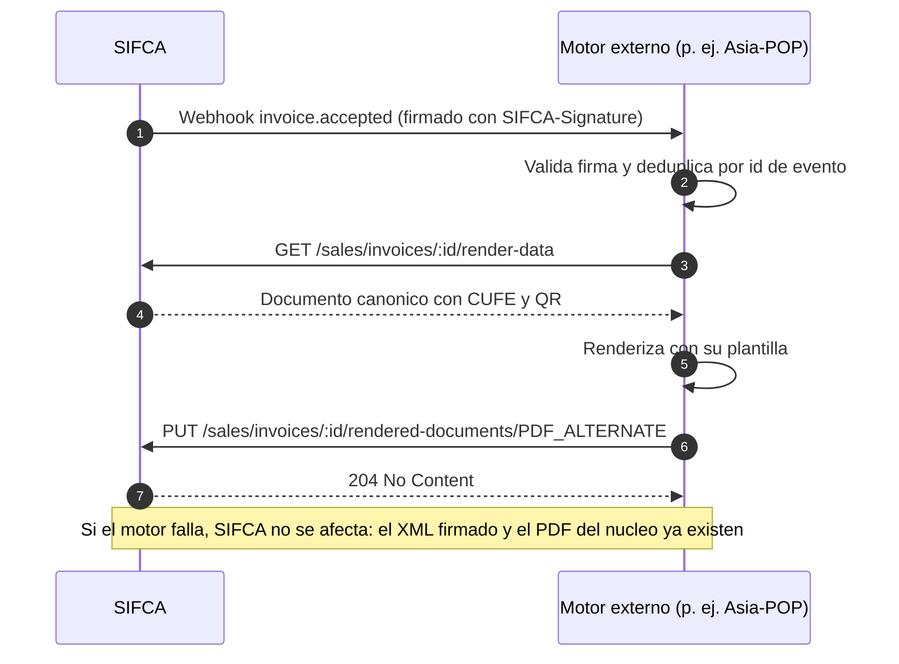

# Integración con motores externos (Asia-POP) — fase futura / experimental

> **Estado: FASE FUTURA / EXPERIMENTAL (decisión Q-03).** Esta integración **no forma parte del núcleo** ni
> bloquea ninguna fase del roadmap. SIFCA **no se acopla** a Asia-POP: expone contratos OpenAPI limpios y
> webhooks estándar para que cualquier motor externo —Asia-POP u otro— los consuma cuando esté listo.
> Gobernanza: constitución, principio IX; ADR-0008.

Repositorio de referencia: <https://github.com/JpMurcia/Asia-POP> (revisado en su rama principal el
13-oct-2026, solo lectura; **no se modificó**).

## 1. Principio de integración: el motor consume a SIFCA

| Regla | Detalle |
|---|---|
| Sentido | **El motor externo extrae y se suscribe.** SIFCA nunca invoca a un motor externo en su camino crítico (facturación, contabilidad, inventario) |
| Contrato | OpenAPI derivado de Zod (`04-contrato-api-y-swagger.md`) + webhooks firmados estándar; sin endpoints «a la medida» de un motor concreto |
| Autenticación | API Key por tenant con **alcances mínimos** (`catalog:read`, `documents:read`, `documents:write`, `inventory:read`) |
| Fallo del motor | No afecta a SIFCA: los webhooks se reintentan y el documento fiscal sigue siendo válido; lo único «pendiente» sería la representación gráfica alternativa |
| Datos | Solo viajan los necesarios para dibujar el documento o el catálogo; **nunca** costos, saldos internos ni datos de otros tenants |

La representación gráfica **obligatoria** de la factura la cubre el núcleo con el puerto `DocumentRenderer`
(PDF del PTA o renderizador mínimo propio, ADR-0008); un motor externo solo la **mejora** (diseño, marca).

## 2. Qué expone SIFCA a cualquier motor externo

| Contrato | Para qué | Alcance |
|---|---|---|
| `GET /integrations/catalog-feed/items` | Catálogos: ítems con precio (IVA explícito), imágenes con URL firmada, disponible, tipo y componentes de kits. **Sin costos** | `catalog:read` |
| `GET /sales/invoices/{id}/render-data` | Documento canónico ya calculado (importes en cadena decimal, CUFE, QR, resolución) | `documents:read` |
| `PUT /sales/invoices/{id}/rendered-documents/PDF_ALTERNATE` | Devolver un PDF alternativo de una factura **aceptada** | `documents:write` |
| Webhooks | `invoice.accepted`, `stock.changed`, `order.created`, `return.received`, `inventory.reorder.required`… | `webhooks:manage` |
| Estado de cuenta y cartera | `GET /receivables/customers/{id}/statement` y `…/credit` | `receivables:read`, `credit:read` |

Ejemplo del flujo para un motor de documentos:

## 3. Diagnóstico de Asia-POP (hechos leídos en su código)

| Tema | Hecho | Dónde se verificó |
|---|---|---|
| Qué hace | Genera un **catálogo PDF** (A4, máximo 3 productos por página) a partir de productos de Alegra y productos propios | `README.md` |
| Stack | Node.js 22 + **Express** + **SQLite**; React + Tailwind; **Puppeteer** imprime la misma vista que se ve en pantalla | `README.md`, `package.json` |
| Despliegue | Aplicación **local**: escucha solo en `127.0.0.1`; usuario semilla; sesión por cookie | `README.md`, `backend/src/auth/*` |
| Fuente de datos | `AlegraClient` de **solo lectura** (Basic auth); base configurable con `ALEGRA_BASE_URL`; token cifrado guardado desde una pantalla | `backend/src/alegra/alegra.client.ts` |
| Modelo normalizado | `NormalizedItem { id, name, description, price, imageUrls[], soldOut, categoryId, categoryName, type }` | `backend/src/alegra/alegra.mapper.ts` |
| Plantillas | JSON con **4 páginas fijas** (`portada`, `seccion`, `productos`, `politicas`), paleta, tipografías, elementos y bloques automáticos; editor visual | `backend/src/catalog/template.ts`, `frontend/src/pages/TemplateEditor/*` |
| Flujo | `POST /catalog/prepare` → `POST /catalog/generate` (asíncrono) → PDF en disco | `backend/src/api/catalog.routes.ts` |
| Gobernanza | Su constitución exige que **todas las rutas requieran sesión** y que Alegra sea la fuente de verdad de solo lectura | `.specify/memory/constitution.md` |

**Conclusión.** Asia-POP es una aplicación de un solo propósito (catálogo), de un solo tenant y confinada a
localhost. Sirve como **consumidor** de un feed de catálogo; para documentos transaccionales necesitaría una
evolución mayor. Por eso se difiere y se mantiene fuera del núcleo.

## 4. Qué tendría que cambiar Asia-POP (solicitudes `AP-CR`, no aplicadas)

| ID | Cambio | Motivo |
|---|---|---|
| AP-CR-01 | Abstraer la fuente de datos (`CatalogSource`) y añadir `SifcaSource` junto a `AlegraClient` | Hoy solo existe Alegra |
| AP-CR-02 | **Receptor de webhooks** con verificación HMAC y deduplicación, accesible desde SIFCA | Su servidor solo escucha en `127.0.0.1` y exige sesión |
| AP-CR-03 | **Multi-tenant** de plantillas, activos y datos del negocio (o una instancia por tenant) | Hoy hay una sola tienda |
| AP-CR-04 | Nuevos tipos de documento y bloques de tabla de líneas con paginación, totales y QR | Las páginas son de catálogo |
| AP-CR-05 | Versionado de plantillas (publicadas e inmutables) | Reproducir un PDF antiguo |
| AP-CR-06 | Enmienda de su constitución (fuente «de solo lectura» en lugar de «Alegra»; acceso de servicio) | Coherencia de gobernanza |
| AP-CR-07 | Límites de concurrencia y tamaño en el render | Estabilidad con Puppeteer |

## 5. Compatibilidad con la API de Alegra (opcional y fuera del núcleo)

Una **fachada de solo lectura** que imite los tres endpoints de Alegra que Asia-POP consume (`/company`,
`/item-categories`, `/items`) permitiría que Asia-POP lea de SIFCA cambiando solo `ALEGRA_BASE_URL`. **No se
incluye en el núcleo** (no es un contrato «limpio» de SIFCA): sería un paquete opcional separado, a construir
solo si se decide en la fase experimental y **después** de verificar la documentación oficial de Alegra
(`02-normativa-y-reglas/06-referencia-api-alegra.md`).

## 6. Criterios para iniciar la fase experimental

| # | Condición |
|---|---|
| 1 | Las fases F3 (facturación vía PTA) y F6 (vitrina) están estables |
| 2 | Existe un cliente interesado en documentos con diseño propio o catálogos PDF |
| 3 | El dueño de Asia-POP aprobó una *feature* para AP-CR-01…05 en su flujo Spec Kit |
| 4 | Se decidió el modelo de despliegue de Asia-POP (compartido o por tenant) |
| 5 | Se acordó una prueba de contrato entre ambos sistemas contra el OpenAPI vigente |

## 7. Riesgos

| ID | Riesgo | Mitigación |
|---|---|---|
| R-AP-01 | Acoplar el calendario de SIFCA al de otro repositorio | Integración solo por contratos; ninguna fase depende de ella |
| R-AP-02 | Datos personales de clientes viajan a otro servicio | Minimización, alcances mínimos, red interna o TLS, sin persistir el cuerpo en el motor |
| R-AP-03 | Plantillas externas que omitan información obligatoria | El PDF obligatorio lo cubre el núcleo; el alternativo es opcional |
