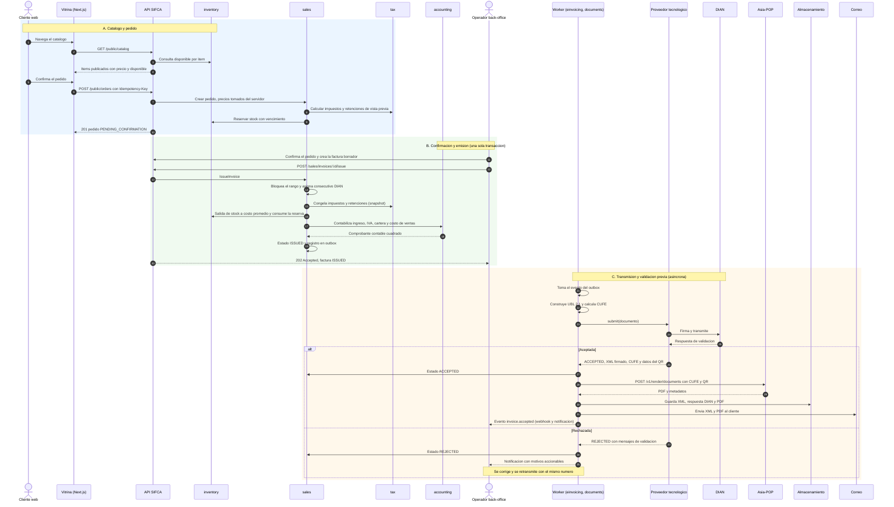
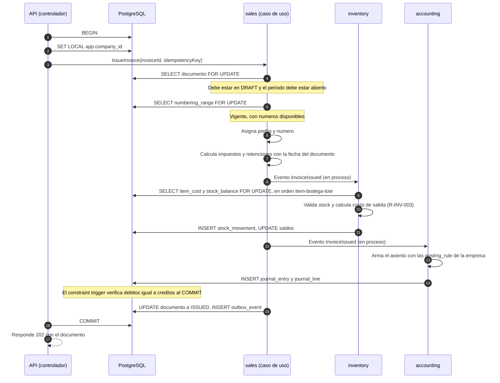
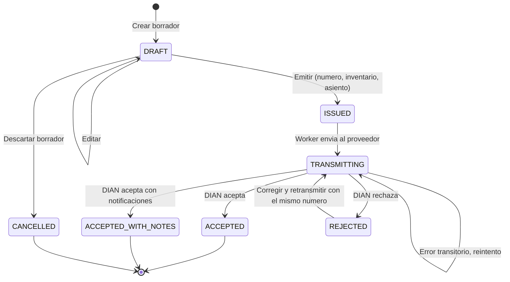

# Flujo de venta: del catálogo web a la factura electrónica y el PDF

Estado: **borrador de Fase 1** · Reglas relacionadas: R-IMP (impuestos), R-INV (inventario), R-CON
(contabilidad), R-FE (factura electrónica) · Arquitectura: `01-arquitectura/01-…`, `05-…`

## 1. Visión general

Lectura del diagrama:

- **Fase A** nunca crea un documento fiscal: solo un pedido con reserva temporal. Los precios los fija el
  servidor.
- **Fase B** es una **única transacción de base de datos**: o ocurre todo (número, impuestos, inventario,
  asiento, estado, outbox) o no ocurre nada.
- **Fase C** es asíncrona: la API no espera a la DIAN. El PDF se genera **después** de la aceptación, porque
  necesita el CUFE y el QR definitivos.

## 2. Qué escribe cada paso

| Paso | Módulo | Tablas que cambian | Reglas |
|---|---|---|---|
| 7–8 | `sales` | `sales.document` (`ORDER`, `PENDING_CONFIRMATION`), `sales.document_line` | R-IMP-001…003 (vista previa) |
| 9 | `inventory` | `inventory.stock_reservation`, `stock_balance.reserved` | R-INV-013 |
| 10 | `jobs` | `jobs.outbox_event` (`order.created`) | ADR-0006 |
| 11 | `sales` | `sales.document` (`INVOICE`, `DRAFT`) a partir del pedido | — |
| 14 | `sales` | `sales.numbering_range.next_number`, `sales.document` (`prefix`, `number`) | R-FE-003, R-FE-004, INV-06 |
| 15 | `tax` / `sales` | `sales.line_tax`, `sales.document_withholding` (con `tax_rate_id`) | R-IMP-010…014, R-IMP-020, R-IMP-021, ADR-0005 |
| 16 | `inventory` | `stock_movement` (`SALE_OUT`), `stock_balance`, `item_cost`; `sales.document_line.unit_cost_at_sale` | R-INV-001…007, 013 |
| 17–18 | `accounting` | `acc.journal_entry`, `acc.journal_line` (FV y costo) | R-CON-001…009, P-01 |
| 19 | `sales` / `jobs` | `sales.document.status = ISSUED`, `jobs.outbox_event` (`invoice.issued`) | ADR-0006 |
| 21–23 | `einvoicing` | `einv.einvoice_submission` (intento 1) | R-FE-005, R-FE-008 |
| 26–27 | `sales` | `status = ACCEPTED`, `cufe` | R-FE-002 |
| 28–30 | `documents` | `files.stored_file` (XML, respuesta DIAN, PDF) | R-FE-007, R-FE-013 |
| 31–32 | `jobs` | `outbox_event` / entrega de correo y webhooks | — |

## 3. Detalle de la transacción de emisión (Fase B)

Si cualquier paso lanza una excepción, la transacción se revierte completa: **no se consume el
consecutivo**, no sale stock y no queda asiento.

## 4. Estados del documento de venta

Reglas de transición:

| Transición | Condición | Regla |
|---|---|---|
| `DRAFT → ISSUED` | Período abierto, rango vigente, stock suficiente, cliente identificado con DV, impuestos resueltos | R-CON-004, R-FE-003, R-INV-007, R-FE-012 |
| `ISSUED → TRANSMITTING` | Lo hace el worker; no hay acción manual | ADR-0006 |
| `REJECTED → TRANSMITTING` | Si la corrección cambia valores: nueva revisión con reversa y nuevo asiento | ADR-0006, R-CON-005 |
| `ACCEPTED*` (terminal) | **Inmutable.** Para cambiar su efecto: nota crédito o nota débito | R-FE-009 |
| `DRAFT → CANCELLED` | Solo borradores (nunca se emitió número) | — |

> No existe el estado «anulada» para una factura aceptada. Una anulación total es una **nota crédito** con
> concepto de anulación, que a su vez recorre el mismo ciclo `ISSUED → … → ACCEPTED`.

## 5. Escenarios de aceptación (base de las pruebas de extremo a extremo)

Cada escenario es una prueba automatizada de la Fase 3.

### E2E-01 · Camino feliz de una venta web a crédito con IVA
- **Dado** un ítem con stock 50 y costo promedio 60.000, precio 100.000 más IVA 19 %, un cliente con plazo
  de 30 días y un rango de numeración vigente.
- **Cuando** el cliente pide 10 unidades por la vitrina, el operador confirma y emite.
- **Entonces:**
  - el pedido reservó 10 (disponible baja de 50 a 40 antes de emitir);
  - la factura tiene subtotal 1.000.000, IVA 190.000, total 1.190.000 y el siguiente número del rango;
  - el stock del ítem baja a 40, con un movimiento `SALE_OUT` de costo 600.000;
  - existen los comprobantes de P-01 (FV por 1.190.000 y costo por 600.000) y cuadran;
  - la factura queda `ISSUED` y luego `ACCEPTED` con la respuesta simulada del proveedor;
  - existe un PDF con CUFE y QR, y se encoló el correo y el webhook `invoice.accepted`.

### E2E-02 · Stock insuficiente en la emisión
- **Dado** un pedido de 10 unidades y que otra venta consumió el stock hasta dejar 5.
- **Cuando** se intenta emitir.
- **Entonces** responde `409 INSUFFICIENT_STOCK`; **no** se consume número, no hay movimientos ni asiento; la
  factura sigue en `DRAFT`.

### E2E-03 · Rechazo de la DIAN y corrección
- **Dado** una factura `ISSUED` y una respuesta simulada de rechazo por dato inválido del adquirente.
- **Cuando** el worker procesa la respuesta.
- **Entonces** el estado es `REJECTED`, el usuario ve los motivos en lenguaje claro; al corregir el dato y
  retransmitir se conserva el **mismo número** y, al ser aceptada, no existen huecos en la numeración.

### E2E-04 · Idempotencia
- **Cuando** se envía dos veces `POST …/issue` con la misma `Idempotency-Key`.
- **Entonces** hay **un** número consumido, **un** movimiento de stock y **un** asiento; ambas respuestas son
  idénticas.

### E2E-05 · Concurrencia
- **Dado** stock 10 y dos operadores emitiendo a la vez dos facturas de 8 unidades.
- **Entonces** exactamente una tiene éxito y la otra falla con `INSUFFICIENT_STOCK`; stock final = 2.
  Con 2 hilos × 1.000 emisiones sobre un rango, los números son contiguos y únicos.

### E2E-06 · Asia-POP no disponible
- **Dado** una factura aceptada y Asia-POP caído.
- **Entonces** la factura permanece `ACCEPTED`, el PDF queda «en preparación», el worker reintenta con
  *backoff* y, al volver el servicio, se genera, se guarda y se envía el correo. Nunca se retrocede el estado fiscal.

### E2E-07 · Período cerrado
- **Dado** que el período de la fecha del documento está cerrado.
- **Entonces** `issue` responde `409 PERIOD_CLOSED` sin efectos.

### E2E-08 · Nota crédito por devolución parcial
- **Dado** la factura de E2E-01 aceptada y la devolución de 2 unidades.
- **Entonces** la nota crédito (subtotal 200.000, IVA 38.000, total 238.000) referencia el CUFE de la
  factura, reingresa 2 unidades **a costo 60.000** (120.000) y genera el comprobante de P-02.

### E2E-09 · Pedido sin confirmar
- **Dado** un pedido web sin confirmación hasta vencer la reserva.
- **Entonces** el pedido pasa a `EXPIRED` y el stock reservado se libera; el disponible vuelve a 50.

### E2E-10 · Cliente con retenciones
- **Dado** un cliente agente de retención y la venta de P-04 (2.000.000 + IVA).
- **Entonces** al registrar el recibo con las retenciones sufridas, el comprobante coincide con P-04b y el
  saldo de la factura queda en 0.

## 6. Casos de falla y respuesta del sistema

| Falla | Dónde | Respuesta |
|---|---|---|
| Stock insuficiente | Emisión (B) | `409 INSUFFICIENT_STOCK`, sin efectos (E2E-02) |
| Rango de numeración agotado o vencido | Emisión (B) | `409 NUMBERING_RANGE_EXHAUSTED` / `…_EXPIRED`; alerta previa cuando quedan pocos números |
| Período cerrado | Emisión (B) | `409 PERIOD_CLOSED` (E2E-07) |
| Cliente sin identificación válida (NIT/DV) | Emisión (B) | `422 VALIDATION_FAILED` con el campo |
| Impuesto ambiguo (dos tarifas aplicables) | Emisión (B) | `422` y registro para el contador; no se adivina |
| Doble envío del mismo `issue` | Emisión (B) | Misma respuesta por idempotencia (E2E-04) |
| Proveedor tecnológico no responde | Transmisión (C) | Reintentos con *backoff*; antes de reenviar, **consulta de estado** por referencia para no duplicar; alarma si supera el umbral |
| DIAN o proveedor caídos de forma prolongada | Transmisión (C) | Modo de contingencia (R-FE-011) con cola de pendientes visible |
| Rechazo de la DIAN | Transmisión (C) | `REJECTED` con motivos; corrección con el mismo número (E2E-03) |
| Asia-POP caído o lento | PDF (C) | El estado fiscal no se toca; PDF pendiente con reintentos (E2E-06) |
| Falla de correo | Entrega (C) | Reintentos; el documento puede descargarse y reenviarse manualmente |
| Webhook del cliente no responde | Entrega (C) | Reintentos exponenciales hasta 24 h; registro y reenvío manual |
| Pedido web vencido | Reserva (A) | Estado `EXPIRED` y liberación del stock (E2E-09) |
| El precio cambió entre pedido y factura | Emisión (B) | El pedido **fija** los precios por la vigencia configurada (p. ej. 24 h); la factura toma las líneas del pedido; un cambio requiere editar el borrador de forma explícita |

## 7. Variantes del flujo

| Variante | Diferencias |
|---|---|
| Venta de mostrador (POS) | No pasa por Fase A. Emite documento equivalente electrónico (POS) o factura si el cliente la pide (R-FE-015); posible modo contingencia sin internet (Q-06) |
| Venta directa en el back-office | Inicia en la factura borrador (sin pedido ni reserva) |
| Cotización → pedido → factura | La cotización (`QUOTE`) se convierte en pedido conservando precios y vigencia |
| Venta de contado | La línea de cartera del asiento se reemplaza por caja/banco; sin vencimiento |
| Cliente agente de retención | Las retenciones sufridas se reconocen en el recibo de caja (por defecto) o en la factura (configurable), P-04 |
| Servicios (sin inventario) | Se omiten las salidas de stock y el asiento de costo |
| Kits | La salida de stock se hace sobre los componentes (R-INV-012) |

## 8. Eventos publicados

| Evento | Momento | Consumidores típicos |
|---|---|---|
| `order.created` | Paso 10 | Back-office (notificación), integraciones |
| `invoice.issued` | Paso 19 | Worker de `einvoicing`, integraciones |
| `stock.changed` | Pasos 9 y 16 | Sistemas externos que sincronizan inventario |
| `invoice.accepted` | Paso 32 | Cliente (correo), integraciones |
| `invoice.rejected` | Rama de rechazo | Back-office (alerta) |
