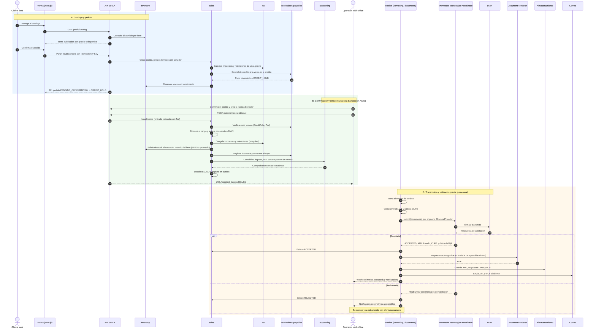
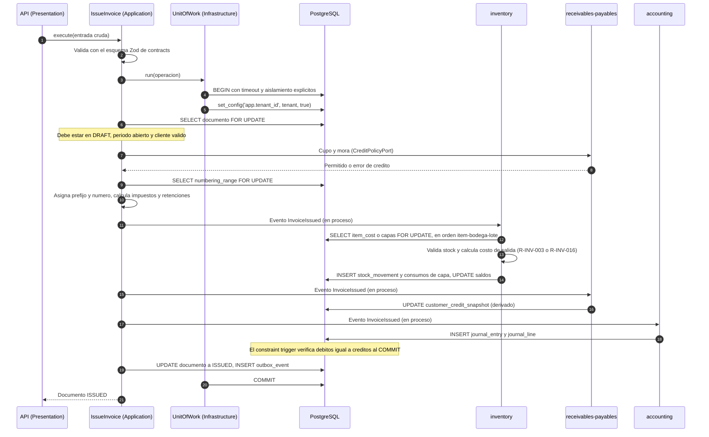
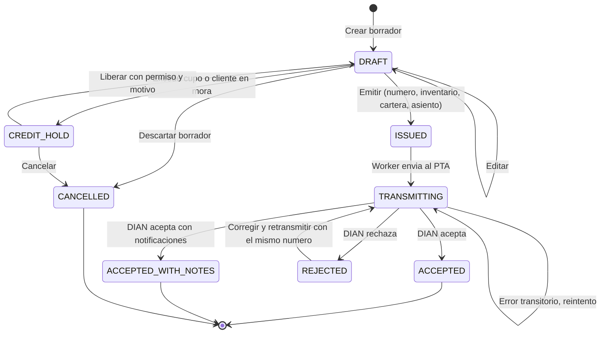

# Flujo de venta: del catálogo web a la factura electrónica y el PDF

Estado: **Fase 1 (actualizada)** · Reglas relacionadas: R-IMP (impuestos), R-INV (inventario y costeo), R-CAR
(crédito y cartera), R-CON (contabilidad), R-FE (factura electrónica) · Gobernanza: constitución III
(transacción ACID) · Escenarios ejecutables: [`../specs/`](../specs/README.md)

## 1. Visión general

Lectura del diagrama:

- **Fase A** nunca crea un documento fiscal: solo un pedido con reserva de stock y, si es a crédito, de cupo.
  Los precios los fija el servidor. Una venta web de un cliente sin crédito es siempre de contado.
- **Fase B** es una **única transacción de base de datos** (constitución III): o ocurre todo —control de
  crédito, consecutivo, impuestos, inventario (y capas PEPS), cartera, asiento, estado, outbox— o no ocurre
  nada. En el código, `inventory`, `receivables-payables` y `accounting` reaccionan a un evento de dominio en
  proceso dentro de esa transacción; el diagrama los dibuja como llamadas por claridad.
- **Fase C** es asíncrona: la API no espera a la DIAN. El PDF se genera **después** de la aceptación porque
  necesita el CUFE y el QR definitivos. Un motor externo de documentos (fase futura) se suscribe al webhook
  `invoice.accepted` y no interviene en este flujo (ADR-0008).

## 2. Qué escribe cada paso

| Paso | Módulo | Tablas que cambian | Reglas |
|---|---|---|---|
| 7–8 | `sales` | `sales.document` (`ORDER`, `PENDING_CONFIRMATION`), `sales.document_line` | R-IMP-001…003 (vista previa) |
| 9–10 | `receivables-payables` | `arap.customer_credit_snapshot` (cupo reservado), `arap.credit_hold` si se excede | R-CAR-008, R-CAR-012 |
| 11 | `inventory` | `inventory.stock_reservation`, `stock_balance.reserved` | R-INV-013 |
| 12 | `jobs` | `jobs.outbox_event` (`order.created`, y `credit.hold.created` si aplica) | ADR-0006 |
| 13 | `sales` | `sales.document` (`INVOICE`, `DRAFT`) a partir del pedido | — |
| 15–16 | `sales` / `arap` | Validación Zod del caso de uso; lectura de exposición y mora | Principio V, R-CAR-012 |
| 17 | `sales` | `sales.numbering_range.next_number`, `sales.document` (`prefix`, `number`) | R-FE-003, R-FE-004, INV-06 |
| 18 | `tax` / `sales` | `sales.line_tax`, `sales.document_withholding` (con `tax_rate_id`) | R-IMP-010…014, R-IMP-020, R-IMP-021, ADR-0005 |
| 19 | `inventory` | `stock_movement` (`SALE_OUT`), `stock_balance`; **promedio:** `item_cost`; **PEPS:** `cost_layer`, `cost_layer_consumption`; `sales.document_line.unit_cost_at_sale` | R-INV-001…003, 016, 017 |
| 20 | `receivables-payables` | `arap.customer_credit_snapshot` (exposición); la cartera se deriva del mayor | R-CAR-001, R-CAR-008 |
| 21–22 | `accounting` | `acc.journal_entry`, `acc.journal_line` (FV y costo) | R-CON-001…009, P-01 |
| 23 | `sales` / `jobs` | `sales.document.status = ISSUED`, `jobs.outbox_event` (`invoice.issued`, `stock.changed`) | ADR-0006 |
| 25–29 | `einvoicing` | `einv.einvoice_submission` (intento 1), `einv.einvoice_event` | R-FE-005, R-FE-008 |
| 30–31 | `sales` | `status = ACCEPTED`, `cufe` | R-FE-002 |
| 32–34 | `documents` | `files.stored_file` (XML, respuesta DIAN, PDF) | R-FE-007, R-FE-013 |
| 35–36 | `jobs` | Entrega de correo y webhooks | — |

## 3. Detalle de la transacción de emisión (Fase B)

Si cualquier paso lanza una excepción, `$transaction` se revierte completa: **no se consume el consecutivo**,
no sale stock, no queda asiento y no se consume cupo. Ninguna llamada de red ocurre dentro de la transacción.

## 4. Estados del documento de venta

Reglas de transición:

| Transición | Condición | Regla |
|---|---|---|
| `DRAFT → CREDIT_HOLD` | Venta `CREDITO` que excede el cupo o con mora sobre el umbral | R-CAR-012 |
| `CREDIT_HOLD → DRAFT` | Liberación con permiso `sales.credit.release` y motivo; queda en bitácora | R-CAR-012 |
| `DRAFT → ISSUED` | Período abierto, rango vigente, stock suficiente, cliente identificado con DV, impuestos resueltos, crédito permitido | R-CON-004, R-FE-003, R-INV-007, R-FE-012, R-CAR-012 |
| `ISSUED → TRANSMITTING` | Lo hace el worker; no hay acción manual | ADR-0006 |
| `REJECTED → TRANSMITTING` | Si la corrección cambia valores: nueva revisión con **contraasiento** y nuevo asiento | ADR-0006, R-CON-005 |
| `ACCEPTED*` (terminal) | **Inmutable.** Para cambiar su efecto: nota crédito o nota débito | R-FE-009 |
| `DRAFT → CANCELLED` | Solo borradores (nunca se emitió número) | — |

> No existe el estado «anulada» para una factura aceptada. Una anulación total es una **nota crédito** con
> concepto de anulación (ver [`02-devoluciones-nota-credito-y-reingreso.md`](02-devoluciones-nota-credito-y-reingreso.md)).

## 5. Escenarios de aceptación

Los escenarios **ejecutables** (Gherkin) viven en las especificaciones; esta tabla es el índice:

| Escenario | Qué verifica | Especificación |
|---|---|---|
| Venta web a crédito con IVA, camino feliz | Cupo, consecutivo, impuestos, kardex, cartera, asiento, estado, outbox | [`002-emision-factura-venta`](../specs/002-emision-factura-venta/spec.md) |
| Stock insuficiente en la emisión | `409 INSUFFICIENT_STOCK` sin efectos colaterales | 002 |
| Doble envío (idempotencia) | Un solo número, un movimiento, un asiento | 002 |
| Concurrencia sobre stock y consecutivo | Exactamente una emisión gana; números contiguos | 002 |
| Falla inyectada en cada paso de la transacción | Atomicidad: no queda nada a medias | 002 |
| Período cerrado | `409 PERIOD_CLOSED` | 002, 001 |
| Cupo excedido o cliente en mora | `CREDIT_HOLD`; liberación con permiso y bitácora | [`003-ventas-credito-y-cartera`](../specs/003-ventas-credito-y-cartera/spec.md) |
| Rechazo de la DIAN y corrección | `REJECTED`; mismo número; contraasiento si cambian valores | [`009-facturacion-electronica-pta`](../specs/009-facturacion-electronica-pta/spec.md) |
| Renderizador o correo no disponible | El estado fiscal no se toca; PDF/correo pendientes con reintentos | 009 |
| Devolución parcial o total con nota crédito | Reingreso al kardex por condición, reversa de IVA y cartera | [`004-devoluciones-ventas-nota-credito`](../specs/004-devoluciones-ventas-nota-credito/spec.md) |
| Pedido sin confirmar | Reserva vencida: `EXPIRED` y liberación de stock | 002 |
| Cliente con retenciones | Recibo con retenciones sufridas (P-04) | 003 |

## 6. Casos de falla y respuesta del sistema

| Falla | Dónde | Respuesta |
|---|---|---|
| Stock insuficiente | Emisión (B) | `409 INSUFFICIENT_STOCK`, sin efectos |
| Cupo excedido | Pedido (A) o emisión (B) | `409 CREDIT_LIMIT_EXCEEDED`; el documento queda en `CREDIT_HOLD` |
| Cliente en mora sobre el umbral | Pedido (A) o emisión (B) | `409 CUSTOMER_BLOCKED_OVERDUE`; `CREDIT_HOLD` |
| Rango de numeración agotado o vencido | Emisión (B) | `409 NUMBERING_RANGE_EXHAUSTED` / `…_EXPIRED`; alerta previa cuando quedan pocos números |
| Período cerrado | Emisión (B) | `409 PERIOD_CLOSED` |
| Cliente sin identificación válida (NIT/DV) | Emisión (B) | `422 VALIDATION_FAILED` con el campo |
| Impuesto ambiguo (dos tarifas aplicables) | Emisión (B) | `422` y registro para el contador; no se adivina |
| Doble envío del mismo `issue` | Emisión (B) | Misma respuesta por idempotencia |
| Falla del asiento o de cualquier manejador | Emisión (B) | Rollback completo (constitución III) |
| PTA no responde | Transmisión (C) | Reintentos con *backoff*; antes de reenviar, **consulta de estado** para no duplicar; alarma si supera el umbral |
| DIAN o PTA caídos de forma prolongada | Transmisión (C) | Modo de contingencia (R-FE-011) con cola de pendientes visible |
| Rechazo de la DIAN | Transmisión (C) | `REJECTED` con motivos; corrección con el mismo número |
| Renderizador de PDF no disponible | PDF (C) | El estado fiscal no se toca; PDF pendiente con reintentos |
| Falla de correo | Entrega (C) | Reintentos; el documento puede descargarse y reenviarse manualmente |
| Webhook del cliente no responde | Entrega (C) | Reintentos exponenciales hasta 24 h; registro y reenvío manual |
| Pedido web vencido | Reserva (A) | Estado `EXPIRED` y liberación del stock y del cupo reservado |
| El precio cambió entre pedido y factura | Emisión (B) | El pedido **fija** los precios por la vigencia configurada (p. ej. 24 h); la factura toma las líneas del pedido |

## 7. Variantes del flujo

| Variante | Diferencias |
|---|---|
| Venta de mostrador (POS) | No pasa por la fase A. Emite documento equivalente electrónico (POS) o factura si el cliente la pide (R-FE-015); posible modo contingencia sin internet (Q-06) |
| Venta directa en el back-office | Inicia en la factura borrador (sin pedido ni reserva) |
| Cotización → pedido → factura | La cotización (`QUOTE`) se convierte en pedido conservando precios y vigencia |
| Venta de **contado** | La línea de cartera del asiento se reemplaza por caja/banco; **no consume cupo**; un cliente `BLOQUEADO_MORA` puede comprar de contado |
| Cliente agente de retención | Las retenciones sufridas se reconocen en el recibo de caja (por defecto) o en la factura (configurable), P-04 |
| Servicios (sin inventario) | Se omiten las salidas de stock y el asiento de costo |
| Kits | La salida de stock se hace sobre los componentes (R-INV-012) |
| Ítem perecedero | Costeo PEPS obligatorio y despacho FEFO; el lote físico y la capa de costo pueden diferir (R-INV-017) |

## 8. Eventos publicados

| Evento | Momento | Consumidores típicos |
|---|---|---|
| `order.created` | Paso 12 | Back-office (notificación), integraciones |
| `credit.hold.created` | Paso 10 | Responsable de cartera |
| `invoice.issued` | Paso 23 | Worker de `einvoicing`, integraciones |
| `stock.changed` | Pasos 11 y 19 | Sistemas externos que sincronizan inventario |
| `inventory.reorder.required` | Paso 19, si la posición cruza el ROP | Compras, integraciones |
| `invoice.accepted` | Paso 36 | Cliente (correo), motores externos, integraciones |
| `invoice.rejected` | Rama de rechazo | Back-office (alerta) |
