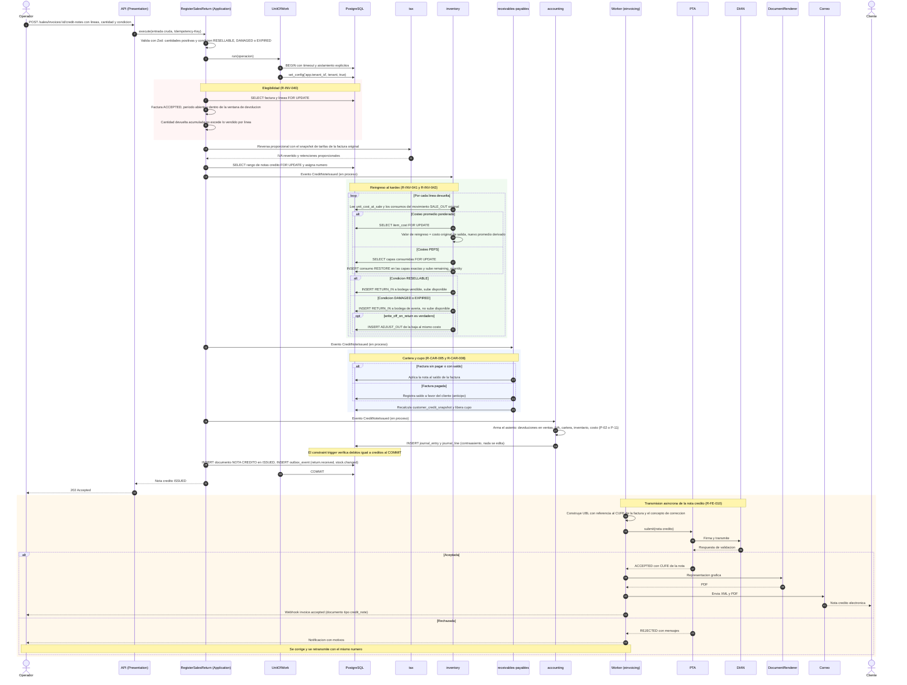
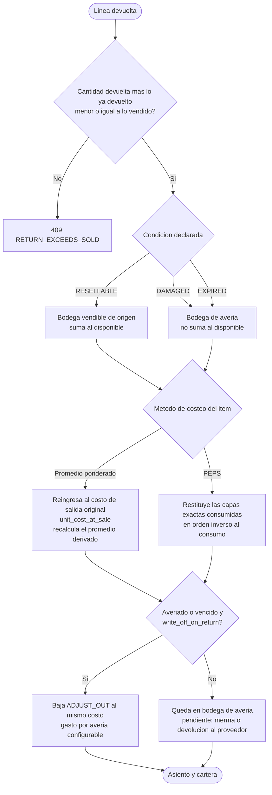
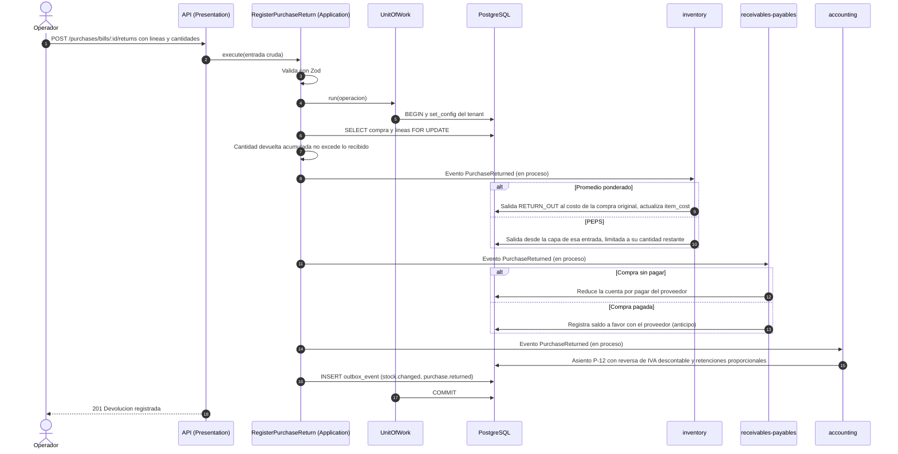

# Devoluciones (RMA): nota crédito y reingreso al kardex

Estado: **Fase 1 (actualizada)** · Reglas: R-INV-040…046 (devoluciones), R-INV-001/003/016 (costeo), R-FE-009/010
(notas), R-CAR-005/008 (cartera y cupo), R-CON-005 (contraasientos), plantillas contables P-02, P-11 y P-12 ·
Gobernanza: constitución I (inmutabilidad) y III (transacción ACID) · Escenarios ejecutables:
[`004`](../specs/004-devoluciones-ventas-nota-credito/spec.md) y [`005`](../specs/005-compras-y-devolucion-proveedor/spec.md)

## 1. Qué cubre

| Tipo | Documento | Efecto en inventario | Efecto en dinero |
|---|---|---|---|
| **Devolución en venta**, total o parcial | **Nota crédito electrónica** DIAN sobre una factura aceptada | Reingreso al kardex según el estado del producto: disponible o avería/merma | Reversa de ingreso, **IVA** y costo de ventas; ajuste de **cartera** o saldo a favor; reversa proporcional de retenciones 🔶 |
| **Devolución a proveedor** | Nota crédito del proveedor (o nota de ajuste del documento soporte) | Salida de kardex al costo correspondiente | Reduce cuentas por pagar; reversa de IVA descontable y retenciones practicadas |

Principio común: lo que se mueve lo hace **al costo con el que se movió originalmente**, nunca al costo del
día (R-INV-005, R-INV-042). Nada se edita: la devolución es un conjunto de **movimientos y asientos nuevos que
contrarrestan** a los originales (constitución I).

## 2. Devolución en venta: secuencia completa

Lectura del diagrama:

- **Toda la parte superior es una sola transacción** (pasos hasta el `COMMIT`): elegibilidad, número de la
  nota, reingreso al kardex, cartera/cupo y asiento. Si algo falla —por ejemplo, el asiento descuadrado—
  **no queda** movimiento de stock, ni consumo de capa, ni número consumido, ni saldo de cartera alterado.
- La **transmisión a la DIAN es posterior** y asíncrona (igual que la factura); el rechazo se corrige
  conservando el número y, si cambian valores, con un nuevo contraasiento (ADR-0006).
- Las **retenciones sufridas** ya reconocidas en recibos se reversan en proporción 🔶 (decisión pendiente
  del contador, Q-14).

## 3. Decisión por línea: dónde reingresa y a qué costo

## 4. Efecto por caso (matriz)

| Condición | Costeo | Factura | Inventario | Cartera | Asiento (resumen) |
|---|---|---|---|---|---|
| `RESELLABLE` | Promedio | Sin pagar | `RETURN_IN` vendible al costo original; promedio recalculado | Reduce el saldo; libera cupo | P-02 |
| `RESELLABLE` | PEPS | Sin pagar | Restituye las capas consumidas | Reduce el saldo; libera cupo | P-02 |
| `RESELLABLE` | Cualquiera | **Pagada** | Igual | **Saldo a favor** del cliente (P-09) o egreso | P-02 + P-09 |
| `DAMAGED`/`EXPIRED` | Cualquiera | Sin pagar | `RETURN_IN` a avería; con baja inmediata `ADJUST_OUT` | Reduce el saldo; libera cupo | **P-11** (gasto por avería) |
| Devolución **total** | Cualquiera | Cualquiera | Todas las líneas según su condición | Saldo de la factura = 0 | Concepto «anulación» de la nota crédito |

## 5. Ejemplo numérico de punta a punta

Factura aceptada: 10 unidades a $100.000 + IVA 19 % ($190.000) = $1.190.000; costo de salida $60.000 por
unidad. Se devuelven **2 unidades**: 1 `RESELLABLE` y 1 `DAMAGED`, con baja inmediata.

| Concepto | Valor |
|---|---:|
| Subtotal devuelto (2 × 100.000) | 200000 |
| IVA revertido (19 %) | 38000 |
| **Total de la nota crédito** | **238000** |
| Costo reingresado (2 × 60.000) | 120000 |
| Del cual dado de baja por avería (1 × 60.000) | 60000 |

Asiento: el de **P-11** (`418.000` = `418.000`). Efectos: el disponible sube **1** unidad; el saldo de la
factura baja $238.000 (si estaba sin pagar) y el cupo se libera en la misma cifra; el costo de ventas baja
$120.000 y el gasto por avería sube $60.000.

**Variante PEPS:** si el ítem se costea en PEPS y las 10 unidades vendidas consumieron la capa 1 (@ $60.000),
la unidad vendible restituye 1 unidad de la capa 1 y la averiada se restituye y luego se da de baja; el valor
del inventario queda igual que en promedio porque ambas capas tenían el mismo costo (con capas de costo
distinto, la restitución respeta la capa original; ejemplo en R-INV-042).

## 6. Devolución a proveedor (secuencia resumida)

Si el proveedor es **no obligado a facturar** y la compra se soportó con **documento soporte**, la
devolución se formaliza con su **nota de ajuste** (R-FE-014). El proveedor obligado a facturar emite su nota
crédito electrónica y SIFCA la registra y la asocia.

## 7. Atomicidad y puntos de falla

| Punto de falla (dentro de la transacción) | Resultado |
|---|---|
| Cantidad excede lo vendido | `409 RETURN_EXCEEDS_SOLD`; nada cambia |
| Ventana de devolución vencida | `409 RETURN_WINDOW_EXPIRED` salvo permiso `sales.return.override` |
| Capa PEPS a restituir no encontrada (dato inconsistente) | Error y rollback; alerta para revisión (INV-13) |
| Asiento descuadrado | El *constraint trigger* falla al `COMMIT`; rollback completo |
| Reintento del mismo `POST` | La clave de idempotencia devuelve la misma nota; no se duplica el reingreso |
| Falla de la DIAN o del PTA | La nota ya existe localmente (`ISSUED`); la transmisión se reintenta o se corrige (R-FE-008) |

## 8. Eventos publicados

| Evento | Cuándo | Consumidores típicos |
|---|---|---|
| `return.received` | Al emitir la nota crédito con reingreso | Integraciones, reporte de devoluciones |
| `stock.changed` | Por cada línea reingresada | Sistemas externos de inventario |
| `credit.limit.warning` / `credit.status.changed` | Si la liberación de cupo cambia el estado de crédito | Cartera |
| `invoice.accepted` (de la nota) | Tras la aceptación de la DIAN | Cliente (correo) |
