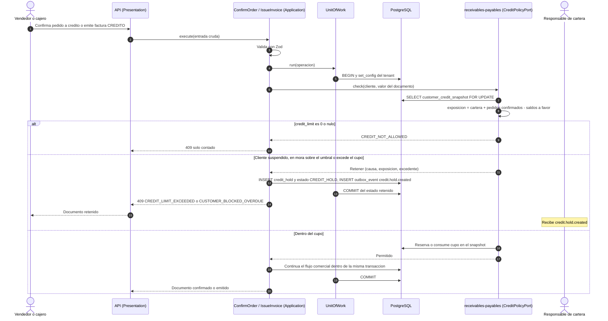
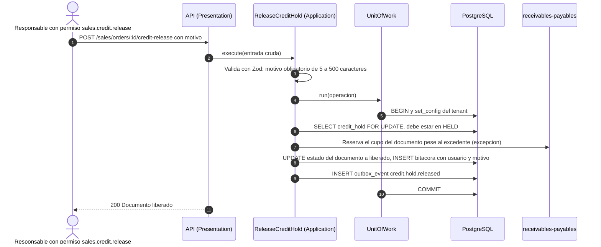
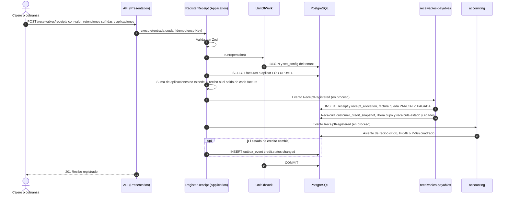

# Venta a crédito: control de cupo, mora y bloqueo de despacho

Estado: **Fase 1 (actualizada)** · Reglas: R-CAR-002, 003, 006, 008, 012…015 · Gobernanza: constitución III
(el consumo de cupo es parte de la transacción comercial) · Escenarios ejecutables:
[`003-ventas-credito-y-cartera`](../specs/003-ventas-credito-y-cartera/spec.md)

## 1. Control de crédito al confirmar, facturar y despachar

Notas:

- El control se hace **dentro** de la transacción comercial, con el snapshot bloqueado (`FOR UPDATE`): dos
  pedidos simultáneos que juntos superen el cupo **no** pasan ambos.
- Una retención **no borra ni edita** el documento: cambia su estado y registra la causa (principio I).
- Una venta de **contado** nunca consume cupo ni se retiene por cupo; un cliente `BLOQUEADO_MORA` puede
  comprar de contado.

## 2. Liberación de un documento retenido

## 3. Recepción de un abono y efecto en cupo y estado

## 4. Trabajos programados de cartera

| Trabajo | Frecuencia | Qué hace | Reglas |
|---|---|---|---|
| Recalcular edades y estado de crédito | Diario (madrugada, hora de Bogotá) | Recorre facturas con saldo, calcula la mora, actualiza el snapshot y emite `receivable.overdue` y `credit.status.changed` | R-CAR-006, 013, 014 |
| Conciliar cartera con el mayor | Diario | Compara Σ cartera por cliente con las cuentas de clientes; alerta y bloquea el cierre mensual si difieren | R-CAR-001, INV-14 |
| Recordatorios de cobro | Según política | Envía recordatorios por canales autorizados | R-CAR-009 |
| Expirar reservas de cupo de pedidos sin confirmar | Cada hora | Libera cupo reservado por pedidos vencidos | R-CAR-008 |
