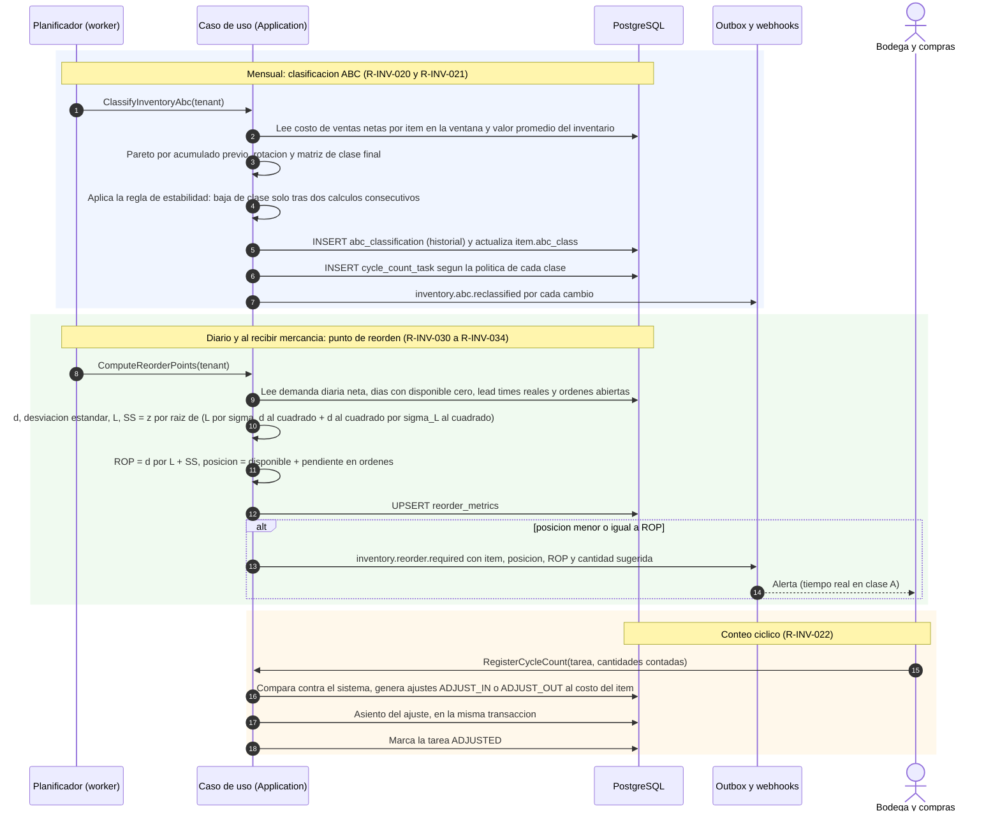

# Reposición, clasificación ABC y conteos cíclicos

Estado: **Fase 1 (actualizada)** · Reglas: R-INV-020…023 (ABC y conteos), R-INV-030…034 (punto de reorden) ·
Escenarios ejecutables: [`007`](../specs/007-clasificacion-abc-y-conteos/spec.md) y
[`008`](../specs/008-punto-de-reorden/spec.md)

## 1. Trabajos programados de logística

Notas:

- Los tres bloques son **casos de uso independientes**, cada uno con su transacción (el último cumple la
  regla de transaccionalidad: ajuste de kardex y asiento juntos).
- Los cálculos de ABC y ROP son **servicios de dominio puros** (`AbcClassifier`, `ReorderPointCalculator`): no
  conocen la base de datos; el caso de uso les entrega datos ya leídos y la fecha (sin `Date.now()`).
- Un conteo vencido de clase A puede **bloquear el cierre del período** (R-INV-022, R-CON-011).
