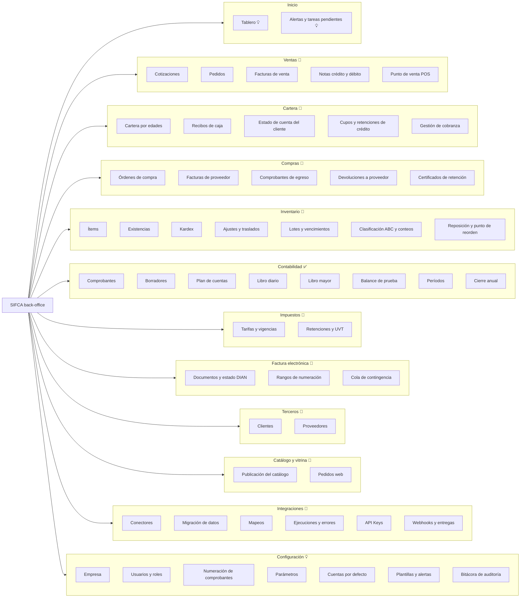
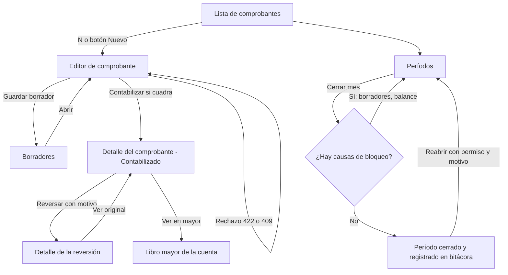
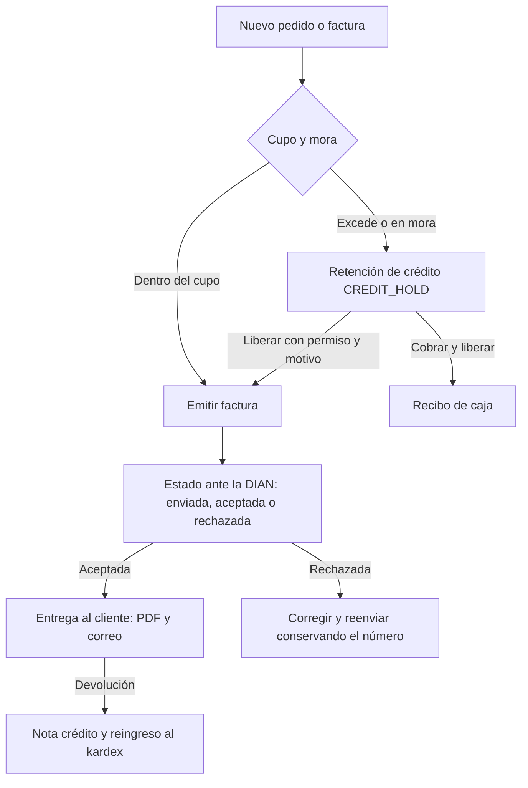
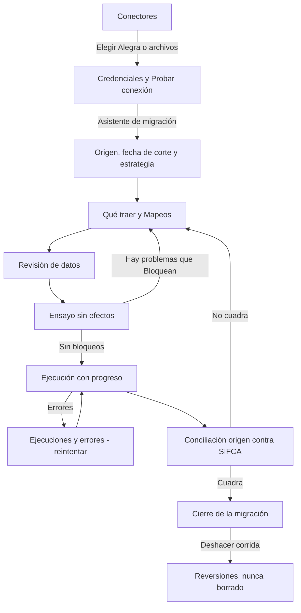

# Navegación y arquitectura de información

Insumo para la maqueta. Leyenda de estado: ✅ el backend existe y está probado · 📐 especificado en una spec, sin
backend aún · 💡 propuesta de diseño sin spec (decisión pendiente).

## 1. Principios de navegación

| # | Principio | Consecuencia en el diseño |
|---|---|---|
| N-1 | **El teclado primero**: el contador trabaja horas sin soltar el teclado | Toda acción frecuente tiene atajo; la paleta `Ctrl/Cmd+K` llega a cualquier pantalla, acción o registro (CP-01…CP-07) |
| N-2 | **El menú sigue el proceso contable**, no la tabla de la base de datos | Grupos por actividad: Ventas, Cartera, Compras, Inventario, Contabilidad… |
| N-3 | **Lo inmutable se ve inmutable** | Un comprobante contabilizado no tiene «Editar» ni «Eliminar»: tiene «Reversar». Las etiquetas *Contabilizado*, *Reversado por…* y *Reversión de…* son visibles |
| N-4 | **El período contable siempre a la vista** | Chip permanente en la barra superior («Oct 2026 · Abierto») y aviso al intentar operar en un período cerrado |
| N-5 | **Estados explicables** | Cada rechazo muestra el código estable, la causa en español y la regla (p. ej. `R-CON-001`) |
| N-6 | **Un solo lugar por tarea**; el resto son enlaces | Un documento se puede abrir desde la lista, la paleta o un enlace de otro documento |
| N-7 | **Profundidad máxima de 3 niveles** en el menú | Grupo → pantalla → pestaña; lo demás se resuelve con filtros y paleta |

## 2. Mapa del sitio (back-office)

## 3. Menú lateral (propuesta)

Orden de arriba hacia abajo. Los grupos se pueden contraer; el menú se puede reducir a íconos. El grupo
**Contabilidad** es el único con backend real hoy y debe maquetarse con el mayor detalle.

| Grupo | Pantalla | Ruta | Permiso (✅ = existe en el backend) | Estado | Spec |
|---|---|---|---|---|---|
| **Inicio** | Tablero | `/` | — | 💡 | — |
| **Ventas** | Cotizaciones | `/ventas/cotizaciones` | `sales.quote.read` 💡 | 📐 | 002 |
| | Pedidos | `/ventas/pedidos` | `sales.order.read` 💡 | 📐 | 002, 003 |
| | Facturas de venta | `/ventas/facturas` | `sales.invoice.read` 💡 | 📐 | 002, 009 |
| | Notas crédito y débito | `/ventas/notas` | `sales.note.read` 💡 | 📐 | 004 |
| | Punto de venta | `/ventas/pos` | `sales.pos.use` 💡 | 📐 | — (Q-06 abierta) |
| **Cartera** | Cartera por edades | `/cartera/edades` | `receivables.read` 💡 | 📐 | 003 |
| | Recibos de caja | `/cartera/recibos` | `receivables.receipt.read` 💡 | 📐 | 003 |
| | Estado de cuenta | `/cartera/clientes/:id/estado-de-cuenta` | `receivables.read` 💡 | 📐 | 003 |
| | Cupos y retenciones | `/cartera/credito` | `receivables.credit.read` 💡 | 📐 | 003 |
| **Compras** | Órdenes de compra | `/compras/ordenes` | `purchases.order.read` 💡 | 📐 | 005, 008 |
| | Facturas de proveedor | `/compras/facturas` | `purchases.invoice.read` 💡 | 📐 | 005 |
| | Comprobantes de egreso | `/compras/egresos` | `purchases.payment.read` 💡 | 📐 | 005 |
| | Devoluciones a proveedor | `/compras/devoluciones` | `purchases.return.read` 💡 | 📐 | 005 |
| **Inventario** | Ítems | `/inventario/items` | `catalog.item.read` 💡 | 📐 | 006 |
| | Existencias | `/inventario/existencias` | `inventory.read` 💡 | 📐 | 006 |
| | Kardex | `/inventario/kardex` | `inventory.read` 💡 | 📐 | 006 |
| | Ajustes y traslados | `/inventario/movimientos` | `inventory.adjust` 💡 | 📐 | 006 |
| | Clasificación ABC y conteos | `/inventario/abc` | `inventory.abc.read` 💡 | 📐 | 007 |
| | Reposición | `/inventario/reposicion` | `inventory.reorder.read` 💡 | 📐 | 008 |
| **Contabilidad** | Comprobantes | `/contabilidad/comprobantes` | `accounting.report.read` ✅ | ✅ | 001 |
| | Nuevo comprobante | `/contabilidad/comprobantes/nuevo` | `accounting.entry.post` ✅ | ✅ | 001 |
| | Borradores | `/contabilidad/borradores` | `accounting.entry.post` ✅ | ✅ | 001 |
| | Plan de cuentas | `/contabilidad/plan-de-cuentas` | `accounting.report.read` ✅ (solo lectura) | ✅ lectura · 💡 edición | 001 |
| | Libro diario | `/contabilidad/diario` | `accounting.report.read` ✅ | ✅ | 001 |
| | Libro mayor | `/contabilidad/mayor` | `accounting.report.read` ✅ | ✅ | 001 |
| | Balance de prueba | `/contabilidad/balance-de-prueba` | `accounting.report.read` ✅ | ✅ | 001 |
| | Períodos | `/contabilidad/periodos` | `accounting.report.read` ✅ · `accounting.period.close` ✅ · `accounting.period.reopen` ✅ · `accounting.period.manage` ✅ | ✅ | 001 |
| | Cierre anual | `/contabilidad/cierre-anual` | `accounting.year.close` ✅ | ✅ | 001 |
| **Impuestos** | Tarifas y vigencias | `/impuestos/tarifas` | `tax.read` 💡 | 📐 | 010 |
| | Retenciones y UVT | `/impuestos/retenciones` | `tax.read` 💡 | 📐 | 010 |
| **Factura electrónica** | Documentos y estado DIAN | `/fe/documentos` | `einvoice.read` 💡 | 📐 | 009 |
| | Rangos de numeración | `/fe/rangos` | `einvoice.range.manage` 💡 | 📐 | 009 |
| | Cola de contingencia | `/fe/contingencia` | `einvoice.read` 💡 | 📐 | 009 |
| **Terceros** | Clientes | `/terceros/clientes` | `parties.read` 💡 | 📐 | 003 |
| | Proveedores | `/terceros/proveedores` | `parties.read` 💡 | 📐 | 005 |
| **Catálogo y vitrina** | Publicación | `/canal/catalogo` | `catalog.publish` 💡 | 📐 | 002 |
| | Pedidos web | `/canal/pedidos` | `sales.order.read` 💡 | 📐 | 002 |
| **Integraciones** | Conectores | `/integraciones/conectores` | `integrations.manage` 💡 | 💡 | 014 (propuesta) |
| | Migración de datos | `/integraciones/migracion` | `integrations.migrate` 💡 | 💡 | 015 (propuesta) |
| | Mapeos | `/integraciones/migracion/:id/mapeos` | `integrations.migrate` 💡 | 💡 | 015 (propuesta) |
| | Ejecuciones y errores | `/integraciones/ejecuciones` | `integrations.read` 💡 | 💡 | 014/015 |
| | API Keys | `/integraciones/api-keys` | `integrations.manage` 💡 | 📐 | 011 |
| | Webhooks | `/integraciones/webhooks` | `integrations.manage` 💡 | 📐 | 011 |
| **Configuración** | Empresa · Usuarios y roles · Numeración · Parámetros · Cuentas por defecto · Plantillas y alertas · Bitácora | `/configuracion/…` | spec de IAM pendiente | 💡 | 012, 013 (propuesta) |

> Los permisos marcados 💡 son **nombres propuestos** para mantener un esquema `modulo.recurso.accion`; los marcados ✅
> existen hoy en el backend y están listados en
> [`contracts/ports.md`](../specs/001-contabilidad-comprobantes-inmutables/contracts/ports.md) §5.
> Un usuario **no ve** las entradas del menú para las que no tiene permiso de lectura.

## 4. Barra superior (siempre visible)

| Zona | Contenido | Comportamiento |
|---|---|---|
| Izquierda | Logo SIFCA y **nombre de la empresa** (NIT) | En el MVP un *tenant* es una empresa (S-01); si hubiese varias, aquí va el selector |
| Centro | Botón de búsqueda «Buscar o ejecutar…  `Ctrl K`» | Abre la paleta de comandos |
| Derecha | **Chip del período** («Oct 2026 · Abierto» / «Sep 2026 · Cerrado») | Clic abre Períodos; en rojo suave si el período de trabajo está cerrado |
| | Campana de **alertas** | Cupo al 80 % y 100 %, mora, rechazos DIAN, reposición requerida, conteos vencidos clase A (specs 003, 007, 008, 009) |
| | Menú de usuario | Idioma/formato, tema claro/oscuro/denso, cerrar sesión |

## 5. Paleta de comandos (`Ctrl/Cmd + K`)

Requisitos ya fijados en `01-arquitectura/01-vision-general-y-modulos.md` §8 (CP-01…CP-07).

| Prefijo | Qué busca | Ejemplos |
|---|---|---|
| (ninguno) | Pantallas, acciones y registros mezclados | «balance», «clientes», «FV-1» |
| `>` | Acciones | `> Nuevo comprobante`, `> Reversar este comprobante`, `> Cerrar período` |
| `@` | Terceros | `@Distribuidora` |
| `#` | Documentos por número | `#AJ-1`, `#FV-125` |
| `/` | Ayuda | `/atajos` |

Comportamientos que la maqueta debe mostrar: resultados agrupados por tipo con su ícono; el **atajo** de cada acción
a la derecha; sección «Recientes»; acciones **contextuales** (estando en un comprobante aparece «Reversar»; en una
factura, «Crear nota crédito»); búsqueda tolerante a tildes; solo muestra lo que el usuario puede hacer.

## 6. Atajos de teclado (💡 propuesta)

| Atajo | Acción | Dónde |
|---|---|---|
| `Ctrl/Cmd + K` | Paleta de comandos | Global |
| `G` luego `C` / `V` / `I` / `T` | Ir a Contabilidad / Ventas / Inventario / Terceros | Global (estilo «ir a») |
| `N` | Nuevo (documento del módulo actual) | Listas |
| `/` | Enfocar el filtro de la lista | Listas |
| `Ctrl/Cmd + S` | Guardar borrador | Editores |
| `Ctrl/Cmd + Enter` | Contabilizar / emitir (solo habilitado si es válido) | Editores |
| `Tab` / `Enter` / flechas | Moverse entre celdas de la grilla | Líneas de comprobante y factura |
| `Ctrl/Cmd + V` | Pegar varias filas desde una hoja de cálculo | Grilla de líneas |
| `Alt + ↑ / ↓` | Mover la fila | Grilla de líneas |
| `Insert` / `Ctrl+Backspace` | Insertar / quitar línea (solo en borradores) | Grilla de líneas |
| `Esc` | Cerrar diálogo o paleta | Global |
| `?` | Ver todos los atajos | Global |

## 7. Flujos de navegación clave

### 7.1 Contabilizar, corregir y cerrar el mes

### 7.2 Venta a crédito con cupo (📐 spec 002 y 003)

### 7.3 Migrar desde otro sistema (💡 specs 014 y 015, fase F8)

Detalle de cada pantalla (IN.1–IN.10) en [`06-integraciones-migracion-y-configuracion.md`](06-integraciones-migracion-y-configuracion.md).

## 8. Qué muestra cada tipo de documento en su cabecera

Convención visual común (se detalla en `04-sistema-de-diseno.md` §6): **título** (tipo y número, p. ej. `AJ-1`),
**etiquetas de estado**, **enlaces de trazabilidad** («Reversión de AJ-1», «Reversado por AJ-2», «Documento fuente
FV-125»), **fecha contable y período**, **autor y fecha de contabilización** y **acciones permitidas** según estado y
permiso.

## 9. Móvil y vitrina

| Superficie | Alcance de la primera maqueta | Navegación |
|---|---|---|
| Back-office responsivo (≥ 360 px) | Solo **consulta** y aprobaciones simples (cartera, alertas, balance) | Menú en cajón; paleta como pantalla completa |
| App Expo (F7) 📐 | Consulta de cartera, alertas y recibos de caja en calle 💡 | Pestañas inferiores: Inicio · Cartera · Alertas · Más |
| Vitrina pública (Next.js, F6) 📐 | Catálogo, ficha de producto, carrito y pedido | Cabecera con buscador y carrito; sin menú del back-office |
