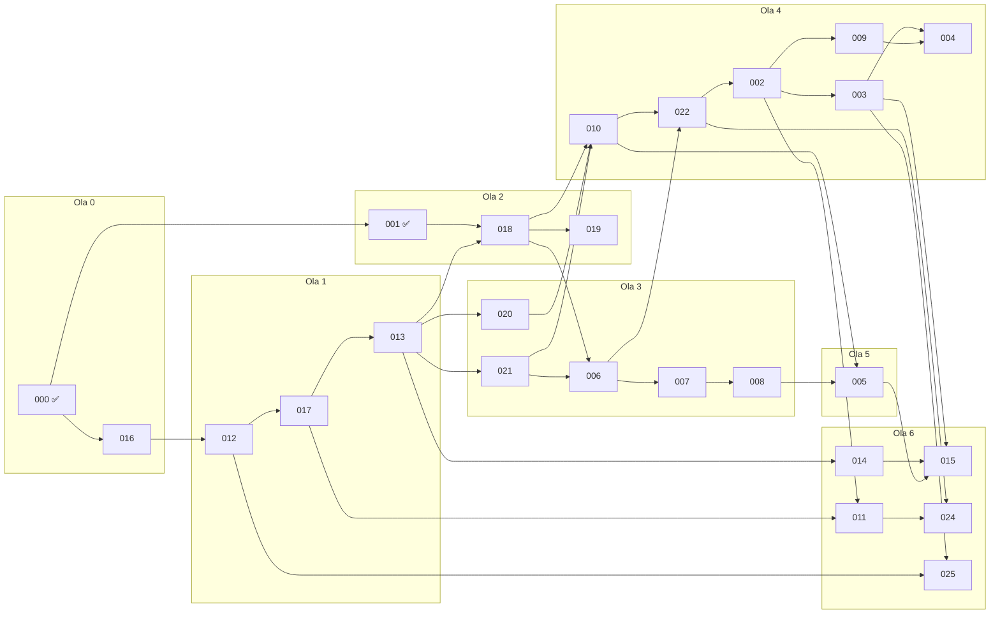

# Hoja de ruta de desarrollo por specs (Spec Kit)

Gobernanza: subordinado a la [constitución](constitution.md). Complementa el roadmap por fases de
[`00-alcance-supuestos-y-roadmap.md`](00-alcance-supuestos-y-roadmap.md) §7 y el índice de
[`specs/README.md`](specs/README.md). Fecha de corte: **16-oct-2026**.

Este documento tiene tres partes:

1. **Auditoría de los mockups** (7 tandas de Claude Design, 141 vistas) contra el catálogo de pantallas y las reglas.
2. **Catálogo ordenado de 25 specs** en 7 olas con dependencias estrictas (2 entregadas, 23 por construir).
3. **Plan de datos semilla** (`prisma/seed.ts`) con cifras cuadradas y verificables.

---

## 1. Auditoría y diagnóstico de los mockups

Fuente: `SIFCA_Mockups_UIUX.zip` (tandas 1 a 7, formato *design canvas*). Cada vista se renderizó y su texto se
contrastó con [`04-diseno-ux/03-catalogo-de-pantallas.md`](04-diseno-ux/03-catalogo-de-pantallas.md),
[`02-navegacion-…`](04-diseno-ux/02-navegacion-y-arquitectura-de-informacion.md) y
[`06-integraciones-…`](04-diseno-ux/06-integraciones-migracion-y-configuracion.md). Los identificadores (`3a`,
`7u`…) son los de las maquetas.

### 1.1 Inventario de vistas

| Plataforma | Vistas | Pantallas únicas | Notas |
|---|---:|---:|---|
| Web escritorio (1440 / 1024 px) | 105 | 43 + 4 patrones de estado | Cada pantalla en tema Claro y Slate; 1024 px en tanda 4 y 7 |
| Hoja de tokens y componentes | 2 | 1 | `1a` Claro, `1b` Oscuro suave |
| Móvil 390 px (back-office) | 22 | 10 | POS, cobro exprés, app de inicio/cartera/alertas, ingreso |
| Vitrina pública multiempresa | 12 | 7 | Escritorio 1440/1024 y móvil 390 |
| **Total** | **141** | **61** | |

**Web escritorio por módulo** (pantallas únicas · vistas):

| Módulo | Pantallas (id de maqueta) | Ruta | Spec |
|---|---|---|---|
| Acceso | Login `2a/2b` | `/ingresar` | 012 |
| Inicio | Tablero por rol `4a–4c` | `/` | 016 → cada módulo aporta tarjetas |
| Contabilidad (9) | Lista de comprobantes `1c–1f`, lista y borradores `5a/5b`, editor `3a/3b`, detalle y reversión `3c/3d`, libros diario y mayor `3e/3f`, balance de prueba `3g/3h`, períodos y cierre `3i/3j`, cierre anual `5e/5f`, plan de cuentas `5c/5d` | `/contabilidad/…` | 001, 018 |
| Ventas (3) | Editor de factura con cupo y DIAN `2c/2d`, cotizaciones y pedidos `7a/7b/7ad`, notas crédito y débito `4m–4o` | `/ventas/…` | 022, 002, 004 |
| Cartera (2) | Edades `3k/3l`, estado de cuenta `7c/7d` | `/cartera/…` | 003 |
| Compras (3) | Factura de proveedor `4d–4f`, egreso `4g–4i`, órdenes con recepción y devolución `7e/7f` | `/compras/…` | 005 |
| Inventario (5) | Existencias + ABC + kardex `2e/2f`, ítems `7g/7h`, ajustes y traslados `7i/7j`, conteo físico `7k/7l/7ae`, reposición `7m/7n` | `/inventario/…` | 021, 006, 007, 008 |
| Impuestos y FE (4) | Tarifas y vigencias `3m/3n`, retenciones y UVT `7o/7p`, rangos de numeración `7q/7r`, cola de contingencia `7s/7t` | `/impuestos/…`, `/fe/…` | 010, 009 |
| Terceros (1) | Ficha maestra cliente/proveedor `4j–4l` | `/terceros/…` | 020 |
| Catálogo y vitrina (2) | Publicación `6g/6h`, pedidos web `6i/6j` | `/canal/…` | 024 |
| Configuración (5) | Empresa y multiempresa `3q/3r`, bitácora `3o/3p`, parámetros con vigencia `5o/5p`, usuarios y roles `7u/7v`, plantillas PDF `7w/7x` | `/configuracion/…` | 013, 017 |
| Integraciones (7) | Conectores y Alegra `2g/2h`, asistente de migración con mapeos, ensayo y conciliación `2i/2j`, ejecuciones `5g/5h`, API Keys `5i/5j`, webhooks `5k/5l`, sincronización `5m/5n`, cierre de migración `7y/7z` | `/integraciones/…` | 011, 014, 015 |
| Estados globales (4 patrones) | Catálogo de errores tipificados y éxito `5q/5r`, 403 sin permiso `7af/7ag`, esqueleto `7ah/7ai`, vacío `7aj`; densidades `7aa–7ac` | todas | 016 |

**Móvil 390 px:** catálogo y pedido POS `1g/1h`, acceso `2k/2o` y `6u/6v` (con error de contraseña), cobro POS con
medio de pago `2l/2p`, cobro exprés (consulta de cupo `3s/3v`, abono `3t/3w`, recibo emitido `3u/3x`), app de inicio,
cartera, alertas y más `6k–6r`.

**Vitrina `/:slug/tienda`:** inicio y catálogo escritorio `6a` (1440) y `6b` (1024) con filtros por categoría;
móvil: catálogo `2m/2q/6c`, buscador con recientes y sinónimos `6s/6t`, ficha de producto `6d`, carrito con pedido
por WhatsApp `2n/2r`, datos de entrega y pago `6e`, seguimiento `6f`.

### 1.2 Validación de flujos críticos

| Paso | Flujo 1 · Venta a crédito | Maqueta | Estado |
|---|---|---|---|
| 1 | Cotización → pedido | `7a` (conversión COT→pedido, cupo del cliente) | ✅ |
| 2 | Validación de cupo y mora | `2c` («Validar cupo», 82 %), `6i` (alerta 89,7 %), `3s` | ✅ |
| 3 | **Documento retenido y liberación con motivo** (R-CAR-012) | — | ❌ **G-01** |
| 4 | Emisión y línea de tiempo DIAN | `2c` (solo estado *Borrador*), `7q`, `7s` | ⚠️ |
| 5 | **Factura emitida/aceptada con panel «Contabilización» (FV + costo) y enlace al kardex** | — | ❌ **G-02** |
| 6 | Afectación del kardex | `2e` (kardex), `7i` | ✅ |
| 7 | Asiento contable automático | `3c` (detalle con origen y documento fuente) | ✅ |

| Paso | Flujo 2 · Comprobante contable | Maqueta | Estado |
|---|---|---|---|
| 1 | Editor con grilla, Σ y diferencia | `3a` (`ENTRY_NOT_BALANCED`, `PERIOD_CLOSED`) | ✅ |
| 2 | Guardar borrador / lista de borradores | `5a`, aviso de bloqueo de cierre en `3i` | ✅ |
| 3 | Contabilizar con idempotencia | `3a`, toast «reintento idempotente» en `5q` | ✅ |
| 4 | Reversión inmutable con motivo | `3c` (diálogo con motivo y vista previa), `ALREADY_REVERSED` en `5q` | ✅ |
| 5 | Cierre de mes con lista de verificación | `3i` | ✅ |
| 6 | Reapertura auditada con motivo | Solo el toast `FORBIDDEN` de `accounting.period.reopen` (`5q`) | ⚠️ m1 |

| Paso | Flujo 3 · Migración Alegra/archivos | Maqueta | Estado |
|---|---|---|---|
| 1 | Conector y credenciales | `2g` (IN.1, IN.2) | ✅ |
| 2 | Mapeo de cuentas, terceros e ítems | `2i` (IN.4) | ✅ |
| 3 | Ensayo (*dry-run*) | `2i` (IN.5), `5g` ejecuciones y errores | ✅ |
| 4 | Conciliación | `2i` (IN.6) | ✅ |
| 5 | Cierre definitivo con confirmación | `7y` (IN.3 paso 9) | ✅ |

**Navegación:** no hay pantallas huérfanas (toda vista tiene entrada de menú o acción que la abre). Sí hay **acciones
huérfanas**: «Registrar recibo» en `7c` (sin pantalla destino, G-03), «Cerrar venta» en `2c` (sin detalle de factura,
G-02), «¿Olvidaste tu contraseña?» en `2a/2k/6u` (m4) y «Crear órdenes de compra» en `7m` (existe `7e`).

### 1.3 Diagnóstico de brechas

**Veredicto: la cobertura NO es del 100 %, pero es suficiente para iniciar la implementación.**

- **Estados de interfaz:** los cinco estados exigidos están resueltos como **patrones del sistema de diseño**
  (vacío `7aj`, cargando con esqueleto `7ah/7ai`, error tipificado `5q` con `CONFLICT`, `INTERNAL_ERROR`,
  `PERIOD_NOT_FOUND`, `ALREADY_REVERSED`, sin conexión y sesión vencida, éxito `5q`, 403 `FORBIDDEN` como toast en
  `5q` y como página en `7af/7ag`). No están dibujados pantalla por pantalla; se implementan una sola vez como
  componentes compartidos (SPEC-016) y cada spec debe probar que su pantalla los usa.
- **Reglas de dominio innegociables:** inmutabilidad (no hay «Editar/Eliminar» en documentos contabilizados), partida
  doble visible, motivo obligatorio en reversiones y ajustes, vigencias en tarifas y parámetros, «un pedido web no
  genera asiento» (`6i`), costeo PEPS/promedio (`2e`) y RLS por empresa (`3q`) **se respetan**, salvo lo listado.

**Brechas críticas** (bloquean el frontend de la spec indicada; no bloquean su backend ni las olas 0–3):

| Id | Brecha | Por qué es crítica | Bloquea UI de |
|---|---|---|---|
| G-01 | No existe `/cartera/credito`: lista de documentos `CREDIT_HOLD` con causa, excedente y acción **Liberar con motivo** | R-CAR-012 y R-CAR-014; el flujo 1 se corta cuando la venta se retiene | SPEC-022 |
| G-02 | No existe la lista ni el **detalle de factura emitida** (`/ventas/facturas/:id`): estados Aceptada / Aceptada con notificaciones / Rechazada con motivos, panel «Contabilización» (FV y costo), enlaces a kardex y CUFE | El flujo 1 no tiene destino después de «Cerrar venta» | SPEC-002, SPEC-009 |
| G-03 | No existe el **recibo de caja web** (`/cartera/recibos/nuevo`): aplicaciones a facturas, retenciones sufridas, anticipo | R-CAR-003/004; `7c` lo invoca. El móvil `3t` solo cubre un abono simple | SPEC-003 |
| G-04 | No hay **estados financieros NIIF** (situación financiera y resultados) ni ruta en la navegación | Alcance F2–F3 de `02-…/01-…` §6 | SPEC-019 |
| G-05 | **Reposición** `7m` usa mínimos/máximos; la spec 008 exige ROP = d × L + SS, z por clase y marca `Confianza baja` | Contradice R-INV-030…034 | SPEC-008 |
| G-06 | **NIT con dígito de verificación inválido** en el brief y en todas las maquetas: `900.123.456-7` (DV correcto **8**), `800.245.117-3` (**7**), `901.234.567-8` (**7**), `811.042.990-8` (**9**), `900.877.340-6` (**8**) | Con la validación de R-FE-012 la interfaz rechazaría sus propios datos de ejemplo | SPEC-020 y semillas |

**Brechas menores** (se resuelven durante la spec, sin tanda de diseño propia):

| Id | Brecha | Spec |
|---|---|---|
| m1 | Diálogo «Reabrir período» con motivo (A.8) no dibujado | 001 (UI) |
| m2 | Kardex PEPS sin detalle de **capas** consumidas | 006 |
| m3 | Falta la tabla de clasificación ABC (Pareto, vueltas, historial) y las tareas de conteo cíclico; solo hay columna ABC `2e` y conteo `7k` | 007 |
| m4 | Recuperación de contraseña sin pantalla | 012 |
| m5 | Documento soporte (proveedor no obligado a facturar) y certificados de retención sin maqueta | 005 |
| m6 | Variantes y kits en el maestro de ítems `7g` | 021 |
| m7 | `/fe/documentos` (lista con hash SHA-256 y descarga de XML) solo aparece como pestaña en `3m` | 009 |
| m8 | POS: arqueo/cierre de caja y POS web 1440 (decisión Q-06 abierta) | 025 |
| m9 | Datos de ejemplo inconsistentes: Droguería Vida Plena con NIT `800.245.117-3` (`7c`) y `900.777.120-4` (`6i`); dominio `andina.co` en maquetas y `andina.com` en las semillas | Semillas (§3) |

**Acción recomendada:** pedir a Claude Design una **Tanda 8** con G-01…G-05 y m1, m3, m4 usando los mismos tokens y
corregir los NIT (G-06). La Tanda 8 debe estar lista **antes de empezar la UI de la Ola 4**; las olas 0–3 avanzan
en paralelo.

---

## 2. Hoja de ruta: catálogo de specs

### 2.1 Convenciones

- **Numeración estable.** El id `SPEC-NNN-slug` coincide con la carpeta `docs/specs/NNN-…`. Las specs 001–011 ya
  existen y **no se renumeran**: los ids de los escenarios Gherkin (`[002-03]`) y la
  [matriz de trazabilidad](specs/traceability-matrix.md) dependen de ellos. Las nuevas toman 012 en adelante (012–015
  ya estaban reservadas en `specs/README.md`). **El orden de construcción lo dan la ola y la columna «Sec.»**, no el
  número.
- **Rebanada vertical.** Cada spec entrega dominio + API + migraciones + **sus pantallas** (ids de maqueta) +
  pruebas de aceptación. Una spec está «terminada» cuando sus escenarios Gherkin pasan sobre PostgreSQL real, el
  OpenAPI derivado de Zod no tiene diferencias, y existen pruebas de aislamiento entre empresas (RLS) y de 403.
- **Dependencia estricta.** Ninguna spec empieza antes de que todas las de su columna «Depende de» estén ✅.
  Las specs sin dependencia mutua pueden ir en paralelo (columna «Paralelo con»), incluso si pertenecen a olas
  contiguas, siempre que todas sus dependencias ya estén ✅; la ola agrupa por dominio, el grafo manda.
- **25 specs** (una por encima del rango estimado de 16–24): se añadió SPEC-016 (fundaciones del frontend), sin la
  cual ninguna pantalla puede construirse, y SPEC-025 (app móvil), que cubre las 22 vistas móviles.

### 2.2 Tabla consolidada

Estado: ✅ entregada · 🟡 spec escrita (`spec.md` + `.feature`), sin implementar · 🆕 por especificar.

| Sec. | Id | Ola | Nombre | Estado | Depende de | Paralelo con |
|---:|---|:-:|---|:-:|---|---|
| 1 | SPEC-000-fundaciones-backend | 0 | Monorepo, Clean Architecture, Prisma + Zod, RLS, `problem+json`, logs, OpenAPI | ✅ | — | — |
| 2 | SPEC-016-fundaciones-frontend | 0 | `apps/admin` (Vite + React), tokens, cascarón, estados globales, cliente API | 🟡 | 000 | — |
| 3 | SPEC-012-autenticacion-y-sesiones | 1 | JWT, refresh tokens rotativos, sesiones, recuperación de contraseña | 🟡 | 000, 016 | — |
| 4 | SPEC-017-usuarios-roles-permisos | 1 | Usuarios, roles, permisos granulares (RBAC), guards | 🟡 | 012 | — |
| 5 | SPEC-013-configuracion-empresa | 1 | Empresa, parámetros con vigencia, numeración, años fiscales, plantillas | 🟡 | 017 | — |
| 6 | SPEC-001-contabilidad-comprobantes-inmutables | 2 | Motor de partida doble inmutable, diario, mayor, balance, períodos, cierre anual | ✅ (93/94) | 000 | — |
| 7 | SPEC-018-plan-de-cuentas-puc | 2 | PUC jerárquico gestionable, conceptos contables, PUC base | 🟡 | 001, 013 | 020, 021 |
| 8 | SPEC-019-estados-financieros-niif | 2 | Estado de situación financiera y de resultados (NIIF Pymes) | 🟡 | 018 | 020, 021 |
| 9 | SPEC-020-terceros | 3 | Clientes y proveedores: NIT con DV, responsabilidades, cupo y plazo | 🆕 | 013 | 018, 019, 021 |
| 10 | SPEC-021-items-y-bodegas | 3 | Ítems, categorías, unidades, bodegas por tipo | 🆕 | 013 | 018, 019, 020 |
| 11 | SPEC-006-inventario-kardex-costeo | 3 | Kardex multibodega, PEPS y promedio ponderado, política de despacho | 🟡 | 018, 021 | — |
| 12 | SPEC-007-clasificacion-abc-y-conteos | 3 | ABC, conteos cíclicos y físicos, ajustes por merma | 🟡 | 006 | — |
| 13 | SPEC-008-punto-de-reorden | 3 | Stock de seguridad, ROP y cantidad sugerida | 🟡 | 007 | 010 |
| 14 | SPEC-010-motor-impuestos-y-retenciones | 4 | IVA, INC y retenciones con vigencias y UVT | 🟡 | 018, 020, 021 | 008 |
| 15 | SPEC-022-cotizaciones-pedidos-y-credito | 4 | Cotización → pedido, control de cupo y mora, retención y liberación | 🆕 | 006, 010 | — |
| 16 | SPEC-002-emision-factura-venta | 4 | Factura de venta ACID: consecutivo, impuestos, kardex, cartera, asiento | 🟡 | 022 | — |
| 17 | SPEC-009-facturacion-electronica-pta | 4 | UBL 2.1, CUFE, QR, PTA desacoplado, contingencia | 🟡 | 002 | 003 |
| 18 | SPEC-003-ventas-credito-y-cartera | 4 | Edades, recibos de caja, retenciones sufridas, estado de cuenta, cobranza | 🟡 | 002 | 009 |
| 19 | SPEC-004-devoluciones-ventas-nota-credito | 4 | Notas crédito/débito con reingreso a kardex al costo de salida | 🟡 | 003, 009 | 005 |
| 20 | SPEC-005-compras-y-devolucion-proveedor | 5 | OC, factura de proveedor, retenciones practicadas, egresos, devolución | 🟡 | 008, 010 | 004 |
| 21 | SPEC-011-multitenancy-api-y-webhooks | 6 | API Keys con alcances y *rate limiting*, *outbox*, webhooks firmados | 🟡 | 017, 002 | 014 |
| 22 | SPEC-014-conectores-integracion | 6 | Conector Alegra (lectura), archivos CSV/XLSX, cola de trabajos | 🆕 | 013 | 011 |
| 23 | SPEC-015-migracion-de-datos | 6 | Asistente: mapeo, ensayo, conciliación, cierre y deshacer | 🆕 | 014, 003, 005 | 024, 025 |
| 24 | SPEC-024-vitrina-publica | 6 | `/:slug/tienda`: catálogo, filtros, carrito, pedido por WhatsApp | 🆕 | 022, 011 | 015, 025 |
| 25 | SPEC-025-app-movil-pos-y-cobranza | 6 | Expo: POS táctil, catálogo rápido, cobro exprés y recibos | 🆕 | 003, 012 | 015, 024 |

> **Sobre SPEC-001 en la Ola 2.** Se construyó primero (como piloto) y ya cubre los dos primeros puntos de la Ola 2
> del pedido: motor inmutable + libro diario, y períodos con cierre y reapertura auditada. Su único pendiente es
> T092 (validación del contador). Usa un adaptador JWT **provisional**; SPEC-017 lo reemplaza.

### 2.3 Fichas de las specs

Formato: **Objetivo y alcance** · **Fuera de alcance** · **Pantallas** · **Criterios de aceptación ejecutables** ·
**Dependencias**. Los criterios marcados `[NNN-NN]` ya existen como escenarios Gherkin; los demás se escriben como
escenarios al ejecutar `/speckit-specify`.

#### Ola 0 — Fundaciones

**SPEC-000-fundaciones-backend** ✅ — *entregada dentro de la spec 001 (tareas T001–T040).*
- **Alcance:** monorepo con npm workspaces + Turborepo; `apps/api` NestJS en capas Domain → Application → Infrastructure →
  Presentation; Prisma solo en infraestructura; contratos Zod en `packages/contracts` con OpenAPI derivado;
  multiempresa por `tenant_id` con RLS (`app.tenant_id` por transacción) y roles `sifca_owner`/`sifca_app`;
  errores `application/problem+json` con `code` estable; logs estructurados con pino y `requestId`; reloj inyectable.
- **Fuera:** autenticación real (012), *outbox* (011), frontend (016).
- **Criterios (ya en verde):** reglas de dependencia verificadas con `dependency-cruiser` (`test:arch`); una consulta
  sin `app.tenant_id` devuelve 0 filas y una escritura con otro tenant falla por RLS (`test:integration`); todo error
  responde `problem+json` con `code` y `requestId`; `prisma:drift` sin diferencias; el contrato publicado coincide con
  los esquemas Zod (`test:contract`).

**SPEC-016-fundaciones-frontend** 🟡 ([spec](specs/016-fundaciones-frontend/spec.md))
- **Alcance:** `apps/admin` (Vite + React + TypeScript); tokens de diseño de `1a/1b` (Claro y Slate) y densidades
  Compacta/Normal/Cómoda (`7aa–7ac`); cascarón con menú expandido 1440 y colapsado 1024 (`1c–1f`, `7ad`), barra
  superior con empresa, período y paleta `Ctrl+K`; componentes de estado global: esqueleto, vacío, banner de error con
  `requestId`, sin conexión, sesión vencida, cambios sin guardar, toast de éxito y página 403 (`5q`, `7af–7aj`);
  cliente HTTP tipado a partir de `@sifca/contracts` que traduce cada `code` de `problem+json` al texto de A.0;
  formato `es-CO` (`$ 1.190.000,00`, `14/10/2026`); enrutador con guardas por permiso; Storybook o equivalente para
  los componentes.
- **Fuera:** pantallas de negocio (las aporta cada spec), vitrina (024), móvil (025).
- **Pantallas:** `1a–1f`, `5q/5r`, `7aa–7aj`, tablero vacío `4a` (sin datos de módulos).
- **Criterios:** cada `code` del catálogo A.0 se renderiza en el lugar indicado (prueba de componentes por código);
  una ruta sin permiso no aparece en el menú y por enlace directo muestra la página 403 con «Solicitar permiso»; la
  tabla con datos cargando muestra filas esqueleto con la forma de la tabla; contraste WCAG 2.1 AA en ambos temas
  (axe sin violaciones); `Ctrl+K` navega a cualquier ruta registrada; el *bundle* inicial no supera el presupuesto
  definido en el plan.
- **Dependencias:** 000.

#### Ola 1 — Seguridad y configuración

**SPEC-012-autenticacion-y-sesiones** 🟡 ([spec](specs/012-autenticacion-y-sesiones/spec.md))
- **Alcance:** inicio de sesión con correo y contraseña (hash argon2id); *access token* JWT corto (15 min) y *refresh
  token* opaco rotativo con detección de reutilización; sesiones por dispositivo con revocación; cierre por
  inactividad (30 min, `5q`); bloqueo progresivo por intentos fallidos; recuperación de contraseña por enlace de un
  solo uso; selección de empresa cuando el usuario pertenece a varias (`3q`); el `tenant_id` del token alimenta RLS.
- **Fuera:** SSO/OIDC externo, MFA obligatorio (queda como opción en 017), API Keys (011).
- **Pantallas:** `2a/2b`, `2k/2o`, `6u/6v`, sesión vencida `5q`, recuperación de contraseña (m4, nueva).
- **Criterios:** credenciales válidas → 200 con *access* + *refresh*; contraseña incorrecta → 401 sin revelar si el
  correo existe; reutilizar un *refresh* ya rotado revoca toda la familia de la sesión; *access* vencido → 401
  `UNAUTHENTICATED` y el cliente renueva una sola vez; 5 intentos fallidos → bloqueo temporal auditado; el enlace de
  recuperación sirve una vez y vence en 30 min; el adaptador JWT provisional de 001 se niega a arrancar en producción
  (se conserva la prueba).
- **Dependencias:** 000, 016.

**SPEC-017-usuarios-roles-permisos** 🟡 ([spec](specs/017-usuarios-roles-permisos/spec.md))
- **Alcance:** usuarios por empresa (invitar, desactivar), roles con matriz de permisos granulares
  (`modulo.recurso.accion`, p. ej. `accounting.period.reopen`), roles base (Administrador, Contador, Auxiliar
  contable, Vendedor/POS, Cartera, Bodega, Solo lectura), *guard* NestJS declarativo por endpoint, endpoint
  «¿quién puede hacer X?» para el mensaje de `5q`, solicitud de permiso, MFA opcional por usuario, bitácora de
  cambios de rol; **reemplaza el adaptador JWT provisional de la spec 001**.
- **Fuera:** permisos por registro (ABAC), sucursales.
- **Pantallas:** usuarios y roles con matriz `7u/7v`, bitácora `3o/3p` (eventos de seguridad).
- **Criterios:** todo endpoint tiene un permiso declarado (prueba de arquitectura que falla si falta); sin permiso →
  403 `FORBIDDEN` con el permiso en `detail`; un usuario de la empresa A no ve usuarios de B (RLS); quitar un
  permiso surte efecto en la siguiente renovación del token; el último Administrador no se puede desactivar; todos
  los escenarios de la spec 001 siguen en verde usando tokens reales.
- **Dependencias:** 012.

**SPEC-013-configuracion-empresa** 🟡 ([spec](specs/013-configuracion-empresa/spec.md))
- **Alcance:** datos de la empresa (NIT con DV, régimen, responsabilidades, logo); parámetros tipados **con vigencia,
  motivo e historial** (`5o/5p`): días de bloqueo por mora, % de alerta de cupo, umbrales ABC, política de redondeo;
  numeración de documentos por tipo y prefijo (consecutivos sin huecos, R-CON-006); años fiscales (los de la spec 001); plantillas PDF
  (`7w/7x`).
- **Fuera:** rangos de numeración DIAN (009), tarifas de impuestos (010).
- **Pantallas:** `3q/3r`, `5o/5p`, `7w/7x`.
- **Criterios:** un parámetro con uso no se edita: se cierra su vigencia y se crea otra (historial con valor anterior,
  nuevo, motivo y usuario); la consulta «valor vigente a la fecha D» es determinista; dos solicitudes concurrentes de
  consecutivo nunca obtienen el mismo número ni dejan huecos (prueba de concurrencia); un NIT con DV incorrecto se
  rechaza con `VALIDATION_FAILED` en el campo `nit`.
- **Dependencias:** 017.

#### Ola 2 — Dominio contable central

**SPEC-001-contabilidad-comprobantes-inmutables** ✅ (93/94)
- **Alcance entregado:** comprobantes de partida doble inmutables, reversión con motivo, borradores, idempotencia,
  libro diario y mayor, balance de prueba por nivel, períodos con cierre (lista de verificación extensible) y
  reapertura auditada, cierre anual reversible. Detalle en su [`spec.md`](specs/001-contabilidad-comprobantes-inmutables/spec.md).
- **Pendiente:** T092 validación del contador ([`validacion-contador.md`](specs/001-contabilidad-comprobantes-inmutables/validacion-contador.md));
  UI de las pantallas `1c–1f`, `3a–3j`, `5a/5b`, `5e/5f` y del diálogo de reapertura (m1), que se construye apenas
  exista SPEC-017.
- **Criterios:** los 14 escenarios `[001-01]…[001-14]` de
  [`comprobantes.feature`](specs/001-contabilidad-comprobantes-inmutables/acceptance/comprobantes.feature) en verde
  (lo están) y `node scripts/check-rules-verified.mjs docs/specs/001-contabilidad-comprobantes-inmutables` en verde
  (falla hasta la validación).

**SPEC-018-plan-de-cuentas-puc** 🟡 ([spec](specs/018-plan-de-cuentas-puc/spec.md))
- **Alcance:** gestión del plan por empresa (hoy solo lectura): crear auxiliares, desactivar, marcar «exige tercero»,
  «exige centro de costo», clasificación corriente/no corriente y partida de estado financiero; niveles protegidos
  (clase, grupo, cuenta de 4 dígitos); cuentas con movimiento no cambian código ni naturaleza (R-CON-013); mapeo
  concepto → cuenta; **PUC base colombiano** sembrado al crear la empresa; centros de costo.
- **Fuera:** importación del plan desde Alegra (015), presupuestos.
- **Pantallas:** `5c/5d`.
- **Criterios:** crear `11050501` bajo `110505` hereda la naturaleza débito; intentar cambiar la naturaleza de una
  cuenta con movimientos → 409 `CONFLICT`; desactivar una cuenta con saldo → 409; una cuenta no imputable no aparece
  en el autocompletar del editor (`postableOnly`); toda empresa nueva tiene el PUC base con las cuentas de §3.3 y los
  conceptos mapeados.
- **Dependencias:** 001, 013.

**SPEC-019-estados-financieros-niif** 🟡 ([spec](specs/019-estados-financieros-niif/spec.md))
- **Alcance:** estado de situación financiera (corriente/no corriente) y estado de resultados (ingresos −
  devoluciones − costo de ventas − gastos) bajo NIIF para Pymes, comparativos entre dos fechas o períodos, a partir
  del balance de prueba; exportación a PDF y XLSX; huella reproducible del informe (R-CON-010).
- **Fuera:** flujo de efectivo, cambios en el patrimonio y notas (fase posterior, `02-…/01-…` §6).
- **Pantallas:** nuevas (G-04).
- **Criterios:** con el libro de referencia (P-01→P-03) el estado de resultados muestra utilidad bruta **$ 320.000**
  (1.000.000 − 200.000 − 480.000); activo = pasivo + patrimonio + resultado del ejercicio al centavo; el mismo rango
  produce la misma huella; una cuenta sin clasificación bloquea la emisión con `VALIDATION_FAILED` que la nombra.
- **Dependencias:** 018.

#### Ola 3 — Terceros, catálogos e inventario

**SPEC-020-terceros** 🆕
- **Alcance:** maestro único de terceros (cliente, proveedor o ambos); tipo y número de identificación con **DV
  validado** (R-FE-012); persona natural/jurídica; responsabilidades fiscales (`O-13`, `O-15`, `O-23`, `R-99-PN`);
  régimen de IVA; declarante; agente retenedor; CIIU; municipio; contactos; **cupo y plazo** con permiso y bitácora de
  valor anterior/nuevo (R-CAR-015); estado de crédito `SUSPENDIDO` manual.
- **Fuera:** cálculo de exposición y estados derivados (022), RUT por API.
- **Pantallas:** `4j–4l`.
- **Criterios:** `900123456` con DV 7 → `VALIDATION_FAILED` («El dígito de verificación debe ser 8»); duplicar
  tipo+número en la misma empresa → 409; el mismo NIT en dos empresas no colisiona (RLS); cambiar el cupo sin
  `parties.credit.manage` → 403; el cambio queda en bitácora con motivo.
- **Dependencias:** 013.

**SPEC-021-items-y-bodegas** 🆕
- **Alcance:** ítems (SKU, tipo simple/servicio/kit/variante, unidad, categoría, clasificación tributaria, ¿controla
  inventario?, lotes, vencimiento, **método de costeo** PEPS/promedio con PEPS obligatorio en perecederos, política
  de despacho FEFO/FIFO/UEPS/manual con advertencia de UEPS — R-INV-001), precios de venta, fotos y publicación en
  vitrina (bandera); bodegas por tipo (principal, avería, cuarentena, tránsito).
- **Fuera:** existencias y movimientos (006), listas de precios por cliente.
- **Pantallas:** `7g/7h` (+ variantes y kits, m6).
- **Criterios:** un ítem perecedero con costeo promedio → `VALIDATION_FAILED`; elegir UEPS como despacho muestra y
  persiste la advertencia; el método de costeo queda bloqueado al existir movimientos (409); SKU único por empresa.
- **Dependencias:** 013.

**SPEC-006-inventario-kardex-costeo** 🟡 ([spec](specs/006-inventario-kardex-costeo/spec.md))
- **Alcance:** existencias por ítem/bodega/lote (físico, reservado, disponible); kardex de solo inserción;
  **promedio ponderado** y **PEPS por capas** (R-INV-016); entradas, salidas, traslados; asiento automático de cada
  movimiento valorizado; conciliación kardex ↔ cuenta 1435.
- **Fuera:** conteos (007), compras (005), ventas (002).
- **Pantallas:** `2e/2f`, `7i/7j` (traslados), detalle de capas PEPS (m2).
- **Criterios:** los 13 escenarios de [`kardex-y-costeo.feature`](specs/006-inventario-kardex-costeo/acceptance/kardex-y-costeo.feature);
  dos salidas concurrentes del último saldo: una pasa y la otra recibe `INSUFFICIENT_STOCK`; Σ valor del kardex =
  saldo de 1435 al cierre de cada prueba.
- **Dependencias:** 018, 021.

**SPEC-007-clasificacion-abc-y-conteos** 🟡 ([spec](specs/007-clasificacion-abc-y-conteos/spec.md))
- **Alcance:** clasificación ABC por valor de consumo (R-INV-020…023) con histéresis (sube de inmediato, baja tras dos
  cálculos); conteos físicos contra existencias congeladas y cíclicos por clase; ajuste por diferencia y por
  **merma/avería** con motivo obligatorio y asiento automático; un conteo A vencido puede bloquear el cierre (se
  registra como verificación del cierre de 001).
- **Pantallas:** `7k/7l/7ae`, `7i/7j` (ajustes), tabla ABC (m3).
- **Criterios:** los 9 escenarios de [`abc-y-conteos.feature`](specs/007-clasificacion-abc-y-conteos/acceptance/abc-y-conteos.feature);
  el ajuste por merma genera un comprobante `STOCK_ADJUSTMENT` cuadrado contra la cuenta de pérdida configurada.
- **Dependencias:** 006.

**SPEC-008-punto-de-reorden** 🟡 ([spec](specs/008-punto-de-reorden/spec.md))
- **Alcance:** demanda diaria y desviación (excluyendo días sin disponible), tiempo de entrega, z por clase ABC,
  stock de seguridad, **ROP = d × L + SS**, posición, cantidad sugerida, marca `LOW_CONFIDENCE`; expone sugerencias
  por proveedor. La acción «Crear órdenes de compra» se habilita en SPEC-005.
- **Pantallas:** `7m/7n` **rediseñada** (G-05).
- **Criterios:** los 11 escenarios de [`punto-de-reorden.feature`](specs/008-punto-de-reorden/acceptance/punto-de-reorden.feature)
  (ROP 167, 211 y 173 de los ejemplos).
- **Dependencias:** 007.

#### Ola 4 — Circuito comercial y facturación electrónica

**SPEC-010-motor-impuestos-y-retenciones** 🟡 ([spec](specs/010-motor-impuestos-y-retenciones/spec.md))
- **Alcance:** tarifas de IVA e INC, conceptos de retención (ReteFuente, ReteIVA, ReteICA) con base mínima en UVT,
  vigencias y estado de verificación; UVT por año; cálculo en cascada por línea y por documento con *snapshot* de lo
  aplicado; error si dos tarifas coinciden con igual especificidad.
- **Pantallas:** `3m/3n`, `7o/7p`.
- **Criterios:** los 10 escenarios de [`impuestos.feature`](specs/010-motor-impuestos-y-retenciones/acceptance/impuestos.feature);
  compra de $ 1.414.098 a un declarante aplica ReteFuente 2,5 % (base = 27 UVT de 2026); una tarifa con uso no se
  edita (409) y se versiona.
- **Dependencias:** 018, 020, 021.

**SPEC-022-cotizaciones-pedidos-y-credito** 🆕 — *toma de la spec 003 las reglas de crédito R-CAR-008, R-CAR-012,
R-CAR-013 y R-CAR-014.*
- **Alcance:** cotizaciones (enviar, aceptar, vencer, convertir); pedidos con reserva de existencias; **exposición**
  calculada desde el mayor + pedidos confirmados − anticipos; estado de crédito derivado
  (`SUSPENDIDO > BLOQUEADO_MORA > BLOQUEADO_CUPO > ALERTA > AL_DIA`); retención `CREDIT_HOLD` en los tres puntos de
  control; **liberación con permiso `sales.credit.release` y motivo**; alertas por *outbox*.
- **Fuera:** facturación (002), recibos (003).
- **Pantallas:** `7a/7b/7ad`, `2c` (resumen de crédito), `3s` (móvil, consulta), **`/cartera/credito` (G-01)**.
- **Criterios:** ejemplo R-CAR-008: cupo 10.000.000, facturas 6.500.000, pedidos 2.000.000, anticipo 500.000 →
  exposición 8.000.000; un pedido de 2.500.000 queda `CREDIT_HOLD` con `409 CREDIT_LIMIT_EXCEEDED` y excedente
  500.000; liberar sin motivo → 422; liberar con motivo → evento `credit.hold.released` en bitácora; una venta de
  contado a un cliente `BLOQUEADO_MORA` no se retiene; dos pedidos concurrentes no consumen dos veces el mismo cupo.
- **Dependencias:** 006, 010.

**SPEC-002-emision-factura-venta** 🟡 ([spec](specs/002-emision-factura-venta/spec.md))
- **Alcance:** factura de venta contado/crédito desde pedido o directa; **una sola transacción**: consecutivo,
  impuestos (010), salida de kardex al costo del método (006), cartera, cupo y asientos (FV + costo) mediante la
  fachada de 001; idempotencia.
- **Fuera:** transmisión al PTA (009), notas (004).
- **Pantallas:** `2c/2d`, **lista y detalle de factura con panel «Contabilización» (G-02)**, POS web (m8, si Q-06 lo
  confirma).
- **Criterios:** los 11 escenarios de [`emision.feature`](specs/002-emision-factura-venta/acceptance/emision.feature);
  P-01 produce exactamente FV (1305 D 1.190.000 / 4135 C 1.000.000 / 2408 C 190.000) y costo (6135 D 600.000 /
  1435 C 600.000); si falla cualquier efecto no queda nada escrito (prueba de fallo inyectado).
- **Dependencias:** 022.

**SPEC-009-facturacion-electronica-pta** 🟡 ([spec](specs/009-facturacion-electronica-pta/spec.md))
- **Alcance:** puerto `EInvoiceProvider` con adaptador de un PTA y uno **falso** para pruebas y semillas; UBL 2.1,
  CUFE, QR; estados Emitida → En transmisión → Aceptada / Aceptada con notificaciones / Rechazada / Error transitorio;
  reintentos con *backoff*; contingencia; rangos de numeración con alerta; archivos con SHA-256.
- **Fuera:** RADIAN y recepción de facturas de proveedores (Q-10), nómina electrónica.
- **Pantallas:** `7q/7r`, `7s/7t`, `/fe/documentos` (m7), línea de tiempo del detalle de factura (G-02).
- **Criterios:** los 13 escenarios de [`facturacion-pta.feature`](specs/009-facturacion-electronica-pta/acceptance/facturacion-pta.feature);
  el CUFE coincide con el vector del Anexo Técnico; una factura aceptada no se edita; una caída del PTA deja el
  documento en la cola de contingencia y se transmite al recuperarse.
- **Dependencias:** 002.

**SPEC-003-ventas-credito-y-cartera** 🟡 ([spec](specs/003-ventas-credito-y-cartera/spec.md)) — *sin las reglas de
crédito que pasaron a 022.*
- **Alcance:** cartera derivada del mayor (R-CAR-001); edades a una fecha de corte; recibos de caja con aplicación
  a las facturas más antiguas, **retenciones sufridas** (R-CAR-004) y anticipos; reversa de recibos; estado de
  cuenta; gestión de cobranza y compromisos.
- **Fuera:** intereses de mora automáticos, deterioro y castigo (fuera del MVP).
- **Pantallas:** `3k/3l`, `7c/7d`, **recibo de caja web (G-03)**, móvil `3t/3u` (API usada por 025).
- **Criterios:** los escenarios de crédito y cartera de [`credito-y-cartera.feature`](specs/003-ventas-credito-y-cartera/acceptance/credito-y-cartera.feature)
  que no migraron a 022; el ejemplo de edades de R-CAR-006 coincide al centavo y Σ edades = saldo de 1305 en el
  mayor; P-03 (recibo de 952.000) deja el cliente en cero.
- **Dependencias:** 002.

**SPEC-004-devoluciones-ventas-nota-credito** 🟡 ([spec](specs/004-devoluciones-ventas-nota-credito/spec.md))
- **Alcance:** nota crédito desde factura aceptada con concepto DIAN y CUFE de referencia; por línea: cantidad (≤
  vendida − devuelta) y condición Disponible/Averiada/Vencida con bodega destino; reingreso **al costo de salida**
  (R-INV-005); efecto en cartera y cupo; nota débito manual (p. ej. intereses).
- **Pantallas:** `4m–4o`.
- **Criterios:** los 12 escenarios de [`devoluciones.feature`](specs/004-devoluciones-ventas-nota-credito/acceptance/devoluciones.feature);
  P-02 produce 4175 D 200.000, 2408 D 38.000, 1305 C 238.000, 1435 D 120.000, 6135 C 120.000.
- **Dependencias:** 003, 009.

#### Ola 5 — Compras y cuentas por pagar

**SPEC-005-compras-y-devolucion-proveedor** 🟡 ([spec](specs/005-compras-y-devolucion-proveedor/spec.md))
- **Alcance:** órdenes de compra (incluida la creación desde sugerencias de 008) con recepción parcial; factura de
  proveedor con valoración de entrada, IVA descontable y **retenciones practicadas**; documento soporte; comprobante
  de egreso con aplicaciones; **devolución a proveedor** al costo de la compra original (capa PEPS exacta) con su
  asiento; certificados de retención.
- **Fuera:** RADIAN, conciliación bancaria.
- **Pantallas:** `7e/7f`, `4d–4f`, `4g–4i`, documento soporte y certificados (m5).
- **Criterios:** los 11 escenarios de [`compras.feature`](specs/005-compras-y-devolucion-proveedor/acceptance/compras.feature)
  (retenciones 50.000; 0; 40.000; 28.500; 9.660); la devolución consume exactamente la capa de la compra original.
- **Dependencias:** 008, 010.

#### Ola 6 — Integraciones, migración, vitrina y móvil

**SPEC-011-multitenancy-api-y-webhooks** 🟡 ([spec](specs/011-multitenancy-api-y-webhooks/spec.md)) — *el aislamiento
ya está en 000; esta spec entrega el resto.*
- **Alcance:** API Keys con alcances mínimos, vencimiento, rotación y revocación (clave visible una sola vez);
  *rate limiting* por clave y por usuario; *outbox* transaccional que reemplaza al publicador en memoria; webhooks
  firmados (HMAC) con reintentos, historial de entregas y reenvío; rechazo de destinos privados (SSRF).
- **Pantallas:** `5i/5j`, `5k/5l`.
- **Criterios:** los 12 escenarios de [`tenancy-api-webhooks.feature`](specs/011-multitenancy-api-y-webhooks/acceptance/tenancy-api-webhooks.feature);
  superar el límite → 429 con `Retry-After`; un evento confirmado en la transacción de negocio se entrega aunque el
  proceso caiga después del *commit*; una URL `http://10.0.0.1` se rechaza.
- **Dependencias:** 017, 002.

**SPEC-014-conectores-integracion** 🆕
- **Alcance:** conector Alegra **de solo lectura** (credenciales cifradas, prueba de conexión) y de archivos CSV/XLSX
  con plantillas; tabla de **referencias externas** (id externo ↔ id SIFCA); cola de trabajos largos con progreso,
  reintentos y registro de errores por fila.
- **Pantallas:** `2g/2h`, `5g/5h`, `5m/5n` (sincronización: solo diseño, fase posterior).
- **Criterios:** credenciales inválidas → error tipificado sin exponer el secreto; un archivo con 3 filas inválidas
  importa 0 filas en modo estricto y reporta las 3 con fila, columna y regla; un trabajo interrumpido se reanuda sin
  duplicar (idempotencia por referencia externa).
- **Dependencias:** 013.

**SPEC-015-migracion-de-datos** 🆕
- **Alcance:** asistente IN.3 con mapeos (cuentas, terceros, ítems, impuestos), **ensayo (*dry-run*) sin escribir**,
  informe, ejecución atómica por lote, conciliación por cuenta, tercero e ítem, cierre definitivo y **deshacer por
  reversión** (nunca borrado); saldos iniciales, cartera abierta, existencias e histórico opcional; origen
  `MIGRATION` en comprobantes.
- **Pantallas:** `2i/2j`, `7y/7z`.
- **Criterios:** el ensayo produce el mismo informe que la ejecución real y deja la base intacta (conteo de filas
  antes/después); tras migrar la empresa de prueba la conciliación da **diferencia 0** por cuenta, tercero e ítem; el
  balance de prueba posterior cuadra; deshacer genera reversiones y deja todos los saldos en cero; reglas MG-01…MG-09
  validadas por el contador antes de liberar.
- **Dependencias:** 014, 003, 005.

**SPEC-024-vitrina-publica** 🆕
- **Alcance:** `apps/storefront` (Next.js) multiempresa por `/:slug/tienda`; marca por empresa; catálogo con
  categorías, filtros y buscador con sinónimos; ficha con hasta 3 fotos; disponibilidad (`Agotado` si disponible ≤ 0);
  carrito; **precio fijado por el servidor**; pedido que entra como pedido web (022) y se comparte por **WhatsApp**
  (enlace `wa.me` con resumen); seguimiento; publicación desde el back-office.
- **Fuera:** pagos en línea (Q-07), cuentas de cliente.
- **Pantallas:** `6a/6b`, `2m/2q`, `6c–6f`, `6s/6t`, `2n/2r`, publicación `6g/6h`, pedidos web `6i/6j`.
- **Criterios:** un slug inexistente → 404 sin filtrar datos de otras empresas; alterar el precio en el navegador no
  cambia el total del pedido; el mensaje de WhatsApp lleva número de pedido, líneas y total; el pedido web **no**
  genera asiento (solo la factura); Lighthouse móvil ≥ 90 en rendimiento y accesibilidad.
- **Dependencias:** 022, 011.

**SPEC-025-app-movil-pos-y-cobranza** 🆕
- **Alcance:** `apps/mobile` (Expo): ingreso, POS táctil con catálogo rápido y cobro por medio de pago, consulta de
  cliente y cupo, registro de abono y recibo exprés, inicio, cartera y alertas; modo sin conexión según la decisión
  Q-06.
- **Pantallas:** `1g/1h`, `2k/2l/2o/2p`, `3s–3x`, `6k–6r`, `6u/6v`.
- **Criterios:** una venta POS emite la factura mediante la API de 002 con `Idempotency-Key` (un reintento no
  duplica); un abono genera un recibo de caja de 003 y su PDF; un vendedor sin `receivables.receipt.create` no ve la
  acción; pruebas E2E en Android e iOS (Detox o Maestro).
- **Dependencias:** 003, 012.

---

## 3. Plan de datos semilla (`prisma/seed.ts`)

### 3.1 Diseño

- **Un solo punto de entrada** `npm run db:seed -w @sifca/api` con dos perfiles acumulativos:
  - `base` — estructura y saldos de apertura. Se puede ejecutar desde que existan 013, 018, 020 y 021.
  - `demo` — operaciones del período **ejecutadas con los casos de uso reales** (no con SQL), para que kardex, cartera
    y contabilidad cuadren por construcción. Requiere 002, 003, 004 y 009 (con el adaptador PTA falso).
- **Módulos por spec:** cada spec añade su archivo `prisma/seed/<modulo>.ts`; `seed.ts` solo los orquesta. Hoy existe
  `seed:test-chart` (plan de cuentas de prueba de la spec 001).
- **Idempotente:** se identifica por `SIFCA_SEED_TENANT` y por claves naturales (NIT, SKU, código de cuenta);
  ejecutarlo dos veces no duplica.
- **Reloj fijo:** `SEED_AS_OF=2026-10-31` para que edades y estados de crédito sean reproducibles.
- **Seguridad:** se niega a ejecutarse con `NODE_ENV=production`. Las contraseñas se toman de `SIFCA_SEED_PASSWORD`
  y se convierten a argon2id **al sembrar**; no se versiona ningún hash ni contraseña. Todos los usuarios quedan con
  «cambiar contraseña al ingresar».
- **Verificación:** `npm run db:seed:verify -w @sifca/api` comprueba los invariantes de §3.6 y falla si alguno no
  se cumple (se ejecuta en CI).

### 3.2 Empresa demo

| Campo | Valor |
|---|---|
| Razón social | Comercializadora Andina S.A.S. |
| NIT | **900.123.456-8** (el `-7` del brief tiene el DV incorrecto, G-06) |
| Régimen | Responsable de IVA, régimen ordinario («régimen común» en la terminología anterior), persona jurídica |
| Marco contable | NIIF para Pymes (Grupo 2) |
| Municipio | Medellín (ReteICA por municipio) |
| Año fiscal | 2026, 12 períodos abiertos |
| Slug de la vitrina | `andina` → `/andina/tienda` |

### 3.3 Usuarios y roles

| Usuario | Rol | Permisos principales |
|---|---|---|
| `admin@andina.com` | **Contador principal** (Administrador + Contador) | Todos, incluidos `accounting.period.reopen`, `accounting.year.close`, `sales.credit.release`, `iam.user.manage` |
| `aux@andina.com` | **Auxiliar contable** | `accounting.entry.post`, `accounting.report.read`, borradores, `parties.read`, `inventory.read`; **sin** reversar, cerrar ni reabrir |
| `ventas@andina.com` | **Vendedor / POS** | `sales.quote.*`, `sales.order.*`, `sales.invoice.create`, `sales.pos.use`, `receivables.receipt.create`, `parties.read`, `catalog.item.read`; sin acceso a contabilidad |

Contraseña: la de `SIFCA_SEED_PASSWORD` (en `.env.example` un valor de desarrollo). Con estos tres usuarios se prueban
el 403 de `5q`/`7af` (p. ej. `aux` intenta reabrir un período) y la retención/liberación de crédito (`ventas` no
puede liberar; `admin` sí).

### 3.4 Catálogos iniciales

**PUC base:** clases 1–9, grupos y cuentas de 4 dígitos del PUC clásico, y las subcuentas de movimiento que usan las
plantillas: `110505` Caja general, `111005` Bancos nacionales, `130505` Clientes nacionales, `135515` Retención en la
fuente, `143505` Mercancías, `220505` Proveedores nacionales, `236540` ReteFuente compras, `236525` ReteFuente
servicios, `236701` ReteIVA, `236801` ReteICA, `240801` IVA generado, `240802` IVA descontable, `311505` Capital,
`360505` Utilidad del ejercicio, `413595` Comercio al por mayor y al por menor, `417501` Devoluciones en ventas,
`519530` Papelería, `590505` Ganancias y pérdidas, `613595` Costo de ventas; con los conceptos de
[`02-…/01-…` §3.3](02-normativa-y-reglas/01-contabilidad-partida-doble-y-puc.md) mapeados.

**Impuestos y retenciones** (de [`02-…/02-…`](02-normativa-y-reglas/02-impuestos-y-retenciones.md); se siembran con
su estado de verificación, que la interfaz muestra como insignia):

| Código | Concepto | Base mínima | Tarifa | Estado |
|---|---|---|---|---|
| `UVT-2026` | UVT 2026 | — | $ 52.374 | ✅ |
| `IVA19` / `IVA5` / `EXE` / `EXC` | IVA general, reducido, exento, excluido | — | 19 % / 5 % / 0 % / no aplica | 🔶 |
| `RF-COMPRAS` | ReteFuente compras generales | 27 UVT ($ 1.414.098) | 2,5 % declarante · 3,5 % no declarante | ⚠️ |
| `RF-SERVICIOS` | ReteFuente servicios generales | 4 UVT ($ 209.496) | 4 % · 6 % | ⚠️ |
| `RF-HONORARIOS` | Honorarios persona jurídica | sin mínimo | 11 % | ⚠️ |
| `RIVA-15` | ReteIVA | — | 15 % del IVA | 🔶 |
| `RICA-MED` | ReteICA Medellín (ilustrativa) | — | 9,66 ‰ | 🔶 |

**Bodegas:** Principal, Averías, Cuarentena.

**Ítems** (5; el valor total del inventario es exactamente el de la apertura):

| SKU | Nombre | Clase ABC | Costeo | Existencia | Costo unit. | Valor | Precio venta (IVA 19 %) |
|---|---|:-:|---|---:|---:|---:|---:|
| `SIL-ERG` | Silla ergonómica | A | Promedio | 10 | $ 60.000 | $ 600.000 | $ 100.000 |
| `RES-CA75` | Resma papel carta 75 g | A | Promedio | 16 | $ 12.500 | $ 200.000 | $ 21.500 |
| `DET-2L` | Detergente líquido 2 L | B | PEPS (perecedero, con vencimiento) | 12 | $ 7.500 | $ 90.000 | $ 18.900 |
| `TON-85A` | Tóner HP 85A | B | Promedio | 1 | $ 70.000 | $ 70.000 | $ 120.000 |
| `CIN-48` | Cinta de embalar 48 mm | C | Promedio | 20 | $ 2.000 | $ 40.000 | $ 4.300 |
| | | | | | **Total** | **$ 1.000.000** | |

`SIL-ERG` reproduce el ítem de las plantillas P-01/P-02 (10 unidades a $ 100.000, costo $ 60.000). La clase ABC se
siembra como **clase inicial manual** hasta que 007 calcule con historia.

**Terceros** (DV verificado con el algoritmo de la DIAN):

| Tercero | NIT | Rol | Cupo | Plazo | Estado esperado al 31/10/2026 |
|---|---|---|---:|---:|---|
| Droguería Vida Plena S.A.S. | 800.245.117-7 | Cliente | $ 2.000.000 | 30 d | `AL_DIA` (saldo 0) |
| Almacenes La Ceiba S.A.S. | 901.234.567-7 | Cliente | $ 1.000.000 | 30 d | `BLOQUEADO_MORA` (57 días de mora > 30) |
| Colegio San Marcos | 811.042.990-9 | Cliente | $ 270.000 | 30 d | `ALERTA` (83,3 % del cupo) |
| Tintas y Tóner de Colombia S.A.S. | 900.877.340-8 | Proveedor | — | 30 d | — |

### 3.5 Comprobante de apertura y operaciones

**Perfil `base` — apertura** (montos del libro de referencia validado,
[`02-…/01-…` §5](02-normativa-y-reglas/01-contabilidad-partida-doble-y-puc.md)): comprobante `AJ` del **01/08/2026**,
«Apertura de inventario aportado como capital», origen `MIGRATION` y entradas de kardex por ítem.

| Cuenta | Débito | Crédito |
|---|---:|---:|
| 143505 Mercancías | $ 1.000.000,00 | |
| 311505 Capital | | $ 1.000.000,00 |
| **Sumas iguales** | **$ 1.000.000,00** | **$ 1.000.000,00** |

> La fecha se adelanta del 01/10 (ejemplo del catálogo) al 01/08 para que la factura en mora de La Ceiba tenga
> existencias; los montos no cambian.

**Perfil `demo` — operaciones por casos de uso** (fechas 2026, todas a crédito 30 días, IVA 19 %):

| # | Fecha | Operación | Asiento resultante |
|---|---|---|---|
| 1 | 05/08 | FV a **La Ceiba**: 10 `RES-CA75` × 21.500 (vence 04/09) | 1305 D 255.850 · 4135 C 215.000 · 2408 C 40.850 · 6135 D 125.000 · 1435 C 125.000 |
| 2 | 05/10 | FV a **Vida Plena** (P-01): 10 `SIL-ERG` × 100.000 | 1305 D 1.190.000 · 4135 C 1.000.000 · 2408 C 190.000 · 6135 D 600.000 · 1435 C 600.000 |
| 3 | 10/10 | FV a **Colegio San Marcos**: 10 `DET-2L` × 18.900 (vence 09/11) | 1305 D 224.910 · 4135 C 189.000 · 2408 C 35.910 · 6135 D 75.000 · 1435 C 75.000 |
| 4 | 10/10 | NC a Vida Plena (P-02): devuelve 2 `SIL-ERG` en buen estado | 4175 D 200.000 · 2408 D 38.000 · 1305 C 238.000 · 1435 D 120.000 · 6135 C 120.000 |
| 5 | 20/10 | Recibo de caja de Vida Plena (P-03) por transferencia | 1110 D 952.000 · 1305 C 952.000 |

Las facturas se transmiten con el adaptador PTA **falso** (aceptación inmediata). Los consecutivos los asigna el
sistema; no se fijan en la semilla.

### 3.6 Invariantes que verifica `db:seed:verify`

| Control | Tras `base` | Tras `demo` |
|---|---|---|
| Balance de prueba (saldo final al 31/10/2026) | 1435 D 1.000.000 = 3115 C 1.000.000 → **cuadrado** | Débitos = créditos = **$ 2.632.760** → **cuadrado** |
| Detalle de saldos `demo` | — | 1110 D 952.000 · 1305 D 480.760 · 1435 D 320.000 · 4175 D 200.000 · 6135 D 680.000 · 2408 C 228.760 · 3115 C 1.000.000 · 4135 C 1.404.000 |
| Kardex = cuenta 1435 | Σ kardex 1.000.000 | `SIL-ERG` 2 × 60.000 + `RES-CA75` 6 × 12.500 + `DET-2L` 2 × 7.500 + `TON-85A` 70.000 + `CIN-48` 40.000 = **320.000** |
| Cartera = cuenta 1305 (R-CAR-001) | 0 | La Ceiba 255.850 + Colegio 224.910 + Vida Plena 0 = **480.760** |
| Edades al 31/10/2026 | — | La Ceiba 255.850 en **31–60**; Colegio 224.910 **corriente** |
| Estados de crédito | Los tres `AL_DIA` | Vida Plena `AL_DIA` · La Ceiba `BLOQUEADO_MORA` · Colegio `ALERTA` |
| Referencia P-01→P-03 | — | Los movimientos de Vida Plena reproducen el libro de referencia (FV 1.190.000, NC 238.000, RC 952.000, utilidad bruta del conjunto 320.000) |
| Seguridad | `aux@andina.com` recibe 403 al reabrir un período; `ventas@andina.com` recibe 403 al liberar una retención | Igual |

Comprobación de los totales `demo`: débitos 952.000 + 480.760 + 320.000 + 200.000 + 680.000 = 2.632.760; créditos
228.760 + 1.000.000 + 1.404.000 = 2.632.760.

---

## 4. Cómo ejecutar cada spec con Claude Code y Spec Kit

Ciclo por spec, en orden de la columna «Sec.» (las skills están en `.claude/skills/`):

| Paso | Qué haces | Comando / indicación al agente | Revisión humana |
|---|---|---|---|
| 1 | Fijar la carpeta | `export SPECIFY_FEATURE_DIRECTORY=docs/specs/NNN-nombre` (o `.specify/feature.json`) | — |
| 2 | Especificar (solo 🆕) | `/speckit-specify` con la ficha de §2.3 pegada como descripción + ids de maqueta | Lee `spec.md`: ¿el alcance y el «fuera de alcance» son los de la ficha? |
| 3 | Aclarar | `/speckit-clarify` (máx. 5 preguntas; responde tú o el contador) | Ningún `[NEEDS CLARIFICATION]` debe quedar |
| 4 | Planificar | `/speckit-plan` — exige responder los gates G-01…G-12 de la constitución y usar la estructura de capas | Revisa modelo de datos, contratos y migraciones antes de seguir |
| 5 | Tareas | `/speckit-tasks` — por historia de usuario, pruebas primero | ¿Cada `.feature` tiene sus definiciones de pasos como tarea? |
| 6 | Analizar | `/speckit-analyze` — consistencia spec ↔ plan ↔ tareas | Corrige lo que marque como crítico |
| 7 | Implementar | `/speckit-implement` — por fases, un *commit* por fase | Revisa cada PR como el de un colega: el agente puede equivocarse |
| 8 | Cerrar | `node scripts/docs.mjs check --strict`, pruebas del paquete, actualizar la tabla de avance del `README.md` | Marca la spec ✅ solo con CI en verde |

Consejos para trabajar con el agente: una spec por sesión; dale siempre las rutas de la maqueta y de las reglas; pídele
que reproduzca primero los ejemplos numéricos de la spec como prueba fallida; y no aceptes que «arregle» una prueba
de aceptación cambiando la cifra esperada: las cifras salen del catálogo de reglas verificado.
