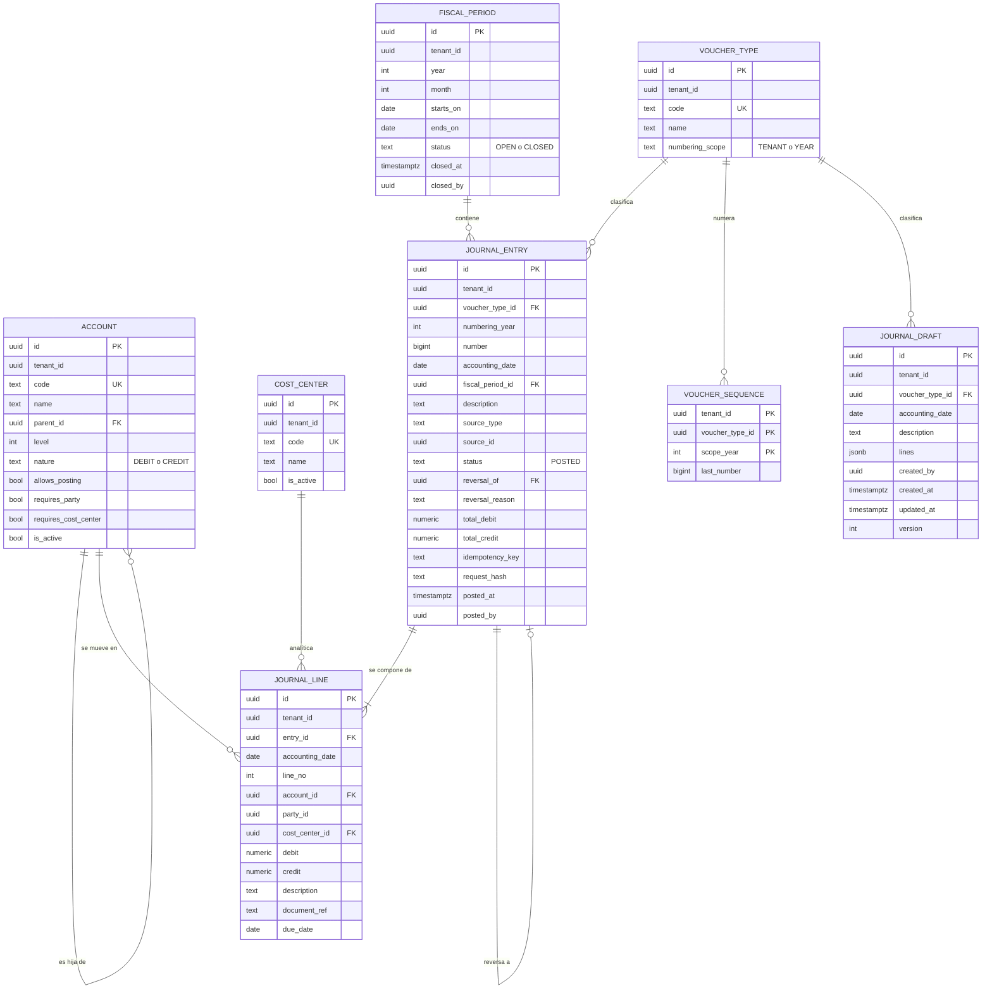
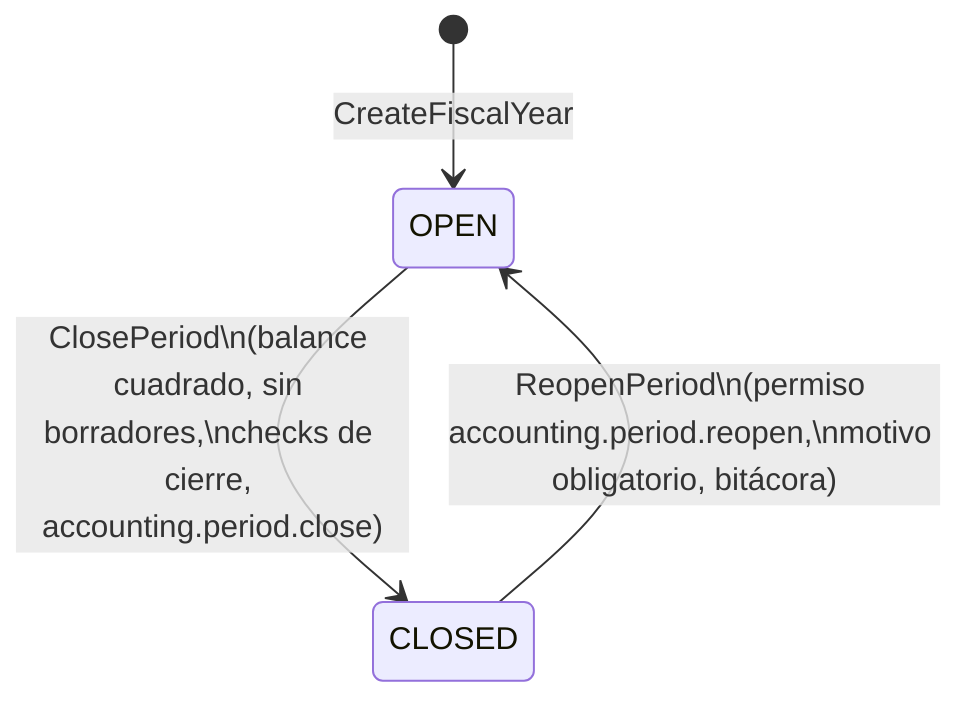
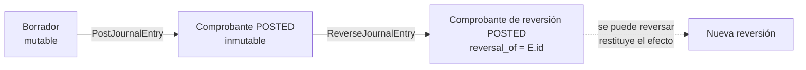

# Data Model — Contabilidad con comprobantes inmutables

**Fecha**: 2026-10-14 · **Spec**: [`spec.md`](spec.md) · **Plan**: [`plan.md`](plan.md) · **Decisiones**: [`research.md`](research.md)

Este documento **refina** el modelo preliminar (`docs/01-arquitectura/02-modelo-de-datos-preliminar.md` §2.4) para
este feature. Donde difiere del preliminar, **este documento manda** y el preliminar se actualiza (tarea en
`tasks.md`). El DDL es la intención final; la migración real se genera con Prisma y se edita a mano (ADR-0004).

Los esquemas PostgreSQL son `acc` (contabilidad) y `audit` (bitácora transversal de la plataforma).
Si el *spike* S-PRISMA-1 obliga al plan B (research §2), los nombres pasan a `acc_*` sin otros cambios.

## 1. Entidades y relaciones



`audit.audit_log` es transversal y se describe en §5. `party_id` **no** lleva clave foránea hacia `parties`
porque ese módulo aún no existe y D-6 prohíbe acoplar tablas de módulos distintos; se añade la FK por migración
cuando exista la spec de terceros, y mientras tanto el dominio exige solo su presencia (R-CON-008).

## 2. Tablas, campos y restricciones

Tipos: `NUMERIC(18,2)` para importes (R-CON-009.2); `DATE` para fechas contables (R-CON-014);
`TIMESTAMPTZ` para instantes (UTC). Todas las tablas llevan `tenant_id uuid NOT NULL` y RLS forzada (§4).

### 2.1 `acc.account` (maestro mutable; el plan de cuentas se carga fuera de este feature)

| Campo | Tipo | Restricción |
|---|---|---|
| `id` | `uuid` | PK |
| `tenant_id` | `uuid` | NOT NULL |
| `code` | `text` | NOT NULL, `CHECK (code ~ '^[0-9]{1,12}$')`, `UNIQUE (tenant_id, code)` |
| `name` | `text` | NOT NULL, longitud 1–200 |
| `parent_id` | `uuid` | FK → `acc.account(id)`, NULL en clase |
| `level` | `int` | NOT NULL, `CHECK (level >= 1)` (1 clase, 2 grupo, 4 cuenta, 6 subcuenta, 8+ auxiliar) |
| `nature` | `text` | NOT NULL, `CHECK (nature IN ('DEBIT','CREDIT'))` (R-CON-013) |
| `allows_posting` | `boolean` | NOT NULL DEFAULT false (R-CON-003) |
| `requires_party` | `boolean` | NOT NULL DEFAULT false (R-CON-008) |
| `requires_cost_center` | `boolean` | NOT NULL DEFAULT false (R-CON-008) |
| `is_active` | `boolean` | NOT NULL DEFAULT true |
| `version` | `int` | NOT NULL DEFAULT 1 (bloqueo optimista) |

Regla adicional: `acc.guard_account()` impide cambiar `code`, `nature` y `tenant_id` de una cuenta que ya
tiene líneas (sus saldos dejarían de ser comparables).

### 2.2 `acc.cost_center`

`id` PK · `tenant_id` · `code text NOT NULL` · `name text NOT NULL` · `is_active boolean NOT NULL DEFAULT true` ·
`UNIQUE (tenant_id, code)`.

### 2.3 `acc.voucher_type`

| Campo | Restricción |
|---|---|
| `id` PK, `tenant_id` | |
| `code text` | NOT NULL, `CHECK (code ~ '^[A-Z]{1,5}$')`, `UNIQUE (tenant_id, code)` (`FV`, `NC`, `RC`, `CE`, `NOT`, `AJ`…) |
| `name text` | NOT NULL |
| `numbering_scope text` | NOT NULL, `CHECK (numbering_scope IN ('TENANT','YEAR'))` |

### 2.4 `acc.voucher_sequence` (contador; única tabla mutable del núcleo)

| Campo | Restricción |
|---|---|
| `tenant_id`, `voucher_type_id`, `scope_year int` | PK compuesta; `scope_year = 0` si el alcance es `TENANT` |
| `last_number bigint` | NOT NULL DEFAULT 0, `CHECK (last_number >= 0)` |

`acc.guard_sequence()` (`BEFORE UPDATE OR DELETE`): rechaza `DELETE` y cualquier `UPDATE` que no sea
exactamente `NEW.last_number = OLD.last_number + 1` con la misma clave (research §5).

### 2.5 `acc.fiscal_period`

| Campo | Restricción |
|---|---|
| `id` PK, `tenant_id` | |
| `year int`, `month int` | NOT NULL, `CHECK (month BETWEEN 1 AND 12)`, `UNIQUE (tenant_id, year, month)` |
| `starts_on date`, `ends_on date` | NOT NULL, `CHECK (ends_on >= starts_on)`; `EXCLUDE USING gist (tenant_id WITH =, daterange(starts_on, ends_on, '[]') WITH &&)` (sin solapes; requiere la extensión `btree_gist`) |
| `status text` | NOT NULL DEFAULT 'OPEN', `CHECK (status IN ('OPEN','CLOSED'))` |
| `closed_at timestamptz`, `closed_by uuid` | `CHECK ((status = 'CLOSED') = (closed_at IS NOT NULL))` |
| `version int` | NOT NULL DEFAULT 1 |

Un período no se elimina (`BEFORE DELETE` lo rechaza). El historial de cierres y reaperturas vive en
`audit.audit_log`, no en esta fila.

### 2.6 `acc.journal_entry` (**inmutable**)

| Campo | Tipo | Restricción |
|---|---|---|
| `id` | `uuid` | PK |
| `tenant_id` | `uuid` | NOT NULL |
| `voucher_type_id` | `uuid` | NOT NULL, FK → `acc.voucher_type` |
| `numbering_year` | `int` | NOT NULL (0 si el tipo numera por `TENANT`) |
| `number` | `bigint` | NOT NULL, `CHECK (number >= 1)`, `UNIQUE (tenant_id, voucher_type_id, numbering_year, number)` (R-CON-006) |
| `accounting_date` | `date` | NOT NULL (R-CON-014) |
| `fiscal_period_id` | `uuid` | NOT NULL, FK → `acc.fiscal_period`; el *trigger* verifica que la fecha esté dentro del período y que esté `OPEN` |
| `description` | `text` | NOT NULL, longitud 1–500 |
| `source_type` | `text` | NOT NULL, `CHECK (source_type IN ('MANUAL','SALES_DOCUMENT','RECEIPT','PURCHASE_DOCUMENT','STOCK_ADJUSTMENT','YEAR_CLOSING','REVERSAL'))` |
| `source_id` | `uuid` | `CHECK (source_type = 'MANUAL' OR source_id IS NOT NULL)` (R-CON-007) |
| `status` | `text` | NOT NULL, `CHECK (status = 'POSTED')` |
| `reversal_of` | `uuid` | FK → `acc.journal_entry(id)`, `CHECK (reversal_of <> id)` |
| `reversal_reason` | `text` | `CHECK ((reversal_of IS NULL) = (reversal_reason IS NULL))` y `CHECK ((source_type = 'REVERSAL') = (reversal_of IS NOT NULL))` |
| `total_debit`, `total_credit` | `numeric(18,2)` | NOT NULL, `CHECK (total_debit > 0)`, `CHECK (total_debit = total_credit)` (R-CON-001) |
| `idempotency_key` | `text` | longitud 8–128 |
| `request_hash` | `char(64)` | `CHECK ((idempotency_key IS NULL) = (request_hash IS NULL))` |
| `posted_at` | `timestamptz` | NOT NULL (UTC) |
| `posted_by` | `uuid` | NOT NULL |

Índices:

| Índice | Para qué |
|---|---|
| `UNIQUE (id, tenant_id, accounting_date)` | Destino de la FK compuesta de `journal_line` |
| `UNIQUE (reversal_of) WHERE reversal_of IS NOT NULL` | Un comprobante se reversa una sola vez (`ALREADY_REVERSED`) |
| `UNIQUE (tenant_id, idempotency_key) WHERE idempotency_key IS NOT NULL` | Idempotencia mínima |
| `(tenant_id, accounting_date, voucher_type_id, number)` | Diario cronológico y paginación por cursor |
| `(tenant_id, fiscal_period_id)` | Conteo y cierre por período |
| `(tenant_id, source_type, source_id)` | Trazabilidad al documento fuente (R-CON-007) |

### 2.7 `acc.journal_line` (**inmutable**)

| Campo | Tipo | Restricción |
|---|---|---|
| `id` | `uuid` | PK |
| `tenant_id` | `uuid` | NOT NULL (denormalizado de la cabecera) |
| `entry_id` | `uuid` | NOT NULL |
| `accounting_date` | `date` | NOT NULL (denormalizado) |
| | | `FOREIGN KEY (entry_id, tenant_id, accounting_date) REFERENCES acc.journal_entry (id, tenant_id, accounting_date)` — la denormalización **no puede desincronizarse** |
| `line_no` | `int` | NOT NULL, `CHECK (line_no >= 1)`, `UNIQUE (entry_id, line_no)` |
| `account_id` | `uuid` | NOT NULL, FK → `acc.account` (INV-03) |
| `party_id` | `uuid` | sin FK (ver §1) |
| `cost_center_id` | `uuid` | FK → `acc.cost_center` |
| `debit` | `numeric(18,2)` | NOT NULL DEFAULT 0, `CHECK (debit >= 0)` |
| `credit` | `numeric(18,2)` | NOT NULL DEFAULT 0, `CHECK (credit >= 0)` |
| | | `CHECK ((debit > 0) <> (credit > 0))` (R-CON-002, INV-02) |
| `description` | `text` | longitud ≤ 500 |
| `document_ref` | `text` | longitud ≤ 60 |
| `due_date` | `date` | |

Índices: `(tenant_id, account_id, accounting_date)` (mayor y balance), `(tenant_id, party_id, account_id)
WHERE party_id IS NOT NULL` (cartera por tercero), `(entry_id)`.

### 2.8 `acc.journal_draft` (**mutable**: no es registro contable)

`id` PK · `tenant_id` · `voucher_type_id` FK · `accounting_date date` · `description text` ·
`lines jsonb NOT NULL` (arreglo validado con Zod al guardar; admite descuadre) · `created_by uuid` ·
`created_at`, `updated_at timestamptz` · `version int NOT NULL DEFAULT 1`. Índice
`(tenant_id, accounting_date)`. No consume consecutivo ni afecta saldos.

## 3. Reglas → dónde se hace cumplir

| Regla / requisito | Dominio | Base de datos |
|---|---|---|
| R-CON-001 cuadre (FR-001) | `JournalEntry.post()` → `ENTRY_NOT_BALANCED` | `CHECK (total_debit = total_credit)`; *constraint trigger* diferido `acc.assert_entry_consistent` (Σ líneas = totales) |
| R-CON-002 un lado positivo (FR-002) | Constructor de `JournalLine` | `CHECK ((debit > 0) <> (credit > 0))`, `CHECK (debit >= 0 AND credit >= 0)` |
| R-CON-003 ≥ 2 líneas y cuentas auxiliares activas (FR-003) | `JournalEntry` + `AccountRepository` | *constraint trigger* (≥ 2 líneas); `acc.validate_line()` (`allows_posting` e `is_active`) |
| R-CON-004 períodos abiertos (FR-004) | `PostJournalEntry` + `PeriodClosePolicy` | `acc.assert_period_open()` con `FOR SHARE` |
| R-CON-005 inmutabilidad (FR-005, FR-014) | Sin *setters* ni `update`/`delete` | `REVOKE UPDATE, DELETE, TRUNCATE`; `acc.reject_mutation()` |
| R-CON-006 consecutivo (FR-006) | `VoucherSequence.next()` | `UNIQUE (tenant_id, voucher_type_id, numbering_year, number)`; `acc.guard_sequence()` |
| R-CON-007 documento fuente (FR-007) | `EntrySource` obligatorio salvo `MANUAL` | `CHECK (source_type = 'MANUAL' OR source_id IS NOT NULL)` |
| R-CON-008 tercero / centro de costo (FR-008) | `JournalEntry` con `Account.requiresParty` | `acc.validate_line()` |
| R-CON-009 decimal exacto (FR-009) | `Money` (decimal.js, mitad hacia arriba) | `NUMERIC(18,2)` y `CHECK (scale(debit) <= 2 AND scale(credit) <= 2)` |
| R-CON-010/013 libros y balance (FR-010) | `TrialBalanceCalculator` | Agregación SQL determinista |
| R-CON-011 cierre mensual (FR-011) | `PeriodClosePolicy` + `PeriodCloseCheck[]` | `acc.guard_fiscal_period()` solo permite `OPEN ↔ CLOSED` |
| R-CON-012 cierre anual (FR-012) | `CloseFiscalYear` genera un comprobante normal | Mismas reglas que cualquier comprobante |
| R-CON-014 fecha sin zona (FR-013) | `LocalDate`; `Clock.toLocalDate` | `accounting_date DATE`; `posted_at TIMESTAMPTZ` |
| Aislamiento por *tenant* | `RequestContext.tenantId` | RLS forzada (§4) |

### 3.1 Funciones y *triggers* (DDL de referencia)

```sql
-- Rechaza cualquier mutación (UPDATE, DELETE y TRUNCATE) de las tablas de registro inmutable.
CREATE FUNCTION audit.reject_mutation() RETURNS trigger LANGUAGE plpgsql AS $$
BEGIN
  RAISE EXCEPTION 'IMMUTABLE_RECORD: % on %.% is not allowed', TG_OP, TG_TABLE_SCHEMA, TG_TABLE_NAME
    USING ERRCODE = 'P0001';
END $$;

CREATE TRIGGER trg_journal_entry_immutable
  BEFORE UPDATE OR DELETE ON acc.journal_entry FOR EACH ROW EXECUTE FUNCTION audit.reject_mutation();
CREATE TRIGGER trg_journal_entry_no_truncate
  BEFORE TRUNCATE ON acc.journal_entry FOR EACH STATEMENT EXECUTE FUNCTION audit.reject_mutation();
-- idéntico para acc.journal_line y para audit.audit_log

-- Cabecera + líneas deben ser coherentes y cuadrar al confirmar la transacción (INV-01).
CREATE FUNCTION acc.assert_entry_consistent() RETURNS trigger LANGUAGE plpgsql AS $$
DECLARE v_entry uuid := CASE WHEN TG_TABLE_NAME = 'journal_entry' THEN NEW.id ELSE NEW.entry_id END;
        v_lines int; v_debit numeric; v_credit numeric; v_hd numeric; v_hc numeric;
BEGIN
  SELECT count(*), COALESCE(sum(debit),0), COALESCE(sum(credit),0) INTO v_lines, v_debit, v_credit
    FROM acc.journal_line WHERE entry_id = v_entry;
  SELECT total_debit, total_credit INTO v_hd, v_hc FROM acc.journal_entry WHERE id = v_entry;
  IF v_lines < 2 OR v_debit <> v_credit OR v_debit <> v_hd OR v_credit <> v_hc THEN
    RAISE EXCEPTION 'ENTRY_NOT_BALANCED: entry % lines=% debit=% credit=%', v_entry, v_lines, v_debit, v_credit
      USING ERRCODE = 'P0001';
  END IF;
  RETURN NULL;
END $$;

CREATE CONSTRAINT TRIGGER trg_entry_balanced_h AFTER INSERT ON acc.journal_entry
  DEFERRABLE INITIALLY DEFERRED FOR EACH ROW EXECUTE FUNCTION acc.assert_entry_consistent();
CREATE CONSTRAINT TRIGGER trg_entry_balanced_l AFTER INSERT ON acc.journal_line
  DEFERRABLE INITIALLY DEFERRED FOR EACH ROW EXECUTE FUNCTION acc.assert_entry_consistent();

-- Cada línea: cuenta de movimiento y activa, y con tercero / centro de costo si la cuenta lo exige.
CREATE FUNCTION acc.validate_line() RETURNS trigger LANGUAGE plpgsql AS $$
DECLARE a acc.account%ROWTYPE;
BEGIN
  SELECT * INTO a FROM acc.account WHERE id = NEW.account_id AND tenant_id = NEW.tenant_id;
  IF NOT FOUND OR NOT a.allows_posting OR NOT a.is_active THEN
    RAISE EXCEPTION 'ACCOUNT_NOT_POSTABLE: %', NEW.account_id USING ERRCODE = 'P0001'; END IF;
  IF a.requires_party AND NEW.party_id IS NULL THEN
    RAISE EXCEPTION 'PARTY_REQUIRED: account %', a.code USING ERRCODE = 'P0001'; END IF;
  IF a.requires_cost_center AND NEW.cost_center_id IS NULL THEN
    RAISE EXCEPTION 'COST_CENTER_REQUIRED: account %', a.code USING ERRCODE = 'P0001'; END IF;
  RETURN NEW;
END $$;
CREATE TRIGGER trg_line_validate BEFORE INSERT ON acc.journal_line FOR EACH ROW EXECUTE FUNCTION acc.validate_line();

-- Período abierto y fecha contenida en él (INV-04); FOR SHARE serializa contra el cierre.
CREATE FUNCTION acc.assert_period_open() RETURNS trigger LANGUAGE plpgsql AS $$
DECLARE p acc.fiscal_period%ROWTYPE;
BEGIN
  SELECT * INTO p FROM acc.fiscal_period WHERE id = NEW.fiscal_period_id AND tenant_id = NEW.tenant_id FOR SHARE;
  IF NOT FOUND OR NEW.accounting_date NOT BETWEEN p.starts_on AND p.ends_on THEN
    RAISE EXCEPTION 'PERIOD_NOT_FOUND' USING ERRCODE = 'P0001'; END IF;
  IF p.status <> 'OPEN' THEN RAISE EXCEPTION 'PERIOD_CLOSED' USING ERRCODE = 'P0001'; END IF;
  RETURN NEW;
END $$;
CREATE TRIGGER trg_entry_period BEFORE INSERT ON acc.journal_entry FOR EACH ROW EXECUTE FUNCTION acc.assert_period_open();
```

> Los mensajes con prefijo (`ENTRY_NOT_BALANCED`, `PERIOD_CLOSED`, `ACCOUNT_NOT_POSTABLE`…) permiten a
> `infrastructure/persistence` traducir un fallo de la base al error de dominio equivalente si el código de
> aplicación llegara a omitir una validación; en operación normal el dominio rechaza antes.

## 4. Roles, privilegios y RLS

| Rol | Uso | Atributos |
|---|---|---|
| `sifca_owner` | Propietario de los objetos; ejecuta migraciones | `NOLOGIN` en producción (se usa por el proceso de migración); sin `BYPASSRLS` |
| `sifca_app` | Conexión de la aplicación | `LOGIN NOSUPERUSER NOCREATEDB NOCREATEROLE NOBYPASSRLS`; no es propietario |
| `sifca_readonly` | Réplicas, reportes externos | `SELECT` solamente |

| Tabla | `sifca_app` puede |
|---|---|
| `acc.journal_entry`, `acc.journal_line` | `SELECT, INSERT` (**sin** `UPDATE`, `DELETE`, `TRUNCATE`) |
| `acc.voucher_sequence` | `SELECT, INSERT, UPDATE (last_number)` |
| `acc.account`, `acc.cost_center`, `acc.voucher_type`, `acc.fiscal_period` | `SELECT, INSERT, UPDATE` (sin `DELETE`) |
| `acc.journal_draft` | `SELECT, INSERT, UPDATE, DELETE` |
| `audit.audit_log` | `SELECT, INSERT` |

RLS en **todas** las tablas de `acc` y `audit`:

```sql
ALTER TABLE acc.journal_entry ENABLE ROW LEVEL SECURITY;
ALTER TABLE acc.journal_entry FORCE  ROW LEVEL SECURITY;
CREATE POLICY tenant_isolation ON acc.journal_entry
  USING      (tenant_id = NULLIF(current_setting('app.tenant_id', true), '')::uuid)
  WITH CHECK (tenant_id = NULLIF(current_setting('app.tenant_id', true), '')::uuid);
```

Sin contexto (`app.tenant_id` no fijado) la política evalúa `NULL` y no se ve ni se escribe nada.

## 5. `audit.audit_log` (transversal, solo inserción)

`id uuid PK` · `tenant_id uuid NOT NULL` · `actor_id uuid NOT NULL` · `action text NOT NULL`
(`accounting.period.closed`, `accounting.period.reopened`, `accounting.year.closed`…) ·
`entity_type text NOT NULL` · `entity_id uuid NOT NULL` · `reason text` · `before jsonb` · `after jsonb` ·
`request_id text` · `occurred_at timestamptz NOT NULL`. Mismos tres niveles de inmutabilidad y RLS.
Índice `(tenant_id, entity_type, entity_id, occurred_at)`.

## 6. Estados y transiciones



Un comprobante tiene un único estado, `POSTED`; «reversado» no es un estado sino la existencia de otro
comprobante con `reversal_of` apuntando a él:



## 7. Objetos de dominio (sin framework)

| Objeto | Tipo | Invariantes |
|---|---|---|
| `Money` | Objeto de valor | Decimal exacto, escala 2, nunca desde `number` (R-CON-009) |
| `LocalDate` | Objeto de valor | Fecha sin zona (R-CON-014) |
| `EntryNumber` | Objeto de valor | Entero ≥ 1 |
| `AccountCode` | Objeto de valor | Dígitos 1–12 |
| `EntrySource` | Objeto de valor | `type` + `id` (obligatorio salvo `MANUAL`) |
| `JournalLine` | Entidad | Un solo lado, positivo; tercero/centro de costo si la cuenta lo exige |
| `JournalEntry` | Agregado raíz | ≥ 2 líneas, Σ débitos = Σ créditos, sin *setters*; `post()` es la única fábrica |
| `Account`, `CostCenter`, `VoucherType` | Entidades de referencia | Solo lectura para el agregado |
| `FiscalPeriod` | Entidad | Transiciones `OPEN ↔ CLOSED` con las políticas de cierre |
| `ReversalFactory` | Servicio de dominio | Construye el contraasiento con lados invertidos y la misma referencia |
| `TrialBalanceCalculator` | Servicio de dominio | Acumula por nivel de código y calcula saldos por lado |
| `PeriodClosePolicy` | Servicio de dominio | Cierra solo si no hay borradores, el balance cuadra y los `PeriodCloseCheck` pasan |

## 8. Riesgos residuales (se aceptan y se documentan)

| Riesgo | Mitigación |
|---|---|
| El propietario o el superusuario de PostgreSQL pueden deshabilitar *triggers* o alterar privilegios | Cuentas de administración separadas, doble control operativo, auditoría del servidor; fuera del alcance de la aplicación |
| Rendimiento del punto caliente `voucher_sequence` | Aceptado por R-CON-006; medido en la prueba de carga |
| El *constraint trigger* se ejecuta por fila | Máximo 500 líneas por comprobante; una sola agregación indexada |
| `party_id` sin FK hasta que exista el módulo de terceros | La validación de existencia entra con la spec de terceros |
